# Combined Analysis Class Diagram

This diagram consolidates the 49 individual analysis class diagrams. Classes merged by domain contain the union of their sequence-derived attributes and operations. Actors are omitted because they are not analysis classes.

Rules: [Analysis Class Diagram Ruleset](../Ruleset.md)

```plantuml
@startuml
left to right direction

class "Administrator Interface" as AdministratorInterface <<Boundary>> {
  changeAccountStatus()
  changePublicationState()
  changeType()
  clearCreateForm()
  confirmAction()
  confirmDeletion()
  confirmStatusChange()
  confirmVisibilityChange()
  createProblem()
  createTestCase()
  currentFilters
  currentOrder
  currentPage
  displayCreatedProblem()
  displayCreatedTestCase()
  displayedActivity
  displayedProfile
  displayEmptyPage()
  displayPublicationState()
  displayReadOnlyDetails()
  displaySubmissionList()
  displayTestCaseOrder()
  displayTypeInformation()
  displayUpdatedOrder()
  displayUpdatedProblem()
  displayUpdatedState()
  displayUpdatedStatus()
  displayUpdatedTestCaseList()
  displayUpdatedType()
  displayUserSummaries()
  displayValidationErrors()
  intendedChanges
  intendedType
  loadedVersion
  loadProblem()
  loadTestCase()
  markDataUnavailable()
  markPageUnavailable()
  pageSize
  problemDraft
  problemFields
  problemFilter
  problemId
  publicationAction
  refreshTestCaseList()
  reloadAccountDetails()
  reloadAccountStatus()
  reloadCurrentOrder()
  reloadLatestTestCase()
  reloadLatestVersion()
  reloadProblem()
  reloadProblemState()
  reloadPublicationState()
  reloadTestCase()
  reloadTestCaseList()
  requestDeletion()
  requestedAction
  requestedStatus
  requestProblemStateChange()
  requestPublicationChange()
  requestStatusChange()
  requestSubmissionDetails()
  requestSubmissionList()
  requestUserDetails()
  requestUserList()
  retrySubmissionRequest()
  retryUserListRequest()
  searchKeyword
  selectedSubmissionId
  selectedUserId
  selectTestCaseType()
  showValidationErrors()
  statusChangeOutcome
  statusFilter
  submitChanges()
  submitCompleteOrder()
  submittedOrder
  testCaseDraft
  testCaseFields
  testCaseId
  updateOutcome
  userFilter
  userId
  verifyCreateOutcome()
  verifyDeleteOutcome()
  verifyStoredOrder()
  verifyStoredState()
  verifyStoredStatus()
  verifyStoredType()
}

class "Application API" as ApplicationAPI <<Boundary>> {
  acceptSubmission()
  changeAccountStatus()
  changePassword()
  changeProblemState()
  changePublicationState()
  changeTestCaseType()
  checkRequestRateLimit()
  createProblem()
  createTestCase()
  deleteTestCase()
  getAccountDetails()
  getAccountStatus()
  getEditorContext(problemId)
  getLeaderboard(page, pageSize)
  getOwnAccountInformation()
  getOwnStatistics()
  getProblem()
  getProblemDetails(problemId)
  getPublicationState()
  getSubmissionDetails(submissionId)
  getSubmissionHistory(page, pageSize)
  getSubmissionList()
  getSubmissionResult(submissionId)
  getSubmissionStatus(submissionId)
  getTestCase()
  getTestCaseList()
  getTestCaseOrder()
  getTestCaseType()
  getUserDetails(userId)
  getUserList()
  listProblems()
  login()
  registerAccount()
  reorderTestCases()
  searchProblems()
  updateAccountInformation()
  updateProblem()
  updateTestCase()
}

class "Execution Environment Interface" as ExecutionEnvironmentInterface <<Boundary>> {
  compile(source, language)
  createExecutionResource()
  executeTestCase(testCase, limits)
  removeExecutionResource()
  removeOrphanedExecutionResources()
}

class "Message Queue Interface" as MessageQueueInterface <<Boundary>> {
  acknowledgeMessage(messageId)
  claimMessage(messageId)
  listPendingMessages()
  publishSubmission()
  readSubmission()
}

class "Persistence Interface" as PersistenceInterface <<Boundary>> {
  deleteAndCompactTestCases()
  findUnpublishedEvents()
  loadSubmission(submissionId)
  loadSubmissionContext(submissionId)
  loadSubmissionStatus(submissionId)
  markEventPublished()
  markInternalError(submissionId, reason)
  persistInternalError(submissionId, reason)
  persistTerminalResult(submissionId)
  queryMatchingAccounts()
  querySubmissionSummaries()
  readAccount()
  readAccountDetails()
  readAccountStatus()
  readAccountStatus(userId)
  readCommittedAccountProfile(userId)
  readOwnSubmissionSummaries(userId, page, pageSize)
  readProblem()
  readProblemState()
  readSubmissionAndProblemAggregates(userId)
  readSubmissionDetails()
  readSubmissionDetails(submissionId)
  readSubmissionResult(submissionId)
  readSubmissionStatus(submissionId)
  readTestCase()
  readTestCaseSet()
  readTestCaseType()
  readUserActivitySummary(userId)
  resetToQueued(submissionId)
  rollBackUncommittedChanges()
  saveAccountStatus()
  saveProblem()
  saveProblemChanges()
  saveProblemState()
  savePublicationState()
  saveTestCase()
  saveTestCaseChanges()
  saveTestCaseOrder()
  saveTestCaseType()
  storeSubmissionAndEvent()
  updateStatus(submissionId, status)
}

class "Protected Test Case Store Interface" as ProtectedTestCaseStoreInterface <<Boundary>> {
  readTestCase(testCaseId)
  readTestCaseData(testCaseId)
  readTestCaseFiles()
  replaceChangedFiles()
  storeTestCaseFiles()
  verifyTestCaseFilesReadable()
}

class "User Interface" as UserInterface <<Boundary>> {
  applyEditorConfiguration()
  authenticationState
  bio
  cachedAccountInformation
  category
  clearAuthenticationInformation()
  clearSource()
  confirmLogout()
  currentLanguage
  currentPage
  currentSource
  difficulty
  displayAccountInformation()
  displayDetails()
  displayedAccountInformation
  displayedDetails
  displayedResult
  displayedStatistics
  displayedStatus
  displayEmptyState()
  displayHistory()
  displayLeaderboard()
  displayLoginForm()
  displayName
  displayPasswordChangeForm()
  displayProblemDetails()
  displayProblemList()
  displayRegistrationForm()
  displayResult()
  displayResults()
  displayStatistics()
  displayStatus()
  displayStatusOnly()
  displaySubmissionReceipt()
  displayUpdateForm()
  editorConfiguration
  editorInitialized
  editSource()
  email
  identifier
  initializeEditor()
  keywords
  navigateAfterLogin()
  navigateToHome()
  navigateToLogin()
  navigateToSubmission()
  navigateToSubmissionHistory()
  navigateToSubmissionStatus()
  openLanguageSelection()
  openRecentSubmission()
  openRelatedPracticeFlow()
  openRelatedSubmissionView()
  pageSize
  passwordChangeFormState
  pausePolling()
  pollingInterval
  problemId
  recentSubmissions
  refreshLeaderboard()
  refreshStatistics()
  requestAccountInformation()
  requestDetails()
  requestHistory()
  requestOwnStatistics()
  requestResult()
  requestStatus()
  resetAuthenticationState()
  restoreLanguageTemplate()
  restoreTemplate()
  returnToProblemList()
  selectAnotherProblem()
  selectedLanguage
  selectLanguage()
  selectProblem()
  selectSubmission()
  showFieldErrors()
  showGuestNavigation()
  showLoginError()
  showNetworkError()
  showNetworkOutcomeUnknown()
  showRateLimitNotice()
  showRefreshError()
  showRetryNotice()
  showSubmissionOutcomeUnknown()
  showSuccess()
  showValidationErrors()
  sort
  sourceDraft
  startPolling()
  stopPolling()
  storeAuthenticationResult()
  submissionId
  submissionSummaries
  submitAccountChanges()
  submitLogin()
  submitPasswordChange()
  submitRegistration()
  submitSearch()
  submitSolution()
  supportedLanguages
  tags
  updateDisplayedInformation()
  username
  validateSupportedLanguage()
  viewAnotherPage()
}

class "Account and Auth" as AccountAndAuth <<Control>> {
  authenticateUser()
  authorizeAdministrator()
  changeAccountStatus()
  changePassword(userId)
  checkAccountActive(userId)
  checkAccountAvailability()
  checkAccountEligibility()
  checkAccountStatus()
  checkEmailAvailability()
  checkIdentifierAvailability()
  compareStatusVersion()
  createAccount()
  createCredentialVerifier()
  getAccount(userId)
  getAccountProfile(userId)
  getUserSummaries()
  handlePersistenceFailure()
  issueAccessToken()
  login()
  preventSelfStatusChange()
  registerAccount()
  removeSensitiveFields()
  resolvePrincipal()
  saveAccountChanges()
  updateAccount(userId, submittedFields)
  updateAccountStatus()
  updateCredentialChangeTime()
  validateAccessToken()
  validateAccountInformation()
  validateNewCredential()
  validatePagination()
  validateRegistrationData()
  validateSearchAndFilters()
  validateStatusAction()
  verifyCredential()
  verifyCurrentCredential()
}

class "Judge Worker" as JudgeWorker <<Control>> {
  acknowledgeAfterCommit()
  acknowledgeMessage()
  cleanFailedResources()
  cleanTemporaryResources()
  cleanTemporaryWorkspaces()
  compileSubmission()
  delegateToProcessSubmission()
  determineVerdict()
  executeTestCases()
  handleInfrastructureFailure()
  handleUnexpectedError()
  inspectSubmission()
  leaveMessagePending()
  markAttemptLimitReached()
  messageId
  persistInternalError()
  persistResult()
  processSubmission()
  recoverPendingSubmissions()
  resetInterruptedSubmission()
  scheduleOrphanCleanup()
  selectEligibleMessages()
  submissionId
  validateConfiguration()
  waitForNextCycle()
}

class "Outbox Dispatcher" as OutboxDispatcher <<Control>> {
  findUnpublishedEvents()
  markEventPublished()
  publishSubmissionEvent()
}

class "Problem Catalog" as ProblemCatalog <<Control>> {
  buildPreviews()
  buildResultPage()
  checkActiveState()
  checkProblemEditable()
  checkPublicationEligibility()
  checkPublicAvailability()
  checkPublicVisibility()
  compareVersion()
  createProblem()
  deactivateProblem()
  getActiveProblem()
  getProblem()
  getProblemContext(problemId)
  getProblemForSubmission(problemId)
  getProblemState()
  getPublicProblem(problemId)
  handlePersistenceFailure()
  listPublishedProblems(page, pageSize, sort)
  publishProblem()
  reactivateProblem()
  savePublicationState()
  searchPublishedProblems(keywords, filters, page, pageSize, sort)
  unpublishProblem()
  updateProblem()
  validateBusinessRules()
  validateProblemFields()
  validatePublicationReadiness()
  validateUpdate()
  verifyProblemEditable()
  verifyProblemExists()
}

class "Progress and Leaderboard" as ProgressAndLeaderboard <<Control>> {
  assembleRecentSubmissions()
  calculateAcceptanceRate()
  calculateAttemptedAndSolvedCounts()
  calculateDifficultyBreakdown()
  calculateTagBreakdown()
  getLeaderboard(page, pageSize)
  getOwnStatistics(userId)
  getUserActivitySummary(userId)
  rankEntries()
}

class "Submission Management" as SubmissionManagement <<Control>> {
  assembleAvailableDetails()
  assembleStatusAndTimestamps()
  assembleStoredResult()
  assembleSubmissionDetails()
  boundCompilationInformation()
  checkOwnership()
  createSubmission()
  excludeHiddenTestData()
  getDetails(submissionId, userId)
  getOwnHistory(userId, page, pageSize)
  getStatus(submissionId, userId)
  getSubmissionDetails(submissionId)
  getSubmissionResult(submissionId, userId)
  handleQueryFailure()
  includeVerdictOnlyWhenCompleted()
  inspectSubmissionStatus()
  querySubmissionList()
  searchSubmissions()
  storeSubmissionAndEvent()
  validateFilters()
  validatePagination()
  validateSubmission()
}

class "Test Case Management" as TestCaseManagement <<Control>> {
  changeTestCaseType()
  compactOrdinals()
  compareCurrentSetAndVersion()
  compareOrder()
  compareSetVersion()
  compareVersion()
  createTestCase()
  deleteTestCase()
  getOrderedTestCases()
  getRequiredCaseTypes()
  getTestCase()
  getTestCaseFileReferences()
  getTestCaseType()
  handlePersistenceFailure()
  reorderTestCases()
  updateTestCase()
  validateCompleteOrder()
  validateExactTestCaseSet()
  validateOrder()
  validateTestCaseData()
  validateType()
  validateUniqueOrder()
  verifyTestCaseAssociation()
}

class "Account" as Account <<Entity>> {
  accountId
  actingAdministratorId
  bio
  createdAt
  credentialChangedAt
  credentialVerifier
  displayName
  email
  role
  status
  statusChangedAt
  userId
  username
  version
}

class "Leaderboard Entry" as LeaderboardEntry <<Entity>> {
  acceptanceRate
  displayName
  solvedCount
  submissionCount
  username
}

class "Outbox Event" as OutboxEvent <<Entity>> {
  eventId
  publicationStatus
  submissionId
}

class "Problem" as Problem <<Entity>> {
  allowedLanguages
  archiveStatus
  category
  constraints
  difficulty
  inputFormat
  lifecycleStatus
  memoryLimit
  outputFormat
  problemData
  problemId
  publicationStatus
  statement
  supportedLanguages
  tags
  timeLimit
  title
  updatedAt
  version
}

class "Public Statistics" as PublicStatistics <<Entity>> {
  publicMetrics
}

class "Submission" as Submission <<Entity>> {
  compilationInformation
  completedAt
  createdAt
  executedCaseSummary
  judgeAttempts
  language
  ownerId
  peakMemory
  problemId
  resultMetrics
  resultSummary
  retainedProblemSummary
  runtime
  source
  startedAt
  status
  submissionId
  updatedAt
  userId
  verdict
}

class "Test Case" as TestCase <<Entity>> {
  expectedOutput
  expectedOutputReference
  input
  inputReference
  ordinal
  problemId
  testCaseId
  type
  updatedAt
  version
}

class "Test Case Result" as TestCaseResult <<Entity>> {
  outcome
  peakMemory
  resultMetrics
  runtime
  testCaseId
}

class "User Statistics" as UserStatistics <<Entity>> {
  acceptanceRate
  attemptedCount
  difficultyBreakdown
  recentActivity
  recentSubmissions
  solvedCount
  tagBreakdown
}

AccountAndAuth --> Account
AccountAndAuth --> PersistenceInterface
AdministratorInterface --> ApplicationAPI
ApplicationAPI --> AccountAndAuth
ApplicationAPI --> ProblemCatalog
ApplicationAPI --> ProgressAndLeaderboard
ApplicationAPI --> SubmissionManagement
ApplicationAPI --> TestCaseManagement
JudgeWorker --> ExecutionEnvironmentInterface
JudgeWorker --> MessageQueueInterface
JudgeWorker --> PersistenceInterface
JudgeWorker --> Problem
JudgeWorker --> ProtectedTestCaseStoreInterface
JudgeWorker --> Submission
JudgeWorker --> TestCase
JudgeWorker --> TestCaseResult
OutboxDispatcher --> MessageQueueInterface
OutboxDispatcher --> OutboxEvent
OutboxDispatcher --> PersistenceInterface
ProblemCatalog --> PersistenceInterface
ProblemCatalog --> Problem
ProblemCatalog --> ProtectedTestCaseStoreInterface
ProblemCatalog --> PublicStatistics
ProblemCatalog --> TestCase
ProblemCatalog --> TestCaseManagement
ProgressAndLeaderboard --> Account
ProgressAndLeaderboard --> LeaderboardEntry
ProgressAndLeaderboard --> PersistenceInterface
ProgressAndLeaderboard --> Problem
ProgressAndLeaderboard --> Submission
ProgressAndLeaderboard --> UserStatistics
SubmissionManagement --> Account
SubmissionManagement --> OutboxEvent
SubmissionManagement --> PersistenceInterface
SubmissionManagement --> Problem
SubmissionManagement --> Submission
SubmissionManagement --> TestCaseResult
TestCaseManagement --> PersistenceInterface
TestCaseManagement --> ProtectedTestCaseStoreInterface
TestCaseManagement --> TestCase
UserInterface --> ApplicationAPI

@enduml
```

