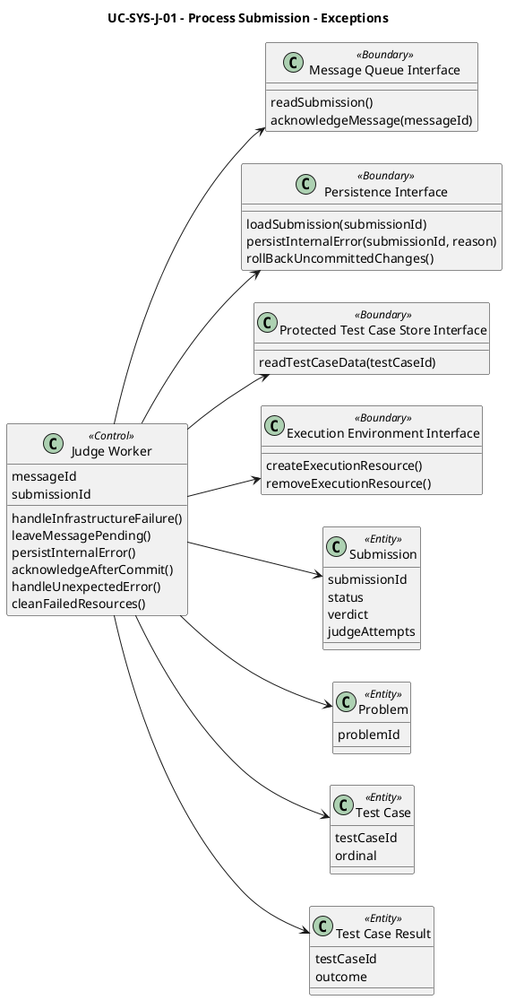

# Analysis Class Diagram - UC-SYS-J-01 - Process Submission - Exceptions

| Field | Value |
|-------|-------|
| Sequence Diagram | [SD-UC-SYS-J-01-X - Process Submission - Exceptions](../../../SequenceDiagram/System/Judge/SD-UC-SYS-J-01-ProcessSubmission-Exceptions.md) |

