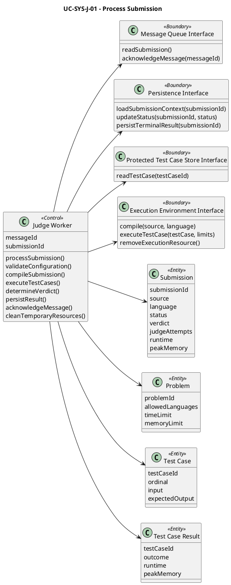

# Analysis Class Diagram - UC-SYS-J-01 - Process Submission

| Field | Value |
|-------|-------|
| Sequence Diagram | [SD-UC-SYS-J-01 - Process Submission](../../../SequenceDiagram/System/Judge/SD-UC-SYS-J-01-ProcessSubmission.md) |

