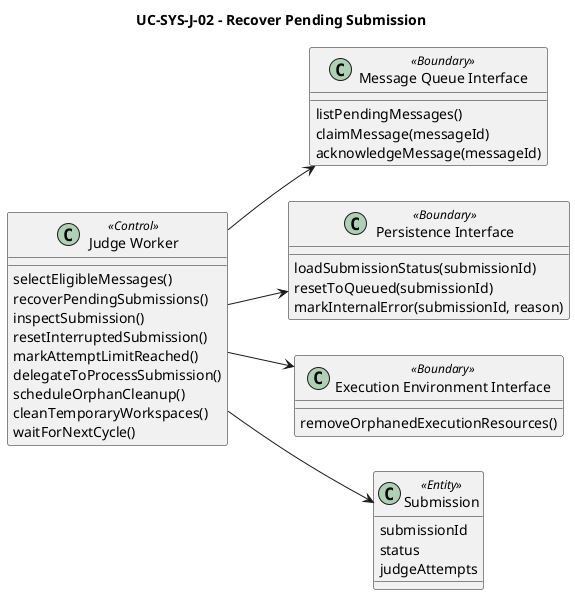

# Analysis Class Diagram - UC-SYS-J-02 - Recover Pending Submission

| Field | Value |
|-------|-------|
| Sequence Diagram | [SD-UC-SYS-J-02 - Recover Pending Submission](../../../SequenceDiagram/System/Judge/SD-UC-SYS-J-02-RecoverPendingSubmission.md) |

