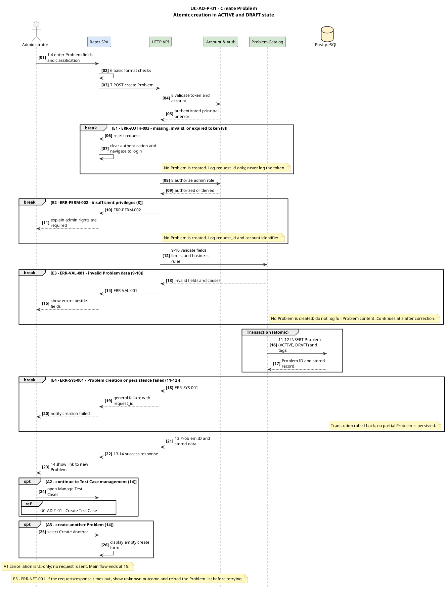

# Sequence Diagram - UC-AD-P-01 - Create Problem

| Field | Value |
|-------|-------|
| Sequence Diagram ID | SD-UC-AD-P-01 |
| Use Case | UC-AD-P-01 - Create Problem |
| Use Case Specification | [UC-AD-P-01-CreateProblem.md](../../../../RequirementAnalysis/UCSpec/Administrator/ProblemManagement/UC-AD-P-01-CreateProblem.md) |
| Primary Actor(s) | Administrator |
| Related Requirements | FR-ADMIN-01, FR-PROB-05, FR-PROB-09, NFR-SEC-03, NFR-REL-01 |
| Scope | Main Flow 1-15, A1-A3, E1-E5 |
| Version | 1.0 |
| Status | Draft |
| Last updated | 2026-11-14 |

## 1. Scope

Create a new active, draft Problem atomically. Test Cases are managed separately.

## 2. Scenario Coverage

| Flow | Coverage | Diagram element / disposition |
|------|----------|-------------------------------|
| Main | 1-15 | Entire diagram |
| A1 | A1 | UI-only cancellation; no request is sent |
| A2 | A2 | `opt A2` after successful creation; continue through UC-AD-T-01 |
| A3 | A3 | `opt A3` after successful creation; clear form |
| E1 | E1 | `break E1` at access-token validation |
| E2 | E2 | `break E2` at admin-role check |
| E3 | E3 | `break E3` at field/business-rule validation |
| E4 | E4 | `break E4` at atomic persistence |
| E5 | E5 | Client-only network outcome note; verify Problem list before retry |

## 3. Diagram

## 4. Notes

- The Problem is not public until a separate publication operation succeeds.
- Problem fields and tag assignment are handled by `PROB`; Test Case content is outside this use case.

## 5. Change History

| Version | Date | Change |
|---------|------|--------|
| 1.0 | 2026-11-14 | Initial diagram. |
