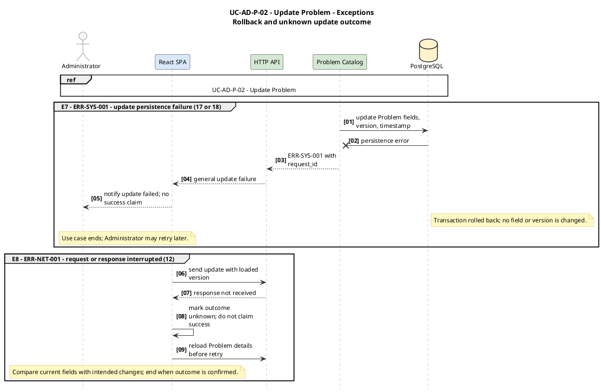

# Sequence Diagram - UC-AD-P-02 - Update Problem - Exceptions

| Field | Value |
|-------|-------|
| Sequence Diagram ID | SD-UC-AD-P-02-X |
| Use Case | UC-AD-P-02 - Update Problem |
| Use Case Specification | [UC-AD-P-02-UpdateProblem.md](../../../../RequirementAnalysis/UCSpec/Administrator/ProblemManagement/UC-AD-P-02-UpdateProblem.md) |
| Primary Actor(s) | Administrator |
| Related Requirements | FR-ADMIN-01, FR-PROB-06, NFR-REL-08 |
| Scope | E7-E8; primary flow in [SD-UC-AD-P-02](SD-UC-AD-P-02-UpdateProblem.md) |
| Version | 1.0 |
| Status | Draft |
| Last updated | 2026-11-14 |

## 1. Scope

Supplement for persistence failure and unknown network outcome during a Problem metadata update.

## 2. Scenario Coverage

| Flow | Coverage | Diagram element / disposition |
|------|----------|-------------------------------|
| Primary | - | [SD-UC-AD-P-02](SD-UC-AD-P-02-UpdateProblem.md) |
| E7 | E7 | `group E7` at update transaction |
| E8 | E8 | Client-only network outcome note at request/response |

## 3. Diagram

## 4. Notes

- No partial update is persisted. The client must confirm the stored state before retrying after a timeout.

## 5. Change History

| Version | Date | Change |
|---------|------|--------|
| 1.0 | 2026-11-14 | Initial exception supplement. |
