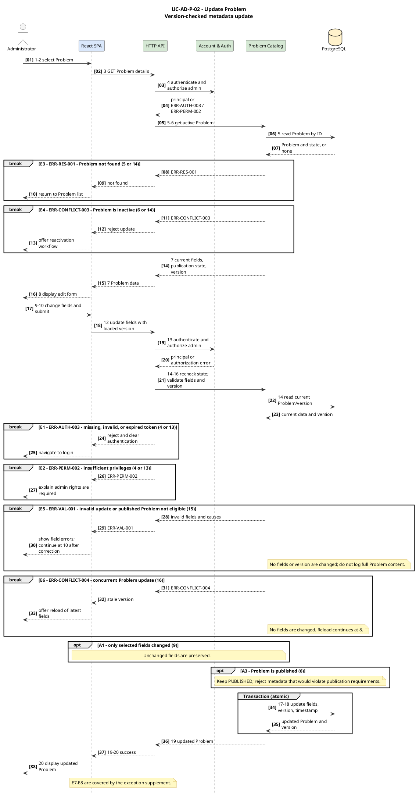

# Sequence Diagram - UC-AD-P-02 - Update Problem

| Field | Value |
|-------|-------|
| Sequence Diagram ID | SD-UC-AD-P-02 |
| Use Case | UC-AD-P-02 - Update Problem |
| Use Case Specification | [UC-AD-P-02-UpdateProblem.md](../../../../RequirementAnalysis/UCSpec/Administrator/ProblemManagement/UC-AD-P-02-UpdateProblem.md) |
| Primary Actor(s) | Administrator |
| Related Requirements | FR-ADMIN-01, FR-PROB-06, FR-PROB-09, NFR-SEC-03, NFR-REL-08 |
| Scope | Main Flow 1-21, A1-A3, E1-E6; E7-E8 in SD-UC-AD-P-02-X |
| Version | 1.0 |
| Status | Draft |
| Last updated | 2026-11-14 |

## 1. Scope

Read and update active Problem metadata with optimistic concurrency. Published Problems retain their publication state and must remain publication-eligible.

## 2. Scenario Coverage

| Flow | Coverage | Diagram element / disposition |
|------|----------|-------------------------------|
| Main | 1-21 | Entire diagram |
| A1 | A1 | `opt A1`; preserve unchanged fields |
| A2 | A2 | UI-only cancellation; no update request |
| A3 | A3 | `opt A3`; published state retained and eligibility rechecked |
| E1 | E1 | `break E1` at token validation |
| E2 | E2 | `break E2` at admin-role validation |
| E3 | E3 | `break E3` at Problem lookup |
| E4 | E4 | `break E4` at active-state check |
| E5 | E5 | `break E5` at update and publication-eligibility validation |
| E6 | E6 | `break E6` at optimistic version comparison |
| E7-E8 | - | [SD-UC-AD-P-02-X](SD-UC-AD-P-02-UpdateProblem-Exceptions.md) |

## 3. Diagram

## 4. Notes

- The update does not modify Test Cases, Submissions, or historical results.
- Main flow ends at step 21; cancellation and stale-version reload retain the specification's outcomes.

## 5. Change History

| Version | Date | Change |
|---------|------|--------|
| 1.0 | 2026-11-14 | Initial diagram. |
