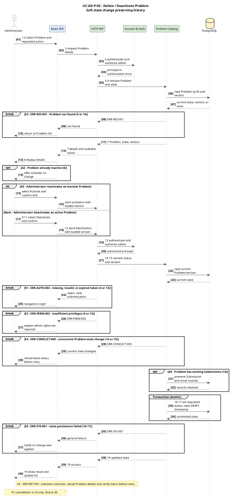

# Sequence Diagram - UC-AD-P-03 - Delete / Deactivate Problem

| Field | Value |
|-------|-------|
| Sequence Diagram ID | SD-UC-AD-P-03 |
| Use Case | UC-AD-P-03 - Delete / Deactivate Problem |
| Use Case Specification | [UC-AD-P-03-DeleteProblem.md](../../../../RequirementAnalysis/UCSpec/Administrator/ProblemManagement/UC-AD-P-03-DeleteProblem.md) |
| Primary Actor(s) | Administrator |
| Related Requirements | FR-ADMIN-01, FR-PROB-07, NFR-SEC-03, NFR-REL-08 |
| Scope | Main Flow 1-20, A1-A4, E1-E6 |
| Version | 1.0 |
| Status | Draft |
| Last updated | 2026-11-14 |

## 1. Scope

Soft-deactivate or reactivate a Problem with optimistic concurrency. Existing Test Cases and Submission history are retained.

## 2. Scenario Coverage

| Flow | Coverage | Diagram element / disposition |
|------|----------|-------------------------------|
| Main | 1-20 | Entire diagram |
| A1 | A1 | UI-only cancellation; no state-change request |
| A2 | A2 | `opt A2`; return current inactive state and offer Activate |
| A3 | A3 | `alt A3`; reactivate and leave publication DRAFT |
| A4 | A4 | `opt A4`; Submissions/results preserved |
| E1 | E1 | `break E1` at token validation |
| E2 | E2 | `break E2` at admin-role validation |
| E3 | E3 | `break E3` at Problem lookup |
| E4 | E4 | `break E4` at state/version comparison |
| E5 | E5 | `break E5` at atomic state persistence |
| E6 | E6 | Client-only unknown network outcome; reload and verify status |

## 3. Diagram

## 4. Notes

- Reactivation always sets publication state to `DRAFT`; it does not make the Problem public.
- No Problem, Test Case, Submission, or grading data is physically deleted.

## 5. Change History

| Version | Date | Change |
|---------|------|--------|
| 1.0 | 2026-11-14 | Initial diagram. |
