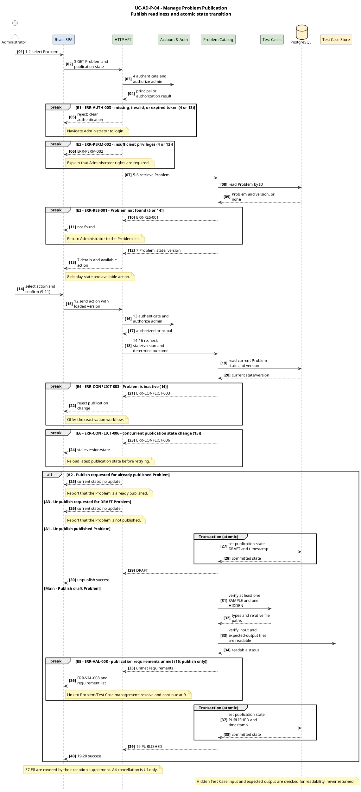

# Sequence Diagram - UC-AD-P-04 - Manage Problem Publication

| Field | Value |
|-------|-------|
| Sequence Diagram ID | SD-UC-AD-P-04 |
| Use Case | UC-AD-P-04 - Manage Problem Publication |
| Use Case Specification | [UC-AD-P-04-ManageProblemPublication.md](../../../../RequirementAnalysis/UCSpec/Administrator/ProblemManagement/UC-AD-P-04-ManageProblemPublication.md) |
| Primary Actor(s) | Administrator |
| Related Requirements | FR-ADMIN-01, FR-PROB-08, NFR-SEC-03, NFR-REL-08 |
| Scope | Main Flow 1-21, A1-A4, E1-E6; E7-E8 in SD-UC-AD-P-04-X |
| Version | 1.0 |
| Status | Draft |
| Last updated | 2026-11-14 |

## 1. Scope

Publish a ready active Problem or unpublish a published Problem. Publication checks are consistent with the metadata, Test Case set, and protected files.

## 2. Scenario Coverage

| Flow | Coverage | Diagram element / disposition |
|------|----------|-------------------------------|
| Main | 1-21 | Entire diagram |
| A1 | A1 | `alt A1`; unpublish active published Problem |
| A2 | A2 | `alt A2`; no-op when already published |
| A3 | A3 | `alt A3`; no-op when already unpublished |
| A4 | A4 | UI-only cancellation; no request is sent |
| E1 | E1 | `break E1` at access-token validation |
| E2 | E2 | `break E2` at admin-role validation |
| E3 | E3 | `break E3` at Problem lookup |
| E4 | E4 | `break E4` at active-state recheck |
| E5 | E5 | `break E5` at publication-readiness validation |
| E6 | E6 | `break E6` at publication-version comparison |
| E7-E8 | - | [SD-UC-AD-P-04-X](SD-UC-AD-P-04-ManageProblemPublication-Exceptions.md) |

## 3. Diagram

## 4. Notes

- The readiness check and publication transition must be consistent; no partial state change occurs if a check fails.
- Unpublishing does not delete Submissions or grading results.

## 5. Change History

| Version | Date | Change |
|---------|------|--------|
| 1.0 | 2026-11-14 | Initial diagram. |
