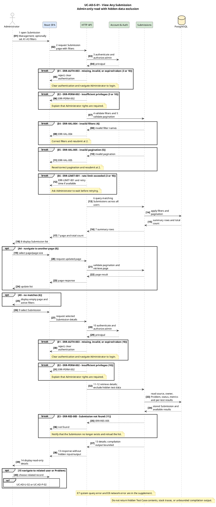

# Sequence Diagram - UC-AD-S-01 - View Any Submission

| Field | Value |
|-------|-------|
| Sequence Diagram ID | SD-UC-AD-S-01 |
| Use Case | UC-AD-S-01 - View Any Submission |
| Use Case Specification | [UC-AD-S-01-ViewAnySubmission.md](../../../../RequirementAnalysis/UCSpec/Administrator/SubmissionManagement/UC-AD-S-01-ViewAnySubmission.md) |
| Primary Actor(s) | Administrator |
| Related Requirements | FR-ADMIN-01, FR-ADMIN-06, FR-SUB-10, NFR-SEC-04, NFR-SEC-05, NFR-SEC-10 |
| Scope | Main Flow 1-16, A1-A5, E1-E6; E7-E8 in SD-UC-AD-S-01-X |
| Version | 1.0 |
| Status | Draft |
| Last updated | 2026-11-14 |

## 1. Scope

Search and inspect any Submission in read-only mode. Hidden Test Case inputs/outputs are excluded, and compilation output is bounded.

## 2. Scenario Coverage

| Flow | Coverage | Diagram element / disposition |
|------|----------|-------------------------------|
| Main | 1-16 | Entire diagram |
| A1 | A1 | Optional User filter in the list request |
| A2 | A2 | Optional Problem filter in the list request |
| A3 | A3 | Optional verdict/status filter in the list request |
| A4 | A4 | `opt A4`; request another page and replace list |
| A5 | A5 | `opt A5`; empty page and zero count |
| E1 | E1 | `break E1` at token validation |
| E2 | E2 | `break E2` at admin-role validation |
| E3 | E3 | `break E3` at selected Submission lookup |
| E4 | E4 | `break E4` at filter validation |
| E5 | E5 | `break E5` at pagination validation |
| E6 | E6 | `break E6` at rate-limit check |
| E7-E8 | - | [SD-UC-AD-S-01-X](SD-UC-AD-S-01-ViewAnySubmission-Exceptions.md) |

## 3. Diagram

## 4. Notes

- Non-terminal Submissions show status rather than a verdict; `INTERNAL_ERROR` is a status, not a verdict.
- The use case performs no modification or rejudging.

## 5. Change History

| Version | Date | Change |
|---------|------|--------|
| 1.0 | 2026-11-14 | Initial diagram. |
