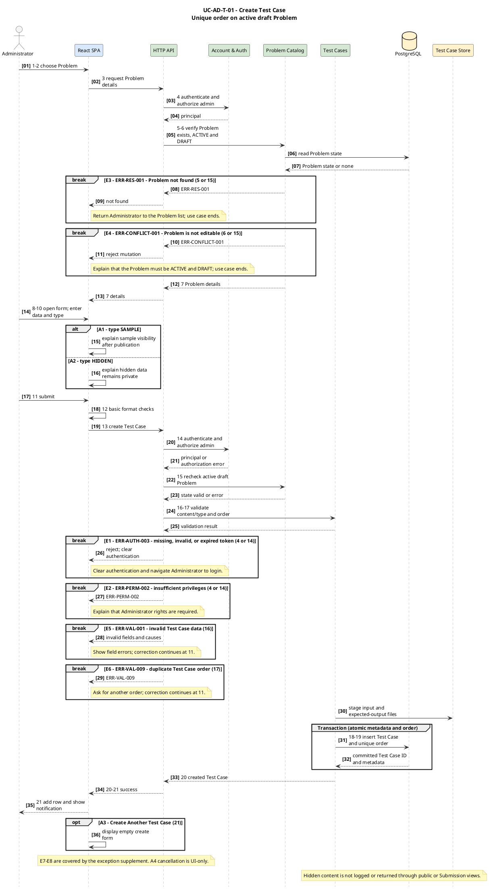

# Sequence Diagram - UC-AD-T-01 - Create Test Case

| Field | Value |
|-------|-------|
| Sequence Diagram ID | SD-UC-AD-T-01 |
| Use Case | UC-AD-T-01 - Create Test Case |
| Use Case Specification | [UC-AD-T-01-CreateTestCase.md](../../../../RequirementAnalysis/UCSpec/Administrator/TestCaseManagement/UC-AD-T-01-CreateTestCase.md) |
| Primary Actor(s) | Administrator |
| Related Requirements | FR-ADMIN-01, FR-TC-01, FR-TC-02, FR-TC-09, NFR-SEC-03, NFR-REL-01 |
| Scope | Main Flow 1-22, A1-A4, E1-E6; E7-E8 in SD-UC-AD-T-01-X |
| Version | 1.0 |
| Status | Draft |
| Last updated | 2026-11-14 |

## 1. Scope

Add a SAMPLE or HIDDEN Test Case with input/output data and a unique order to an active draft Problem.

## 2. Scenario Coverage

| Flow | Coverage | Diagram element / disposition |
|------|----------|-------------------------------|
| Main | 1-22 | Entire diagram |
| A1 | A1 | `alt A1`; explain SAMPLE visibility |
| A2 | A2 | `alt A2`; explain HIDDEN privacy |
| A3 | A3 | UI-only; display another empty form |
| A4 | A4 | UI-only cancellation; no create request |
| E1 | E1 | `break E1` at token validation |
| E2 | E2 | `break E2` at admin-role validation |
| E3 | E3 | `break E3` at Problem lookup |
| E4 | E4 | `break E4` at Problem editability check |
| E5 | E5 | `break E5` at Test Case data validation |
| E6 | E6 | `break E6` at unique-order check |
| E7-E8 | - | [SD-UC-AD-T-01-X](SD-UC-AD-T-01-CreateTestCase-Exceptions.md) |

## 3. Diagram

## 4. Notes

- Metadata and execution-order persistence are atomic. Problem publication state remains DRAFT.
- File contents are written to the protected Test Case Store; metadata contains references, not public content.

## 5. Change History

| Version | Date | Change |
|---------|------|--------|
| 1.0 | 2026-11-14 | Initial diagram. |
