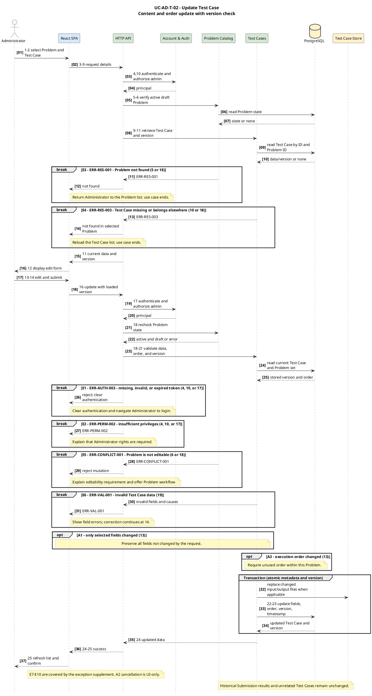

# Sequence Diagram - UC-AD-T-02 - Update Test Case

| Field | Value |
|-------|-------|
| Sequence Diagram ID | SD-UC-AD-T-02 |
| Use Case | UC-AD-T-02 - Update Test Case |
| Use Case Specification | [UC-AD-T-02-UpdateTestCase.md](../../../../RequirementAnalysis/UCSpec/Administrator/TestCaseManagement/UC-AD-T-02-UpdateTestCase.md) |
| Primary Actor(s) | Administrator |
| Related Requirements | FR-ADMIN-01, FR-TC-04, FR-TC-09, NFR-REL-08 |
| Scope | Main Flow 1-26, A1-A3, E1-E6; E7-E10 in SD-UC-AD-T-02-X |
| Version | 1.0 |
| Status | Draft |
| Last updated | 2026-11-14 |

## 1. Scope

Update Test Case content or order with optimistic concurrency while preserving other Test Cases and historical results.

## 2. Scenario Coverage

| Flow | Coverage | Diagram element / disposition |
|------|----------|-------------------------------|
| Main | 1-26 | Entire diagram |
| A1 | A1 | Unchanged fields preserved |
| A2 | A2 | UI-only cancellation; no update request |
| A3 | A3 | New order checked for uniqueness |
| E1 | E1 | `break E1` at token validation |
| E2 | E2 | `break E2` at admin-role validation |
| E3 | E3 | `break E3` at Problem lookup |
| E4 | E4 | `break E4` at Test Case lookup/association check |
| E5 | E5 | `break E5` at Problem editability check |
| E6 | E6 | `break E6` at Test Case data validation |
| E7-E10 | - | [SD-UC-AD-T-02-X](SD-UC-AD-T-02-UpdateTestCase-Exceptions.md) |

## 3. Diagram

## 4. Notes

- The loaded version is checked before mutation. Historical grading results are not recalculated or changed.
- Test Case input and expected output are never written to logs or error responses.

## 5. Change History

| Version | Date | Change |
|---------|------|--------|
| 1.0 | 2026-11-14 | Initial diagram. |
