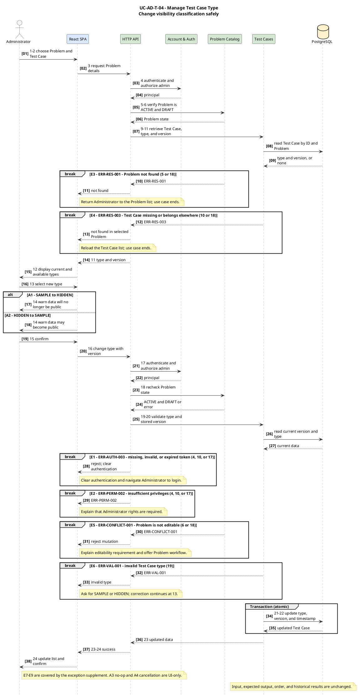

# Sequence Diagram - UC-AD-T-04 - Manage Test Case Type

| Field | Value |
|-------|-------|
| Sequence Diagram ID | SD-UC-AD-T-04 |
| Use Case | UC-AD-T-04 - Manage Test Case Type |
| Use Case Specification | [UC-AD-T-04-ManageTestCaseType.md](../../../../RequirementAnalysis/UCSpec/Administrator/TestCaseManagement/UC-AD-T-04-ManageTestCaseType.md) |
| Primary Actor(s) | Administrator |
| Related Requirements | FR-ADMIN-01, FR-TC-03, FR-TC-07, FR-TC-09, NFR-REL-08 |
| Scope | Main Flow 1-25, A1-A4, E1-E6; E7-E9 in SD-UC-AD-T-04-X |
| Version | 1.0 |
| Status | Draft |
| Last updated | 2026-11-14 |

## 1. Scope

Change a Test Case between SAMPLE and HIDDEN with an explicit visibility confirmation and a stale-version check.

## 2. Scenario Coverage

| Flow | Coverage | Diagram element / disposition |
|------|----------|-------------------------------|
| Main | 1-25 | Entire diagram |
| A1 | A1 | `alt A1`; warn before SAMPLE becomes HIDDEN |
| A2 | A2 | `alt A2`; warn before HIDDEN becomes SAMPLE |
| A3 | A3 | UI-only no-op when current type is selected |
| A4 | A4 | UI-only cancellation; no update request |
| E1 | E1 | `break E1` at token validation |
| E2 | E2 | `break E2` at admin-role validation |
| E3 | E3 | `break E3` at Problem lookup |
| E4 | E4 | `break E4` at Test Case lookup/association check |
| E5 | E5 | `break E5` at Problem editability check |
| E6 | E6 | `break E6` at type validation |
| E7-E9 | - | [SD-UC-AD-T-04-X](SD-UC-AD-T-04-ManageTestCaseType-Exceptions.md) |

## 3. Diagram

## 4. Notes

- SAMPLE data may be public after publication; HIDDEN data is never exposed publicly or through Submission views.
- A selected current type causes no request and ends the use case.

## 5. Change History

| Version | Date | Change |
|---------|------|--------|
| 1.0 | 2026-11-14 | Initial diagram. |
