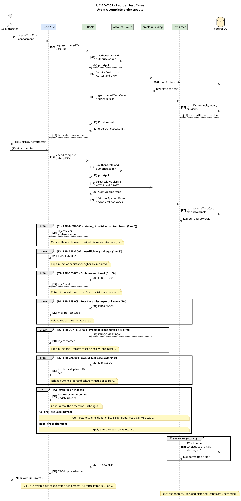

# Sequence Diagram - UC-AD-T-05 - Reorder Test Cases

| Field | Value |
|-------|-------|
| Sequence Diagram ID | SD-UC-AD-T-05 |
| Use Case | UC-AD-T-05 - Reorder Test Cases |
| Use Case Specification | [UC-AD-T-05-ReorderTestCases.md](../../../../RequirementAnalysis/UCSpec/Administrator/TestCaseManagement/UC-AD-T-05-ReorderTestCases.md) |
| Primary Actor(s) | Administrator |
| Related Requirements | FR-ADMIN-01, FR-TC-08, FR-TC-09, NFR-REL-08 |
| Scope | Main Flow 1-15, A1-A3, E1-E6; E7-E9 in SD-UC-AD-T-05-X |
| Version | 1.0 |
| Status | Draft |
| Last updated | 2026-11-14 |

## 1. Scope

Persist a complete Test Case order atomically, ensuring the exact set is present and ordinals are unique, contiguous, and start at one.

## 2. Scenario Coverage

| Flow | Coverage | Diagram element / disposition |
|------|----------|-------------------------------|
| Main | 1-15 | Entire diagram |
| A1 | A1 | UI-only cancellation; no request |
| A2 | A2 | `alt A2`; return current order without update |
| A3 | A3 | One-item move represented in the complete submitted order |
| E1 | E1 | `break E1` at token validation |
| E2 | E2 | `break E2` at admin-role validation |
| E3 | E3 | `break E3` at Problem lookup |
| E4 | E4 | `break E4` at submitted Test Case lookup |
| E5 | E5 | `break E5` at Problem editability check |
| E6 | E6 | `break E6` at complete-order validation |
| E7-E9 | - | [SD-UC-AD-T-05-X](SD-UC-AD-T-05-ReorderTestCases-Exceptions.md) |

## 3. Diagram

## 4. Notes

- The submitted identifiers must exactly match the current Problem Test Case set.
- Reordering is allowed only for an active draft Problem with at least two Test Cases.

## 5. Change History

| Version | Date | Change |
|---------|------|--------|
| 1.0 | 2026-11-14 | Initial diagram. |
