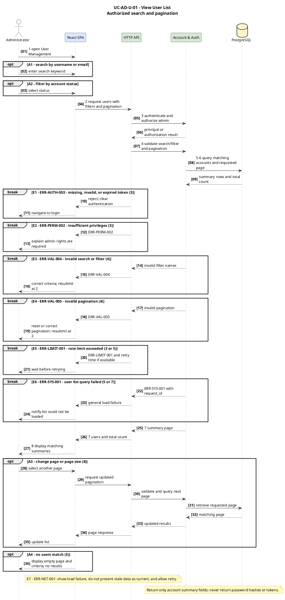

# Sequence Diagram - UC-AD-U-01 - View User List

| Field | Value |
|-------|-------|
| Sequence Diagram ID | SD-UC-AD-U-01 |
| Use Case | UC-AD-U-01 - View User List |
| Use Case Specification | [UC-AD-U-01-ViewUserList.md](../../../../RequirementAnalysis/UCSpec/Administrator/UserManagement/UC-AD-U-01-ViewUserList.md) |
| Primary Actor(s) | Administrator |
| Related Requirements | FR-ADMIN-01, FR-ADMIN-02, NFR-SEC-03, NFR-SEC-10 |
| Scope | Main Flow 1-9, A1-A4, E1-E6; E7 in SD-UC-AD-U-01-X |
| Version | 1.0 |
| Status | Draft |
| Last updated | 2026-11-14 |

## 1. Scope

List, search, filter, and paginate account summaries without exposing secrets or modifying account data.

## 2. Scenario Coverage

| Flow | Coverage | Diagram element / disposition |
|------|----------|-------------------------------|
| Main | 1-9 | Entire diagram |
| A1 | A1 | `opt A1`; search by username or email |
| A2 | A2 | `opt A2`; filter by account status |
| A3 | A3 | `opt A3`; change page or page size |
| A4 | A4 | `opt A4`; empty page and zero count |
| E1 | E1 | `break E1` at token validation |
| E2 | E2 | `break E2` at admin-role validation |
| E3 | E3 | `break E3` at search/filter validation |
| E4 | E4 | `break E4` at pagination validation |
| E5 | E5 | `break E5` at rate-limit check |
| E6 | E6 | `break E6` at account query/assembly |
| E7 | - | [SD-UC-AD-U-01-X](SD-UC-AD-U-01-ViewUserList-Exceptions.md) |

## 3. Diagram

## 4. Notes

- Search/filter and pagination parameters are validated before querying.
- Main flow is read-only; account status changes use UC-AD-U-03.

## 5. Change History

| Version | Date | Change |
|---------|------|--------|
| 1.0 | 2026-11-14 | Initial diagram. |
