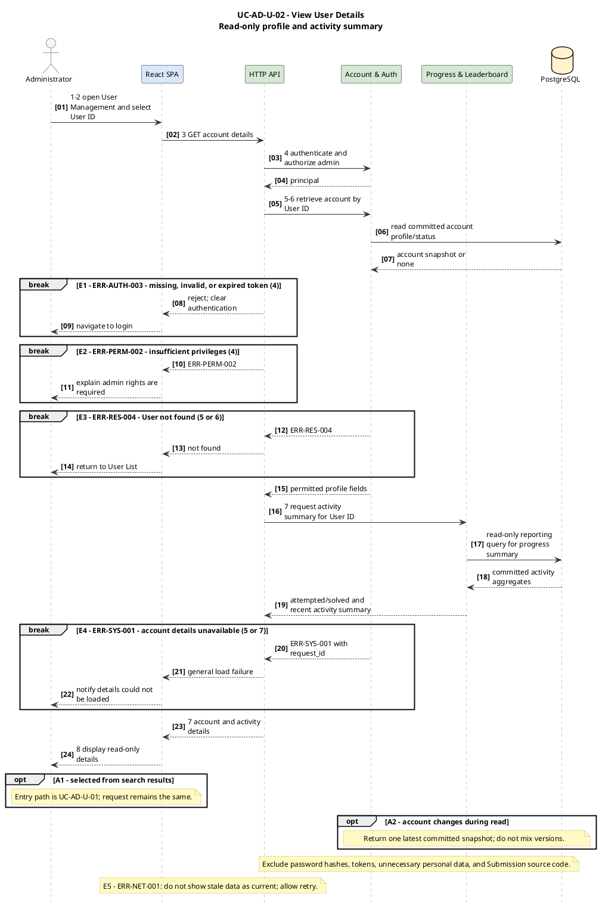

# Sequence Diagram - UC-AD-U-02 - View User Details

| Field | Value |
|-------|-------|
| Sequence Diagram ID | SD-UC-AD-U-02 |
| Use case | UC-AD-U-02 - View User Details |
| Use Case Specification | [UC-AD-U-02-ViewUserDetails.md](../../../../RequirementAnalysis/UCSpec/Administrator/UserManagement/UC-AD-U-02-ViewUserDetails.md) |
| Primary Actor(s) | Administrator |
| Related Requirements | FR-ADMIN-01, FR-ADMIN-07, FR-PROG-01, NFR-SEC-03, NFR-SEC-10 |
| Scope | Main Flow 1-9, A1-A2, E1-E5 |
| Version | 1.0 |
| Status | Draft |
| Last updated | 2026-11-14 |

## 1. Scope

Read permitted profile and activity details for one account; source code and secrets are excluded.

## 2. Scenario Coverage

| Flow | Coverage | Diagram element / disposition |
|------|----------|-------------------------------|
| Main | 1-9 | Entire diagram |
| A1 | A1 | User selected from UC-AD-U-01 search results |
| A2 | A2 | Read a consistent latest committed account snapshot |
| E1 | E1 | `break E1` at token validation |
| E2 | E2 | `break E2` at admin-role validation |
| E3 | E3 | `break E3` at User lookup |
| E4 | E4 | `break E4` at account/activity assembly |
| E5 | E5 | Client-only network outcome; do not show stale data as current |

## 3. Diagram

## 4. Notes

- Account details are read-only. Submission source code is available only through UC-AD-S-01.
- Activity summary follows the reporting measures in FR-PROG-01.

## 5. Change History

| Version | Date | Change |
|---------|------|--------|
| 1.0 | 2026-11-14 | Initial diagram. |
