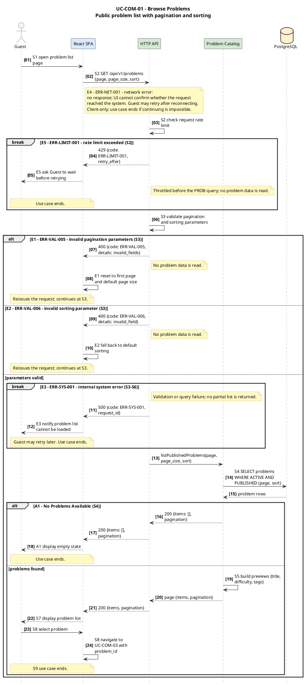

# Sequence Diagram - UC-COM-01 - Browse Problems

| Field | Value |
|-------|-------|
| Sequence Diagram ID | SD-UC-COM-01 |
| Use Case | UC-COM-01 - Browse Problems |
| Use Case Specification | [UC-COM-01-BrowseProblems.md](../../../RequirementAnalysis/UCSpec/GuestCommon/UC-COM-01-BrowseProblems.md) |
| Primary Actor(s) | Guest, User (through public behavior inheritance) |
| Related Requirements | FR-PROB-01, NFR-PERF-01, NFR-SEC-10 |
| Scope | Main flow, A1-A4, E1-E5 |
| Version | 1.0 |
| Status | Draft |
| Last updated | 2026-11-14 |

## 1. Scope

This diagram covers the public problem list: pagination and sorting parameters, the published-problem query, preview projection, and the empty-result outcome.

A2 and A3 reissue the same request with new pagination or sorting parameters and are dispositioned below. A4 is the same UI handoff as S8. The use case is read-only, so no write transaction, outbox event, or queue message appears.

## 2. Scenario Coverage

| Flow | Coverage | Diagram element / disposition |
|------|----------|-------------------------------|
| Main | S1-S9 | Entire diagram; S9 end state is stated in the final note |
| A1 | A1 | `alt A1` at S4 |
| A2 | - | Reuses S2-S7 with new pagination parameters; no new interaction |
| A3 | - | Reuses S2-S7 with new sorting parameters; no new interaction |
| A4 | - | Represented by S8; UI-only navigation to UC-COM-03 |
| E1 | E1 | `alt E1` branch at S3 |
| E2 | E2 | `alt E2` branch at S3 |
| E3 | E3 | `break E3` at S3-S6 |
| E4 | - | Client-only note at UI during the request/response |
| E5 | E5 | `break E5` at S2 |

## 3. Diagram

## 4. Notes

- The query returns only `ACTIVE` and `PUBLISHED` problems and only public preview fields.
- Ordering is deterministic so pagination does not duplicate or skip rows.
- The diagram is read-only; no outbox event or queue message is created.
- Rate limiting is enforced at `API`; no separate limiter lifeline exists in v1.

## 5. Change History

| Version | Date | Change |
|---------|------|--------|
| 1.0 | 2026-11-14 | Initial diagram. |
