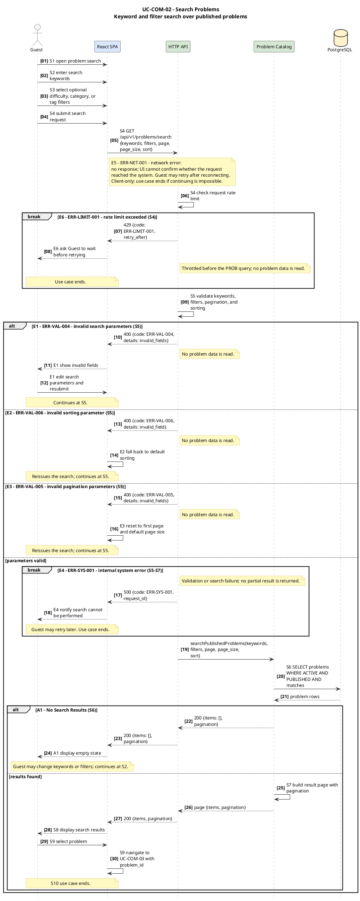

# Sequence Diagram - UC-COM-02 - Search Problems

| Field | Value |
|-------|-------|
| Sequence Diagram ID | SD-UC-COM-02 |
| Use Case | UC-COM-02 - Search Problems |
| Use Case Specification | [UC-COM-02-SearchProblems.md](../../../RequirementAnalysis/UCSpec/GuestCommon/UC-COM-02-SearchProblems.md) |
| Primary Actor(s) | Guest, User (through public behavior inheritance) |
| Related Requirements | FR-PROB-02, NFR-PERF-01, NFR-SEC-10 |
| Scope | Main flow, A1-A4, E1-E6 |
| Version | 1.0 |
| Status | Draft |
| Last updated | 2026-11-14 |

## 1. Scope

This diagram covers keyword and filter search over published problems, validation of search parameters, the paginated result, and the empty-result outcome.

A2 (no filters) and A3 (filters only) change only the UI input before the same request path and are dispositioned below. A4 is the same UI handoff as S9. The use case is read-only.

## 2. Scenario Coverage

| Flow | Coverage | Diagram element / disposition |
|------|----------|-------------------------------|
| Main | S1-S10 | Entire diagram; S10 end state is stated in the final note |
| A1 | A1 | `alt A1` at S6 |
| A2 | - | No filters selected; S3 is omitted; same request path |
| A3 | - | Keywords omitted; filter-only search; same request path |
| A4 | - | Represented by S9; UI-only navigation to UC-COM-03 |
| E1 | E1 | `alt E1` branch at S5 |
| E2 | E2 | `alt E2` branch at S5 |
| E3 | E3 | `alt E3` branch at S5 |
| E4 | E4 | `break E4` at S5-S7 |
| E5 | - | Client-only note at UI during the request/response |
| E6 | E6 | `break E6` at S4 |

## 3. Diagram

## 4. Notes

- Search input is treated as data, never as executable query syntax.
- The query returns only `ACTIVE` and `PUBLISHED` problems and only public fields.
- A2 and A3 are input variations, not additional server interactions.
- Rate limiting is enforced at `API`; no separate limiter lifeline exists in v1.

## 5. Change History

| Version | Date | Change |
|---------|------|--------|
| 1.0 | 2026-11-14 | Initial diagram. |
