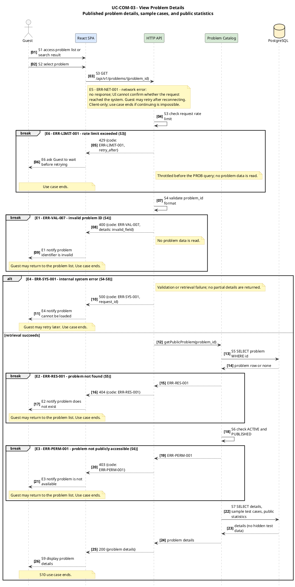

# Sequence Diagram - UC-COM-03 - View Problem Details

| Field | Value |
|-------|-------|
| Sequence Diagram ID | SD-UC-COM-03 |
| Use Case | UC-COM-03 - View Problem Details |
| Use Case Specification | [UC-COM-03-ViewProblemDetails.md](../../../RequirementAnalysis/UCSpec/GuestCommon/UC-COM-03-ViewProblemDetails.md) |
| Primary Actor(s) | Guest, User (through public behavior inheritance) |
| Related Requirements | FR-PROB-03, FR-PROB-04, FR-PROB-10, NFR-PERF-01, NFR-SEC-05, NFR-SEC-10 |
| Scope | Main flow, A1-A2, E1-E6 |
| Version | 1.0 |
| Status | Draft |
| Last updated | 2026-11-14 |

## 1. Scope

This diagram covers retrieval of a published problem's statement, formats, constraints, limits, sample test cases, classification, supported languages, and public statistics.

The visibility check is a domain check in `PROB`. The read never returns hidden test data. A1 (back to the list) and A2 (another problem) are UI navigation and are dispositioned below. The use case is read-only.

## 2. Scenario Coverage

| Flow | Coverage | Diagram element / disposition |
|------|----------|-------------------------------|
| Main | S1-S10 | Entire diagram; S10 end state is stated in the final note |
| A1 | - | UI-only navigation after S9; no server interaction |
| A2 | - | UI-only; re-enters at S3 with a new `problem_id` |
| E1 | E1 | `break E1` at S4 |
| E2 | E2 | `break E2` at S5 |
| E3 | E3 | `break E3` at S6 |
| E4 | E4 | `alt E4` at S4-S8 |
| E5 | - | Client-only note at UI during the request/response |
| E6 | E6 | `break E6` at S3 |

## 3. Diagram

## 4. Notes

- Only sample test cases are read and returned; hidden inputs and expected outputs never leave the protected store.
- Public statistics are read as part of the problem detail response.
- The specification assigns `ERR-PERM-001` to a problem that is not publicly accessible; this is treated as a visibility boundary, not an authentication failure.
- A1 and A2 are navigation only; A2 re-enters the request path at S3.

## 5. Change History

| Version | Date | Change |
|---------|------|--------|
| 1.0 | 2026-11-14 | Initial diagram. |
