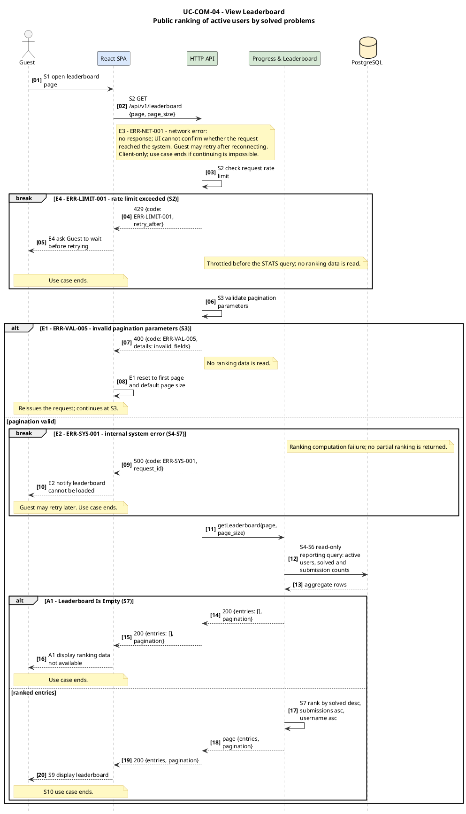

# Sequence Diagram - UC-COM-04 - View Leaderboard

| Field | Value |
|-------|-------|
| Sequence Diagram ID | SD-UC-COM-04 |
| Use Case | UC-COM-04 - View Leaderboard |
| Use Case Specification | [UC-COM-04-ViewLeaderboard.md](../../../RequirementAnalysis/UCSpec/GuestCommon/UC-COM-04-ViewLeaderboard.md) |
| Primary Actor(s) | Guest, User (through public behavior inheritance) |
| Related Requirements | FR-PROG-02, NFR-PERF-01, NFR-SEC-10 |
| Scope | Main flow, A1-A3, E1-E4 |
| Version | 1.0 |
| Status | Draft |
| Last updated | 2026-11-14 |

## 1. Scope

This diagram covers the public leaderboard: pagination validation, the read-only aggregate query over active users and their submissions, deterministic ranking, and the empty-leaderboard outcome.

A2 (another page) and A3 (refresh) reuse the same request path and are dispositioned below. The use case is read-only. `STATS` performs a read-only reporting query across module tables, as allowed by the ruleset.

## 2. Scenario Coverage

| Flow | Coverage | Diagram element / disposition |
|------|----------|-------------------------------|
| Main | S1-S10 | Entire diagram; S10 end state is stated in the final note |
| A1 | A1 | `alt A1` at S7 |
| A2 | - | Reuses S2-S9 with new pagination parameters; no new interaction |
| A3 | - | Reuses S2-S9 and recalculates from current data; no new interaction |
| E1 | E1 | `alt E1` at S3 |
| E2 | E2 | `break E2` at S4-S7 |
| E3 | - | Client-only note at UI during the request/response |
| E4 | E4 | `break E4` at S2 |

## 3. Diagram

## 4. Notes

- The aggregate query is read-only and spans module tables; it does not load every user into application memory.
- Ranking is deterministic: solved count descending, total submissions ascending, then username ascending.
- The response exposes username, display name, solved count, submission count, and acceptance rate only; no email or private account data.
- A2 and A3 are page-navigation and refresh variants of the same request path.

## 5. Change History

| Version | Date | Change |
|---------|------|--------|
| 1.0 | 2026-11-14 | Initial diagram. |
