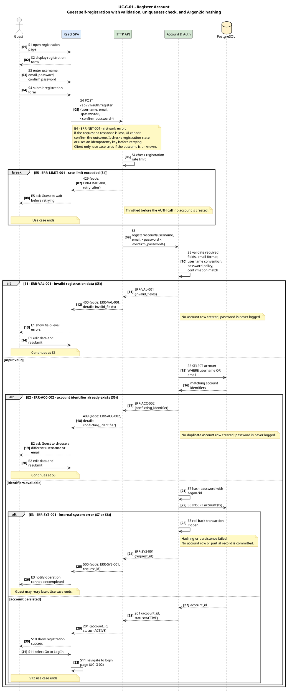

# Sequence Diagram - UC-G-01 - Register Account

| Field | Value |
|-------|-------|
| Sequence Diagram ID | SD-UC-G-01 |
| Use Case | UC-G-01 - Register Account |
| Use Case Specification | [UC-G-01-RegisterAccount.md](../../../RequirementAnalysis/UCSpec/GuestCommon/UC-G-01-RegisterAccount.md) |
| Primary Actor(s) | Guest |
| Related Requirements | FR-AUTH-01, FR-AUTH-11, FR-AUTH-12, NFR-SEC-01 |
| Scope | Main flow, A1, E1-E5 |
| Version | 1.0 |
| Status | Draft |
| Last updated | 2026-11-14 |

## 1. Scope

This diagram covers guest self-registration: form entry, server-side validation, identifier uniqueness, Argon2id password hashing, account persistence, and the success response.

The `API` lifeline enforces transport concerns and rate limiting. The `AUTH` module owns the registration policy, uniqueness check, hashing, and the account insert. Registration is synchronous: it creates no outbox event and does not use the judge queue.

A1 is a pure UI navigation at S2 and is dispositioned below. E4 is a client-only network condition and is shown as a UI note. E5 is a terminal early exit at the API boundary. v1 requires no email verification, so none is drawn.

## 2. Scenario Coverage

| Flow | Coverage | Diagram element / disposition |
|------|----------|-------------------------------|
| Main | S1-S12 | Entire diagram; S12 end state is stated in the final note |
| A1 | - | UI-only at S2; Guest selects the login link; no server interaction |
| E1 | E1 | `alt E1` at S5 |
| E2 | E2 | `alt E2` at S6 |
| E3 | E3 | `alt E3` at S7-S8 |
| E4 | - | Client-only note at UI during the request/response |
| E5 | E5 | `break E5` at S4 |

## 3. Diagram

## 4. Notes

- The password is hashed with Argon2id inside `AUTH`; the plaintext password and the hash never appear in the diagram, logs, or error responses.
- Registration is a synchronous write. No outbox event and no queue message are created, so `OUTBOX` and `QUEUE` are correctly absent.
- Rate limiting is enforced at `API`; there is no separate rate-limit lifeline in the v1 module decomposition.
- Disclosing that a username or email is already in use is the accepted v1 trade-off recorded in FR-AUTH-11.
- A1 and E4 are intentionally not drawn as message sequences; their dispositions are recorded in the coverage table.

## 5. Change History

| Version | Date | Change |
|---------|------|--------|
| 1.0 | 2026-11-14 | Initial diagram. |
