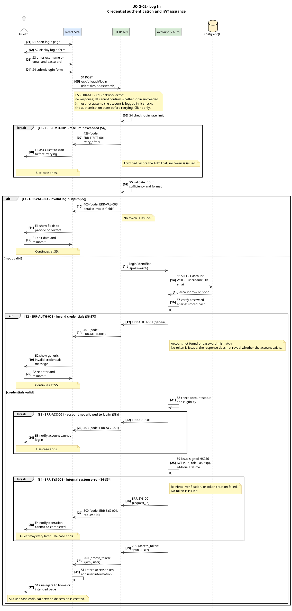

# Sequence Diagram - UC-G-02 - Log In

| Field | Value |
|-------|-------|
| Sequence Diagram ID | SD-UC-G-02 |
| Use Case | UC-G-02 - Log In |
| Use Case Specification | [UC-G-02-Login.md](../../../RequirementAnalysis/UCSpec/GuestCommon/UC-G-02-Login.md) |
| Primary Actor(s) | Guest |
| Related Requirements | FR-AUTH-02, FR-AUTH-04, FR-AUTH-09, FR-AUTH-10, NFR-SEC-01, NFR-SEC-02, NFR-SEC-10 |
| Scope | Main flow, A1-A2, E1-E6 |
| Version | 1.0 |
| Status | Draft |
| Last updated | 2026-11-14 |

## 1. Scope

This diagram covers credential login: input validation, account retrieval, password verification, account-status check, JWT issuance, and client-side token storage.

A1 (redirect to the previously requested page) is a client-side target choice at S12. A2 (choose registration) is UI navigation at S2. Neither adds a server interaction. Login is stateless: no server-side session is created, and no outbox event or queue message is involved.

## 2. Scenario Coverage

| Flow | Coverage | Diagram element / disposition |
|------|----------|-------------------------------|
| Main | S1-S13 | Entire diagram; S13 end state is stated in the final note |
| A1 | - | UI-only; S12 selects the previously requested page or the home page |
| A2 | - | UI-only navigation to UC-G-01 at S2; no server interaction |
| E1 | E1 | `alt E1` at S5 |
| E2 | E2 | `alt E2` at S6-S7 |
| E3 | E3 | `break E3` at S8 |
| E4 | E4 | `break E4` at S6-S9 |
| E5 | - | Client-only note at UI during the request/response |
| E6 | E6 | `break E6` at S4 |

## 3. Diagram

## 4. Notes

- The password is verified against the Argon2id hash; neither the password nor the hash appears in the diagram.
- The JWT is shown as `<jwt>`; the signing secret never appears.
- A failed login returns a generic `ERR-AUTH-001`, so the response does not reveal whether an account exists.
- Disabled or otherwise ineligible accounts are rejected at S8 even when the password is valid.
- Logout is client-side only; the issued token remains valid until it expires.

## 5. Change History

| Version | Date | Change |
|---------|------|--------|
| 1.0 | 2026-11-14 | Initial diagram. |
