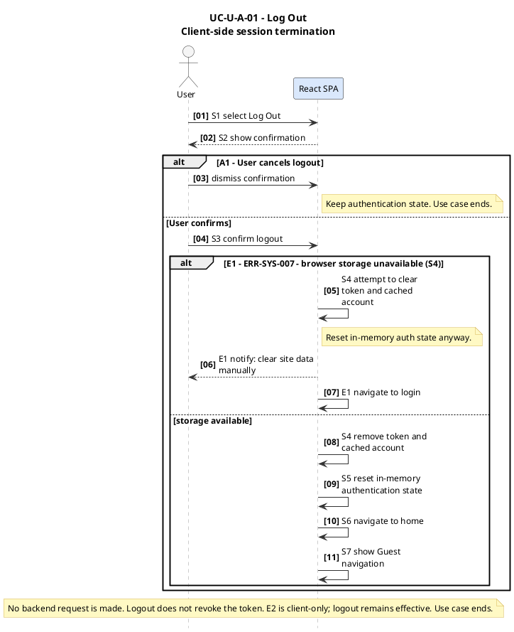

```plantuml
@startuml SD-UC-G-01
...
@enduml
```

# Sequence Diagram Ruleset

**Arbiter — Online Judge Platform**

| Document control | Value |
|------------------|-------|
| Project | Arbiter — Online Judge Platform |
| Applies to | Every sequence diagram under `ArchitecturalDesign/SequenceDiagram/` |
| Source of truth | [`SRS.md`](../../RequirementAnalysis/SRS/SRS.md), [`UseCaseCatalog.md`](../../RequirementAnalysis/UCSpec/UseCaseCatalog.md), and the individual use case specifications |
| Status | Active |
| Version | 1.1 |
| Date | 2026-11-14 |

---

## 1. Purpose and Scope

This document defines the mandatory rules for drawing the sequence diagrams of the Architectural Design phase. It exists so that all 33 v1 use cases are documented with the same notation, level of detail, traceability, and security posture.

### 1.1 Goals

1. **Fidelity** — every diagram describes behavior that is already stated in the SRS, the use case catalog, or a use case specification. Diagrams do not invent requirements.
2. **Consistency** — participants, message labels, fragments, colors, and file metadata are the same in every diagram.
3. **Traceability** — every main-flow step, alternative flow, and exception flow can be traced from the use case specification to the diagram and back.
4. **Readability** — a reviewer can understand the interaction at a glance without reading implementation code.
5. **Security** — no diagram exposes a password, token, secret, source code, hidden test data, or unnecessary personal data.

### 1.2 Non-goals

Sequence diagrams are **not**:

- a class diagram, package diagram, or deployment diagram;
- a substitute for the REST API specification;
- a UI wireframe or screen-flow specification;
- a line-by-line description of the Judge Worker implementation;
- a place to introduce new use cases, actors, error codes, endpoints, or business rules.

### 1.3 Audience

The author of each diagram, the reviewer, and anyone implementing or testing the corresponding use case.

### 1.4 Key decisions

| Decision | Choice |
|----------|--------|
| Notation | PlantUML sequence diagrams embedded in Markdown. |
| Abstraction | Component/module level; no classes, functions, or ORM calls. |
| Coverage | One primary diagram per use case; supplements only above the §3.3 thresholds. |
| Branches | `alt`, `opt`, `loop`, `break`, and `group`; exact `A<n>` and `E<n>` IDs. |
| Asynchrony | Transactional outbox after commit; `XACK` after durable commit; HTTP polling. |
| Participants | Fixed canonical set in §7.1; no ad-hoc lifelines. |
| Security | No secrets, source code, or hidden test data in any diagram. |
| Review | Coverage table plus the §14 checklist and the §12.5 review procedure. |

### 1.5 Workflow

1. Read the use case specification and list every main, alternative, and exception flow.
2. Identify the owning module and every infrastructure participant that actually participates.
3. Draw the main flow left to right, with one message per interaction and `S<n>` references.
4. Add `alt`/`opt` fragments for alternatives and `alt`/`break` fragments for exceptions.
5. Add the coverage table and disposition every flow that is not drawn.
6. Run the checklist in §14, render the diagram, and complete the review in §12.5.

---

## 2. Authority and Precedence

### 2.1 Source documents

| Rank | Document | Authority |
|------|----------|-----------|
| 1 | [`SRS.md`](../../RequirementAnalysis/SRS/SRS.md) | Functional and non-functional requirements, architecture, statuses, verdicts, and cross-cutting constraints. |
| 2 | [`UseCaseCatalog.md`](../../RequirementAnalysis/UCSpec/UseCaseCatalog.md) | Actor set, use case inventory, relationships, lifecycles, and business rules. |
| 3 | Individual use case specifications under `RequirementAnalysis/UCSpec/` | Main, alternative, and exception flows; error codes; preconditions and postconditions. |
| 4 | This ruleset | Notation, abstraction level, file conventions, and review process only. |

If a diagram and a use case specification disagree, **the specification wins**. Fix the diagram, or update both in the same change if the specification itself is being revised.

### 2.2 No invention

A diagram must not introduce:

- a new actor, use case, module, external system, error code, status, verdict, or endpoint;
- a behavior that the use case specification does not describe;
- a technology that the SRS does not prescribe.

If a flow is ambiguous in the specification, record the question under `## Open Issues` in the diagram file and, when necessary, revise the use case specification first. Do not resolve the ambiguity silently in a diagram.

### 2.3 Error codes

Use only error codes declared in the use case specification. Do not renumber, reuse, or invent codes in a diagram. If a diagram needs a code that does not exist, stop and raise the issue in the specification.

---

## 3. Diagram Set and Coverage

### 3.1 Mandatory set

Every v1 use case has exactly one **primary** sequence diagram. The mandatory set is:

| Group | Use cases | Primary diagrams |
|-------|-----------|------------------|
| Guest / Common | UC-COM-01 to UC-COM-04, UC-G-01, UC-G-02 | 6 |
| User — Account | UC-U-A-01 to UC-U-A-04 | 4 |
| User — Practice | UC-U-P-01 to UC-U-P-03 | 3 |
| User — Submissions | UC-U-S-01 to UC-U-S-04 | 4 |
| User — Progress | UC-U-ST-01 | 1 |
| Administrator — Problems | UC-AD-P-01 to UC-AD-P-04 | 4 |
| Administrator — Test Cases | UC-AD-T-01 to UC-AD-T-05 | 5 |
| Administrator — Users | UC-AD-U-01 to UC-AD-U-03 | 3 |
| Administrator — Submissions | UC-AD-S-01 | 1 |
| Judge Worker | UC-SYS-J-01, UC-SYS-J-02 | 2 |
| **Total** | **33 use cases** | **33** |

The full inventory, with owning modules and specification links, is in [Appendix A](#appendix-a-required-diagram-inventory). File names follow §4.2.

### 3.2 Primary diagram

The primary diagram must show the main flow end-to-end. It includes:

- the initiating actor and the UI interaction that starts the use case;
- every synchronous request/response pair needed to complete the main flow;
- every asynchronous handoff that is part of the use case (outbox, queue, worker);
- the alternative flows that change system interaction or outcome;
- the exception flows that are detected by the server, the worker, or an infrastructure component, unless §3.3 requires an exception supplement.

A primary diagram is not required to draw pure UI navigation, a cancelled dialog, or a client-side network failure as a separate sequence. Those flows must still be listed and dispositioned in the coverage table (§3.4).

### 3.3 Supplemental diagrams

A supplemental diagram is allowed only when the primary diagram would be unreadable. Use a supplement when one of these limits is exceeded:

| Limit | Threshold |
|-------|-----------|
| Messages in one diagram | More than 40 |
| Lifelines in one diagram | More than 12 |
| Nested fragment depth | More than 3 |
| Exception flows in one diagram | More than 6 |

Supplement rules:

1. The primary diagram remains the main-flow diagram and must still show the main flow end-to-end.
2. A supplement uses the suffix `-Exceptions` for exception-only content, or `-Part2`, `-Part3` for a phased main flow.
3. A supplement has its own diagram ID and title, and begins with a `ref` to the diagram it continues.
4. The coverage table in the primary file links every supplement.
5. Splitting must not change the use case's flow numbering.

### 3.4 Coverage rule

Every numbered flow in the use case specification must be accounted for:

| Flow type | Required treatment |
|-----------|--------------------|
| Main flow | Every step is visible in a message, self-message, or note, or is explicitly marked as UI-only in the coverage table. |
| Alternative flow | Drawn when it changes participant interaction or outcome; otherwise listed as `UI-only` or `No new interaction` with a reason. |
| Exception flow | Drawn when any server, worker, database, queue, filesystem, or Docker interaction is involved; listed as `Client-only` when it is entirely inside the UI. |

The coverage table is mandatory. A blank or missing entry is a defect. "Not drawn" is acceptable only when the table states why.

Example:

```markdown
## 3. Scenario Coverage

| Flow | Coverage | Diagram element / disposition |
|------|----------|-------------------------------|
| Main | S1–S16 | Entire diagram |
| A1 | A1 | `opt A1` |
| A2 | — | UI-only navigation; no server interaction |
| E1 | E1 | `alt E1` |
| E9 | — | Client-side note on UI; no request is sent |
```

### 3.5 Cross-cutting diagrams

An end-to-end diagram that spans several use cases (for example, submit → dispatch → judge → poll) is optional. It uses the ID prefix `SD-X-` and lives under `CrossCutting/`. It must reference, not duplicate, the per-use-case diagrams. A cross-cutting diagram never replaces a required primary diagram.

### 3.6 Index

Maintain `ArchitecturalDesign/SequenceDiagram/Index.md` with one row per diagram:

| Diagram ID | Use case | File | Status | Last updated |
|------------|----------|------|--------|--------------|

Status values are `Planned`, `Draft`, `In Review`, `Approved`, and `Deprecated`. Update the index whenever a diagram is added, split, approved, or materially changed.

---

## 4. File, Naming, and Metadata

### 4.1 Directory layout

Mirror the use case specification groups so that a diagram and its specification are easy to find:

```text
ArchitecturalDesign/SequenceDiagram/
├── Ruleset.md
├── Index.md
├── GuestCommon/
├── User/
│   ├── AccountAuthentication/
│   ├── ProblemPractice/
│   ├── SubmissionHistory/
│   └── Progress/
├── Administrator/
│   ├── ProblemManagement/
│   ├── TestCaseManagement/
│   ├── UserManagement/
│   └── SubmissionManagement/
├── System/
│   └── Judge/
└── CrossCutting/          (optional)
```

### 4.2 File names

Use:

```text
SD-UC-<AREA>-<NN>-<PascalCaseName>.md
```

Examples:

- `SD-UC-G-01-RegisterAccount.md`
- `SD-UC-U-P-03-SubmitSolution.md`
- `SD-UC-AD-T-05-ReorderTestCases.md`
- `SD-UC-SYS-J-01-ProcessSubmission.md`

Supplement examples:

- `SD-UC-SYS-J-01-ProcessSubmission-Exceptions.md`
- `SD-UC-SYS-J-01-ProcessSubmission-Part2.md`

The file name, the diagram ID inside `@startuml`, the metadata table, and the `Index.md` row must agree.

### 4.3 Diagram IDs

| Kind | Pattern | Example |
|------|---------|---------|
| Primary | `SD-UC-<AREA>-<NN>` | `SD-UC-AD-P-04` |
| Exception supplement | `SD-UC-<AREA>-<NN>-X` | `SD-UC-AD-P-04-X` |
| Phased supplement | `SD-UC-<AREA>-<NN>-P<n>` | `SD-UC-SYS-J-01-P2` |
| Cross-cutting | `SD-X-<NN>` | `SD-X-01` |

The diagram ID is a document identifier, not a PlantUML alias. Use it in the title and in cross-references.

### 4.4 Metadata block

Every diagram file begins with:

```markdown
# Sequence Diagram — UC-<AREA>-<NN> — <Use Case Name>

| Field | Value |
|-------|-------|
| Sequence Diagram ID | SD-UC-<AREA>-<NN> |
| Use Case | UC-<AREA>-<NN> — <Use Case Name> |
| Use Case Specification | [UC-<AREA>-<NN>-<Name>.md](<relative path>) |
| Primary Actor(s) | <actor(s)> |
| Related Requirements | <SRS FR/NFR IDs> |
| Scope | Main flow, A<n>, E<n> (list the flows covered) |
| Version | 1.0 |
| Status | Draft |
| Last updated | YYYY-MM-DD |
```

Rules:

- Use the SRS requirement IDs (`FR-AUTH-01`, `NFR-SEC-03`, and so on). If the use case specification still carries proposal IDs, map them through SRS §7.1 and cite the SRS IDs.
- `Scope` must list the exact flow IDs covered, not a vague phrase such as "all flows".
- Link to the specification with a relative link; do not use an absolute local path. The number of `../` segments depends on the diagram's directory; the example path in Appendix B is not a universal prefix.
- Do not duplicate the full specification metadata; link to it.

### 4.5 Versions and status

| Status | Meaning |
|--------|---------|
| `Planned` | Listed in the index; no diagram yet. |
| `Draft` | Diagram exists; coverage or review is incomplete. |
| `In Review` | Coverage is complete; awaiting reviewer sign-off. |
| `Approved` | Checklist in §14 passes and a reviewer has confirmed step coverage. |
| `Deprecated` | Superseded; keep the file for history and link the replacement. |

Increment the version for any material change: a new participant, a new flow, a changed transaction boundary, or a changed asynchronous ordering. Typo fixes do not require a version change but must still be recorded when the file's change history is next updated.

### 4.6 Encoding and links

- Files are UTF-8 with LF line endings.
- Markdown prose may use typographic characters.
- **PlantUML source is ASCII only.** Use `-` instead of en/em dashes, `->` instead of arrows, and straight quotes. This keeps rendering stable across tools and operating systems.
- Cross-references use the form `UC-<AREA>-<NN> — <Name>` in prose and `UC-<AREA>-<NN>` inside diagram labels.
- When referencing another diagram, use its ID and file, for example `SD-UC-SYS-J-01` (file `SD-UC-SYS-J-01-ProcessSubmission.md`).

### 4.7 One diagram per block

Each `plantuml` fenced block in a diagram file contains exactly one `@startuml ... @enduml` diagram. If a file contains a primary and a supplement, put each in its own block under its own heading. Do not place two unrelated diagrams in one block. The snippets in this ruleset are illustrative and are not diagram files.

### 4.8 Rendered images

Rendered SVG or PNG files are optional. If they are committed:

- place them under `SequenceDiagram/_rendered/` with the same base name;
- treat the Markdown source as authoritative;
- never edit a rendered file by hand;
- regenerate it when the source changes.

---

## 5. Diagram Format and Tooling

### 5.1 PlantUML in Markdown

Sequence diagrams are written in [PlantUML](https://plantuml.com/sequence-diagram) and embedded in Markdown:

````markdown

````

PlantUML is chosen because the use case catalog already uses PlantUML for the use case diagram, and because the source remains reviewable in Git.

### 5.2 Portability

- Use stable PlantUML features only. Do not use experimental preprocessor directives.
- Do not use `!include` for themes or shared fragments. Every diagram must be self-contained so that it renders in an IDE, a Markdown preview, and a CI extractor without a special include path.
- Do not use `!pragma` unless a specific layout defect cannot be fixed otherwise; document the reason in a comment.
- Target PlantUML 1.2024 or newer.

### 5.3 Standard preamble

Every diagram starts with this preamble, adapted only for the title and participants:

```plantuml
@startuml SD-UC-<AREA>-<NN>
title UC-<AREA>-<NN> - <Use Case Name>\n<Diagram scope>
hide footbox
autonumber "<b>[00]"
skinparam shadowing false
skinparam responseMessageBelowArrow true
skinparam maxMessageSize 140
skinparam defaultFontName "Helvetica"
skinparam defaultFontSize 12
skinparam ParticipantPadding 12
skinparam BoxPadding 8
skinparam NoteBackgroundColor #FFF9C4
skinparam NoteBorderColor #D6B656
skinparam sequence {
  ArrowColor #333333
  ActorBorderColor #333333
  LifeLineBorderColor #999999
  LifeLineBackgroundColor #FFFFFF
}
```

Do not add a dark theme, handwritten style, random colors, or a custom font. Consistency across 33 diagrams matters more than individual styling.

### 5.4 Render check

Before a diagram is marked `In Review`:

1. Render it with a PlantUML tool (IDE extension, PlantUML server, or CLI).
2. Confirm there are no syntax errors and no missing participant declarations.
3. Confirm the diagram is readable at 100% zoom on an A4 landscape page.
4. If a CI check is added, extract the fenced `plantuml` blocks and run `plantuml -checkonly` on the extracted files.

### 5.5 Authoring comments

PlantUML comments start with `'` at the beginning of a line. Use them to explain a non-obvious ordering decision, not to restate the diagram:

```plantuml
' The publish step runs only after the submission transaction commits.
```

Do not leave commented-out participants or dead fragments in an approved diagram.

---

## 6. Abstraction Level

### 6.1 Architectural, not code-level

A sequence diagram shows **components, modules, data stores, and external systems**, not classes, functions, packages, or ORM calls.

| Allowed | Not allowed |
|---------|-------------|
| `API -> AUTH : authenticate + authorize(admin)` | `AuthMiddleware.Handle()` / `JwtService.Validate()` |
| `SUB -> DB : INSERT submission + outbox_event (tx)` | `submissionRepo.Save(ctx, entity)` / `db.QueryRow(...)` |
| `WK -> DOCKER : create + start execution container` | `dockerClient.ContainerCreate(...)` |
| `UI -> API : POST /api/v1/submissions` | `SubmissionForm.submit()` / `axios.post(...)` |
| `WK -> WK : record TIME_LIMIT_EXCEEDED` | `verdict = VerdictTLE` |

Architectural diagrams may name concrete infrastructure (`DB`, `QUEUE`, `DOCKER`) because they document the system architecture. This does not relax the use case specification rule that user-facing text uses logical terms: keep infrastructure names out of API response bodies and user-visible messages.

### 6.2 Messages are interactions at a boundary

A message represents a call, reply, event, or data transfer across a component boundary. Do not draw:

- getters, setters, serializers, validators inside one component;
- framework lifecycle methods;
- every SQL statement behind one repository call;
- every React component render or state update;
- log lines, metrics increments, or health checks unless the use case depends on them.

### 6.3 Data-store operations

At this level, a database message states the **intent and the affected data**, not full SQL:

- Good: `SELECT published problems (page, filters)`
- Good: `INSERT submission + outbox_event (tx)`
- Good: `UPDATE test_cases SET ordinal (tx)`
- Bad: a 15-line SQL statement with every column and join.

Include a table name or aggregate name when the operation changes or reads a business entity. Include `(tx)` when the operation is part of an explicit transaction boundary. Do not show connection pools, ORM unit-of-work objects, or query builders.

### 6.4 UI steps

Show user intent and UI response, not widgets:

- Good: `User -> UI : select Submit`
- Good: `UI -> UI : validate source is non-empty`
- Bad: `User -> Button : onClick`
- Bad: `UI -> Monaco : getValue()`

UI-side validation that the use case specification describes may be shown as a self-message. Validation that the backend enforces must be shown at the API or module boundary.

### 6.5 System steps

The use case specifications use the word `System`. A diagram must resolve `System` to a concrete canonical participant:

- request routing, authentication enforcement, transport validation → `API`;
- business rules and state transitions → the owning module (`AUTH`, `PROB`, `TC`, `SUB`, `STATS`);
- asynchronous judging → `WK`;
- persistence → `DB`;
- job delivery → `OUTBOX` and `QUEUE`;
- sandbox execution → `DOCKER`.

Do not declare a lifeline named `System`, `Backend`, `Server`, or `Database`.

### 6.6 State transitions

Show a submission status transition (`QUEUED`, `COMPILING`, `RUNNING`, `COMPLETED`, `INTERNAL_ERROR`) when it is part of the use case's guarantees. Show it as an update to `DB` or as a self-message on `WK`, not as a separate state-machine diagram.

`INTERNAL_ERROR` is a terminal **status**, not a verdict. A diagram must never label it as a verdict or show it alongside the six verdicts as if it were one.

### 6.7 Scope discipline

If an interaction does not help explain how the use case reaches its postcondition, omit it. Logging, metrics, tracing, and audit events are cross-cutting; represent them with a note or a single self-message when the use case's exception flow depends on them, and otherwise omit them.

### 6.8 Domain state checks

When a use case depends on a resource state, show the check at the owning module, not only in the UI. Examples:

- a problem must be `ACTIVE` and `DRAFT` before a test case can be created, updated, deleted, or reordered;
- a problem must be `ACTIVE` and `PUBLISHED` before it can be viewed publicly or submitted to;
- a submission must not already be terminal before a worker judges it;
- an administrator must not be able to disable their own account;
- an administrative update must compare the submitted version or state with the stored version.

Its failure is an exception with the exact `ERR-CONFLICT`, `ERR-PERM`, or `ERR-RES` code from the use case specification. Do not collapse a state conflict into "not found". Do not show the check only as a UI guard when the backend enforces it.

---

## 7. Participants

### 7.1 Canonical participants

Only the following participant aliases may appear. Add a new alias only by revising this ruleset first.

| Alias | Display name | PlantUML element | Stereotype | Color | Responsibility |
|-------|--------------|------------------|------------|-------|----------------|
| `Guest` | Guest | `actor` | — | `#F5F5F5` | Unauthenticated human actor. |
| `User` | User | `actor` | — | `#F5F5F5` | Authenticated human actor. |
| `Admin` | Administrator | `actor` | — | `#F5F5F5` | Administrator; inherits User behavior. |
| `UI` | React SPA | `participant` | `<<component>>` | `#DAE8FC` | Browser application, Monaco Editor, client-side state, polling loop. |
| `API` | HTTP API | `participant` | `<<component>>` | `#D5E8D4` | Routing, authentication/authorization guard, transport validation, response envelope. |
| `AUTH` | Account & Auth | `participant` | `<<module>>` | `#D5E8D4` | Registration, login, JWT claims, account status, profile, password change, user administration. |
| `PROB` | Problem Catalog | `participant` | `<<module>>` | `#D5E8D4` | Problem metadata, tags, publication state, public problem reads. |
| `TC` | Test Cases | `participant` | `<<module>>` | `#D5E8D4` | Test-case metadata, files, ordering, sample/hidden classification. |
| `SUB` | Submissions | `participant` | `<<module>>` | `#D5E8D4` | Submission creation, status, history, results, ownership checks. |
| `STATS` | Progress & Leaderboard | `participant` | `<<module>>` | `#D5E8D4` | Personal progress, leaderboard, public problem aggregates. |
| `DB` | PostgreSQL | `database` | — | `#FFF2CC` | Authoritative persistent store. |
| `FS` | Test Case Store | `participant` | `<<filesystem>>` | `#FFF2CC` | Protected input/expected-output files. |
| `OUTBOX` | Outbox Dispatcher | `participant` | `<<component>>` | `#E1D5E7` | Publishes committed outbox events; runs inside the API process. |
| `QUEUE` | Redis Streams | `queue` | — | `#FFE6CC` | `judge:submissions` stream and `judge-workers` consumer group. |
| `WK` | Judge Worker | `participant` | `<<worker>>` | `#E1D5E7` | Consumes jobs, compiles, executes, evaluates, persists results, acknowledges. |
| `DOCKER` | Docker Engine | `participant` | `<<external>>` | `#E1D5E7` | Compile and execution containers. |

Participant declaration examples:

```plantuml
actor "Administrator" as Admin #F5F5F5
participant "React SPA" as UI #DAE8FC
participant "HTTP API" as API #D5E8D4
participant "Problem Catalog" as PROB #D5E8D4
database "PostgreSQL" as DB #FFF2CC
queue "Redis Streams" as QUEUE #FFE6CC
participant "Outbox Dispatcher" as OUTBOX #E1D5E7
participant "Judge Worker" as WK #E1D5E7
```

These module names are the baseline decomposition for the sequence diagrams. They refine the modules in SRS §3.1 and must be kept consistent with the system component architecture. `Administration` is not a separate runtime module: administrator authorization is enforced by `API`/`AUTH`, and the operation is handled by the owning module.

### 7.2 Selection

Include only participants that send or receive at least one message. Do not add a lifeline "for completeness". A public read that never touches Redis must not show `QUEUE`; a client-only logout must not show `API` or `DB`.

### 7.3 Order

Declare participants left to right in this canonical order, skipping unused ones:

1. Actor (`Guest`, `User`, or `Admin`)
2. `UI`
3. `API`
4. `AUTH`
5. `PROB`
6. `TC`
7. `SUB`
8. `STATS`
9. `DB`
10. `FS`
11. `OUTBOX`
12. `QUEUE`
13. `WK`
14. `DOCKER`

This order keeps synchronous request flow moving left to right and asynchronous infrastructure on the right.

### 7.4 Actor selection

Show the **most specific primary actor** that exercises the flow:

- public Guest/User flows → `Guest`, with a scope note that `User` and `Administrator` follow the same path;
- authenticated user flows → `User`, with a note that `Administrator` inherits the behavior;
- administrator flows → `Admin`;
- judge flows → `WK` (a system actor is not drawn as a human).

Do not draw both `User` and `Administrator` for an inherited flow. Do not use `UI` as an actor.

### 7.5 API and modules

- `API` owns routing, authentication/authorization enforcement, transport validation, HTTP status mapping, and the response envelope.
- The owning module owns business invariants and state transitions.
- Do not collapse `API` and a module into one lifeline. The modular monolith's module boundary is part of the architecture being documented.
- Prefer module-to-module calls for cross-module business operations. A module may read and write its own tables directly. A read-only reporting query that spans module tables is allowed for `STATS`; mark it with a note such as `read-only reporting query`.
- `AUTH` is called by `API` as a guard, not by every module. Modules receive the authenticated principal from the API.

### 7.6 Infrastructure

- `DB` is PostgreSQL. It is the source of truth. Do not show a separate cache; caching is not a v1 function.
- `FS` is the protected test-case volume. Show it when test-case content is read or written; do not show it for metadata-only operations.
- `OUTBOX` is the internal dispatcher, not an actor and not a use case.
- `QUEUE` is Redis Streams, not a generic message broker. Use the stream and consumer-group names from the SRS.
- `WK` is a separate process from the API.
- `DOCKER` is reached only by `WK`, never by `API`, `SUB`, or `UI`.

### 7.7 Prohibited lifelines

Do not declare:

- `System`, `Backend`, `Server`, `Database`, `Cache`, `QueueManager`;
- `Log`, `Logger`, `Monitoring`, `Metrics` — use a self-message or note instead;
- individual React components, Go packages, services, repositories, or handlers;
- a second worker or a second API instance in a v1 diagram. v1 deploys one worker; horizontal scaling is a future concern. For the UC-SYS-J-02 A2 consumer-group race, represent the competing claim as a note on `QUEUE` rather than a second `WK` lifeline; the consumer group still permits more workers.

### 7.8 Activation bars

Activation bars are optional. When used:

- activate `API` for the lifetime of an HTTP request and deactivate it before the response arrow;
- activate `WK` for one judging attempt;
- do not stack nested activations on the same lifeline;
- do not activate data stores.

If activation bars make the diagram harder to read, omit them. Consistency within a diagram matters more than using them everywhere.

---

## 8. Messages

### 8.1 Arrow vocabulary

| Arrow | PlantUML | Meaning | Use for |
|-------|----------|---------|---------|
| Solid arrow | `A -> B : label` | Synchronous request or command | HTTP request, module call, DB operation, Docker operation |
| Dashed arrow | `A --> B : label` | Return, reply, or result | HTTP response, query result, operation result |
| Async send | `A ->> B : label` | Fire-and-forget or asynchronous publish | `XADD` to Redis, event publication |
| Async return | `A -->> B : label` | Asynchronous acknowledgement or reply | `XACK`, asynchronous result notification |
| Lost message | `A -x B : label` | Message sent but no reply received | Network interruption, lost response |
| Self-message | `A -> A : label` | Internal decision or state change | Validation result, status transition, local state update |

Do not use `->>` for a normal HTTP request. HTTP polling is synchronous request/response; use `->>` only for a fire-and-forget publish such as the outbox `XADD`, not for `XREADGROUP` or a normal HTTP request.

Human actor ↔ UI:

- actor → `UI` uses a solid arrow for an action (`User -> UI : select Submit`);
- `UI` → actor uses a dashed arrow for a display, prompt, or notification (`UI --> User : show validation error`);
- do not use a self-message for a user action.

### 8.2 Label grammar

Use:

```text
<flow ref> <verb> <object> [<arguments>] [-> <result>]
```

Examples:

- `S6 validate JWT and load principal`
- `S9 create submission + outbox_event (tx)`
- `S12 XADD judge:submissions {submission_id}`
- `S17 create + start execution container (limits)`

Rules:

- Start the label with a flow reference (`S<n>`, `A<n>`, or `E<n>`) when the message realizes that numbered step. Omit the prefix for a return or for an implementation detail of the same step.
- Use active voice and a verb-object phrase.
- Keep labels under roughly 140 characters; break longer labels with `\n`.
- Do not write bare `request`, `response`, `data`, `ok`, or `success`.
- Do not put a period at the end of a label.

### 8.3 UI ↔ API labels

Use the HTTP method, the logical resource path, and a summary of the payload or result:

```plantuml
UI -> API : S5 POST /api/v1/submissions {problem_id, language, source}
API --> UI : 202 {submission_id, status=QUEUED}
```

Rules:

- Paths use `/api/v1/...`. Administrator endpoints use `/api/v1/admin/...`.
- Endpoint labels are architectural placeholders until the REST API specification is approved; once it exists, the API specification is authoritative and labels must be updated.
- Payload summaries use field names in `{}`. Never include field values for sensitive data.
- Response labels include the HTTP status and the meaningful fields or error code.
- Do not show query parameters that do not affect the interaction; pagination and filters may be summarized as `{page, filters}`.

### 8.4 Module, database, and queue labels

| Boundary | Pattern | Example |
|----------|---------|---------|
| `API` → module | `verb + object + key arguments` | `createSubmission(userID, problemID, language, source)` |
| Module → module | `verb + object` | `getPublishedProblem(problemID)` |
| Module → `DB` | `SQL verb + entity + qualifier` | `SELECT submission WHERE id AND user_id` |
| Module → `DB` write | `INSERT/UPDATE/DELETE + entity + (tx)` | `INSERT submission + outbox_event (tx)` |
| Module → `FS` | `read/write + file kind` | `read hidden input and expected output` |
| `OUTBOX` → `DB` | `claim/publish/mark + outbox events` | `SELECT unpublished outbox_events` |
| `OUTBOX` → `QUEUE` | `XADD + stream` | `XADD judge:submissions {submission_id}` |
| `WK` → `QUEUE` | `XREADGROUP/XACK/XAUTOCLAIM + group` | `XREADGROUP judge-workers` |
| `WK` → `DOCKER` | `create/start/wait/remove + container` | `create + start compile container` |

Do not show full SQL. Do not show Redis keys other than the stream and group names defined in the SRS.

### 8.5 Returns and errors

- A return message states the outcome: `200 {items, pagination}`, `202 {submission_id}`, `204`, `401 {code: ERR-AUTH-003}`.
- A return never says only `ok` or `done`.
- An error return includes the exact error code from the use case specification and, when applicable, `details` and `retry_after`.
- Do not draw a success return and an error return on the same arrow. Use an `alt` fragment.
- Do not put an error code on a message that is part of a valid alternative flow.

### 8.6 Self-messages

Use a self-message only when an internal decision or state change is visible in the use case:

- `UI -> UI : S4 validate source size`
- `API -> API : S7 reject self-disable`
- `WK -> WK : S6 set status=COMPILING`
- `WK -> WK : record TIME_LIMIT_EXCEEDED`

Do not use self-messages for logging, metrics, or trivial assignments.

### 8.7 Numbering

- `autonumber` is mandatory and starts at 1 in each diagram.
- Do not hand-number messages.
- A supplement starts its own numbering at 1 and uses a `ref` to show continuity.
- Fragment labels use the use case's flow IDs (`A1`, `E3`), not the autonumber. The autonumber is for navigation; the flow ID is for traceability.

### 8.8 Prohibited message content

Never put in a message label, note, or fragment title:

- a password, password hash, JWT, refresh token, API key, or secret;
- full source code;
- hidden test-case input or expected output;
- a stack trace, SQL statement, container ID, or internal filesystem path;
- personal data beyond an identifier needed to explain the flow.

Use placeholders such as `<jwt>`, `<password>`, `<source>`, `<hidden_input>`, `<hidden_output>`. A placeholder is a field name, not a value.

---

## 9. Control Flow and Fragments

### 9.1 Fragment vocabulary

| Fragment | PlantUML | Use for | Do not use for |
|----------|----------|---------|----------------|
| `alt` | `alt condition` … `else other` … `end` | Mutually exclusive outcomes, including success versus an exception | Sequential steps that always happen |
| `opt` | `opt condition` … `end` | A valid optional branch that may be skipped | An error |
| `loop` | `loop condition` … `end` | Pagination, test-case iteration, polling | A simple one-time check |
| `break` | `break condition` … `end` | A single terminal early exit | A branch that rejoins the flow |
| `group` | `group label` … `end` | A transaction boundary or an asynchronous phase | Alternatives |
| `ref` | `ref over A, B : UC-...` | Delegating to another use case's diagram | Repeating another diagram inline |
| `par` | `par` … `else` … `end` | Genuinely concurrent work | Sequential operations |

### 9.2 Fragment labels

Use the exact flow ID and title from the use case specification:

```plantuml
alt E1 - ERR-AUTH-003 - missing, invalid, or expired token
  ...
else token valid
  ...
end
```

```plantuml
opt A1 - User reviews solution before submission
  ...
end
```

```plantuml
loop for each test case in ascending ordinal, until first failure
  ...
end
```

Rules:

- `E<n>` labels include the exact `ERR-<CAT>-<NNN>` code and title.
- `A<n>` labels contain no error code.
- Include the detection step in parentheses when it is not obvious: `alt E4 - ERR-RES-002 (S2 or S22)`.
- Do not invent labels such as `Error case`, `Failure`, or `Bad path`.

### 9.3 Branch and rejoin

Every alternative or exception fragment must make its detection point and end state clear:

- the fragment label or preceding message states the detection step;
- a note inside the fragment states the data outcome (rolled back, not created, left pending);
- a note or the final message states whether the flow rejoins the main flow or ends.

Use the same wording as the specification: `continues at S<n>` or `use case ends`.

### 9.4 Nesting

Maximum fragment nesting is **3**. Typical valid structure:

```text
group transaction                  (1)
  alt validation failure           (2)
    ...
  else valid
    alt storage failure            (2)
      ...
    end
  end
end
```

If a diagram needs a fourth level, split the flow into a supplement or move a detail into a note. Deep nesting is a readability defect, not a sign of precision.

### 9.5 Alternative flows

- Draw an alternative when it changes participants, messages, or the outcome.
- Do not draw pure UI navigation, a cancelled confirmation dialog, or a client-side state reset as a separate sequence. List it in the coverage table as `UI-only` or `No new interaction`.
- An alternative must not contain an error code or a failure.
- An alternative that ends the use case is still an alternative, not an exception.

### 9.6 Exception flows

- Draw every exception that involves `API`, a module, `DB`, `FS`, `OUTBOX`, `QUEUE`, `WK`, or `DOCKER`.
- A client-only exception may be represented by a note at `UI`, but it must still appear in the coverage table.
- Show the system reaction, the data outcome, and the UI reaction. Do not leave the diagram at the error response.
- Do not continue the happy path after a terminal exception. Use `break` or an `alt` branch that ends.
- After a write error, add a note such as `No submission row and no outbox event committed; transaction rolled back.`
- After an asynchronous failure, state whether the job remains pending, is retried, or becomes terminal.

### 9.7 `ref` usage

Use `ref` when a use case delegates to another use case:

```plantuml
ref over API, WK : UC-SYS-J-01 - Process Submission
```

Rules:

- `ref` targets a use case ID and name, not a file path.
- The referenced diagram must exist and be listed in the index.
- Do not use `ref` to hide a flow that the current use case is responsible for specifying. `ref` is for a genuine use case handoff, not for missing work.
- UC-U-P-03 → UC-SYS-J-01, UC-SYS-J-02 → UC-SYS-J-01, and navigation between browsing/detail views are the expected uses.

### 9.8 `group` usage

Use `group` for:

- a database transaction: `group Transaction (atomic)`;
- an asynchronous phase after a commit: `group After commit (asynchronous)`;
- a recovery cycle: `group Recovery cycle`;
- a per-test-case execution phase when a loop is not precise enough.

Do not use `group` as a substitute for `alt`. A group is sequential; an alternative is exclusive.

### 9.9 Dividers

PlantUML dividers (`== Phase name ==`) are allowed in long diagrams to separate synchronous request handling from asynchronous processing. Use at most three per diagram. Prefer `group` when the phase has a clear boundary and a label is needed in the flow.

---

## 10. Asynchronous and Distributed Interactions

### 10.1 Transactional outbox

The submission and its outbox event are committed in one PostgreSQL transaction. Publication happens **after** the commit. A diagram must never show `OUTBOX` publishing to `QUEUE` before the `SUB` transaction commits.

Required ordering:

```plantuml
group Transaction (atomic)
  SUB -> DB : INSERT submission (status=QUEUED)
  SUB -> DB : INSERT outbox_event
end
note right of DB : Commit succeeds before any publish attempt.

... after commit ...

OUTBOX -> DB : SELECT unpublished outbox_events
DB --> OUTBOX : events
OUTBOX ->> QUEUE : XADD judge:submissions {submission_id}
QUEUE -->> OUTBOX : message_id
OUTBOX -> DB : mark outbox_event published
```

Failure rule: if `QUEUE` is unavailable, the submission stays `QUEUED`, the outbox event stays unpublished, the dispatcher retries with backoff, and no user-visible failure is reported because the submission and event are durable. Show this as an `alt` branch, not as a rollback of the submission.

### 10.2 Redis Streams

Use the exact names from the SRS:

- stream: `judge:submissions`
- consumer group: `judge-workers`
- recovery: `XAUTOCLAIM` (or `XPENDING` followed by `XCLAIM`) for messages idle beyond the threshold.

Rules:

- `XACK` is sent only after the corresponding result or safe outcome is durably committed.
- A worker that fails before `XACK` leaves the message pending; the diagram must not show an acknowledgement.
- Duplicate delivery is idempotent: a terminal submission is not judged again.
- At most two attempts per submission; once the limit is exhausted, recovery records `INTERNAL_ERROR`.
- Do not show Redis as a source of truth for submission data. The worker loads authoritative data from `DB`.

### 10.3 Judge Worker and Docker

The worker diagram must preserve these invariants:

1. Read the message from `QUEUE`.
2. Load the submission, problem, and ordered test-case metadata from `DB`.
3. If the submission is already terminal, acknowledge and stop.
4. Increment `judge_attempts`, set `COMPILING`, and commit.
5. Compile C++17 once per submission, or syntax-check Python 3 with `py_compile`, in a fresh compile container.
6. Set `RUNNING` and commit.
7. For each test case in ascending `ordinal`, use a **fresh execution container**; mount the input read-only; enforce time, memory, CPU, PID, network, filesystem, and capability limits.
8. Stop at the first failing test case. The verdicts `TIME_LIMIT_EXCEEDED`, `MEMORY_LIMIT_EXCEEDED`, `RUNTIME_ERROR`, `WRONG_ANSWER`, and `COMPILATION_ERROR` are alternatives, not exceptions.
9. Persist the terminal status, verdict, aggregates, and per-test results for executed cases in one transaction.
10. `XACK` only after that transaction commits.
11. Remove containers and the temporary workspace.
12. Treat output larger than 1 MiB as `WRONG_ANSWER`.
13. Treat a missing or unreadable test-case file as `INTERNAL_ERROR`, never `ACCEPTED`.

A compilation timeout produces `COMPILATION_ERROR`; a runtime timeout produces `TIME_LIMIT_EXCEEDED`. A Python syntax error is detected during `COMPILING` with `py_compile` and produces `COMPILATION_ERROR`, not `RUNTIME_ERROR`.

A diagram must not show the API compiling or executing source code, and must not show `DOCKER` connected to `API`.

### 10.4 Polling

Submission status uses HTTP polling, not WebSocket or SSE. Show:

```plantuml
loop until terminal status or user leaves
  UI -> API : GET /api/v1/submissions/{id}/status
  API -> SUB : getStatus(submissionID, principal)
  SUB -> DB : SELECT status, timestamps WHERE id AND user_id
  DB --> SUB : row
  SUB --> API : status
  API --> UI : 200 {status, timestamps}
  alt status is not terminal
    UI -> UI : wait 1 s with backoff
  else status is terminal
    note right of UI : Stop polling. COMPLETED or INTERNAL_ERROR.
  end
end
```

Rules:

- Polling is a client-initiated synchronous loop. Do not draw a server push.
- Stop at `COMPLETED` or `INTERNAL_ERROR`.
- `INTERNAL_ERROR` is never displayed as a verdict.
- Honor `retry_after` on `ERR-LIMIT-001`.
- Do not show an unbounded busy loop; state the wait/backoff.

### 10.5 Handoffs between use cases

| From | To | Representation |
|------|----|----------------|
| UC-U-P-03 Submit Solution | UC-SYS-J-01 Process Submission | `ref` after the commit, or a separate worker diagram; do not draw worker internals in the submission diagram. |
| UC-U-P-03 Submit Solution | UC-U-S-01 View Submission Status | UI navigation; polling starts in the status diagram. |
| UC-U-S-03 View Submission History | UC-U-S-02 View Submission Result / UC-U-S-04 View Submission Details | UI navigation note; no server handoff. |
| UC-SYS-J-02 Recover Pending Submission | UC-SYS-J-01 Process Submission | `ref` after a successful reset to `QUEUED`. |
| UC-U-S-01 View Submission Status | UC-U-S-02 View Submission Result | UI navigation note; no server handoff. |
| UC-COM-01 / UC-COM-02 | UC-COM-03 View Problem Details | UI navigation note. |

Do not duplicate another use case's internal messages. A `ref` plus a one-line note is enough.

### 10.6 Timing and delays

- Use PlantUML delay notation for asynchronous gaps: `... after commit ...`, `... retry with backoff ...`.
- Do not imply a real-time guarantee that the SRS does not state.
- The initial poll interval is 1 second with backoff; the exact maximum is an open issue until confirmed.
- The recovery idle threshold is five minutes by default; state that it is configurable.

### 10.7 Idempotency and recovery

Show these checks where the use case requires them:

- duplicate delivery → load submission → if terminal, acknowledge and stop;
- worker crash → message remains pending → recovery reclaims it;
- attempt count → increment on a new attempt, cap at two, then `INTERNAL_ERROR`;
- cleanup failure → do not change the verdict; leave the resource for the next recovery cycle;
- result commit failure → do not acknowledge; no partial terminal result.

Do not draw a distributed transaction between PostgreSQL and Redis. The architecture is at-least-once delivery plus an idempotent worker and a durable source of truth.

---

## 11. Error, Alternative, and Security Representation

### 11.1 Error branches

Every drawn exception branch must contain:

1. the detection point (step reference);
2. the system action (reject, stop, roll back, leave pending, retry);
3. the data outcome (created, not created, rolled back, unchanged, pending);
4. the user-visible or operator-visible result;
5. the retry or end state.

Use the exact error code and the HTTP status implied by [`SpecStructure.md`](../../RequirementAnalysis/UCSpec/SpecStructure.md) §2.1.1. Do not maintain a second status mapping in the diagram.

Example:

```plantuml
alt E1 - ERR-AUTH-003 - missing, invalid, or expired token (S6)
  API --> UI : 401 {code: ERR-AUTH-003}
  note right of API : No submission is created. Token value is not logged.
  UI -> UI : clear stored auth; navigate to login
end
```

### 11.2 Alternative branches

- No error codes.
- No rollback language.
- State the valid outcome and where the flow rejoins or ends.
- A "no results" outcome is an alternative, not an exception.
- A cancelled action is an alternative, not an exception.

### 11.3 Data outcomes

Add a note near `DB` or the owning module for every write exception:

- `No row inserted; transaction rolled back.`
- `Submission and outbox_event remain uncommitted.`
- `Ordinals unchanged; previous order preserved.`
- `Submission remains QUEUED; outbox event remains unpublished.`
- `Message remains pending; no terminal result recorded.`

Do not claim a rollback if the operation is asynchronous and the correct outcome is "left pending".

### 11.4 Security and privacy

These rules are mandatory in every diagram:

| Data | Representation |
|------|----------------|
| Password or password hash | `<password>` / `<password_hash>` — field name only; never a value. |
| JWT or access token | `<jwt>` — never a token value; do not repeat it on every request. |
| Source code | `<source>` — field name only; never code content. |
| Hidden test input/output | `<hidden_input>` / `<hidden_output>` — field names only. |
| Compiler output | `<compiler_output>` — may be truncated; never full source context. |
| Personal data | Only the identifier needed to explain the flow; no email, bio, or other profile content. |

Additional rules:

- Hidden test-case data is never returned to Guests, Users, or Administrators viewing submissions. Administrator test-case management may show the fields, but not their values in a diagram.
- Source code is visible only to its owner and to Administrators inspecting a submission; the diagram shows the `source` field, not its content.
- Authentication failures must not reveal whether an account exists. Login uses a generic invalid-credential response; registration may report a conflicting username/email as an accepted v1 trade-off.
- A disabled account is rejected on every authenticated request (`ERR-ACC-*`), regardless of token validity.
- A token issued before `users.password_changed_at` is rejected. Show this check when the use case is password change or an authenticated request that depends on it.
- Administrative endpoints require the `admin` role on the backend. Show the guard, not only a UI check.
- Do not show Docker socket access, host paths, container IDs, or internal ports.
- Do not show secrets in configuration, environment variables, or connection strings.

### 11.5 Logging and monitoring

Logging is cross-cutting and normally omitted. When the use case's exception flow depends on logging or alerting:

- use a self-message such as `API -> API : log(request_id, code)`;
- never include the sensitive value;
- for worker flows, a note such as `Monitoring alerts if the pending backlog grows` is sufficient;
- do not add a `Log` or `Monitoring` lifeline.

### 11.6 Account, permission, and conflict cases

Use the correct category boundary:

- `ERR-AUTH` — who are you? Missing, invalid, or expired token.
- `ERR-ACC` — is the account allowed to act? Disabled, locked, ineligible.
- `ERR-PERM` — is the role or ownership sufficient? Not an administrator; not the owner.
- `ERR-RES` — the resource does not exist.
- `ERR-CONFLICT` — the resource exists but is in the wrong state, changed concurrently, or conflicts with another resource.
- `ERR-VAL` — input the actor can correct.
- `ERR-LIMIT` — throttle or quota exceeded.
- `ERR-SYS` — internal or dependency failure.
- `ERR-NET` — no definitive server response; client-side.

Do not use `ERR-RES` for a state conflict. Do not use `ERR-PERM` for a disabled account. Do not use `ERR-SYS` for invalid input.

### 11.7 Rate limiting

Rate limiting is an `API` responsibility. It has no lifeline of its own.

- Show a self-message at `API` immediately after the inbound request, for example `API -> API : S4 check registration rate limit`.
- Use a terminal `break E<n> - ERR-LIMIT-001 - <title> (S<n>)` when the throttle ends the use case.
- The error response includes `retry_after` when the use case specification provides it.
- The fragment states that no module call and no write occurred.
- Do not show limiter counters, buckets, or storage.

When the throttle branch rejoins the flow instead of ending it, use `alt` and state the rejoin step.

---

## 12. Traceability and Review

### 12.1 Header traceability

The metadata block (§4.4) must link the diagram to:

- the use case ID and name in the catalog;
- the use case specification file;
- the SRS functional and non-functional requirement IDs;
- the exact flow IDs covered.

### 12.2 Coverage table

Every diagram file contains a coverage table. The table is the reviewer's primary tool: it proves that no flow was silently skipped.

Minimum columns:

| Flow | Coverage | Diagram element / disposition |
|------|----------|-------------------------------|
| Main | S1–S<n> | Entire diagram |
| A1 | A1 | `opt A1` |
| E1 | E1 | `alt E1` |
| E2 | — | Client-only; note on `UI` |

For a split diagram, add the part or supplement file:

| Flow | Coverage | Diagram element / disposition |
|------|----------|-------------------------------|
| Main | S1–S15 | Primary diagram |
| Main | S16–S30 | `SD-UC-SYS-J-01-P2` |
| E4 | E4 | `SD-UC-SYS-J-01-X` |

### 12.3 Identifier consistency

The following must all use the same IDs:

- catalog entry;
- use case specification file name and heading;
- diagram file name;
- diagram title and `@startuml` ID;
- metadata table;
- coverage table;
- `Index.md`.

If they disagree, the catalog is authoritative for the use case ID and name; the SRS is authoritative for requirements. Correct all artifacts in the same change.

### 12.4 Definition of done

A diagram is `Approved` only when:

1. The file follows §4 naming and metadata.
2. The PlantUML renders without errors.
3. The main flow is covered step by step.
4. Every alternative and exception is drawn or dispositioned with a reason.
5. Error codes match the use case specification.
6. Data outcomes and retry/end states are visible.
7. Asynchronous ordering respects commit-before-publish and commit-before-ack.
8. No sensitive value appears anywhere in the file.
9. The quality checklist in §14 passes.
10. A reviewer has compared the diagram against the specification and signed off.
11. `Index.md` is updated.

### 12.5 Review procedure

1. **Author self-check** — complete the checklist in §14.
2. **Step audit** — open the use case specification and tick each numbered step against a message, self-message, or note.
3. **Flow audit** — for every `A<n>` and `E<n>`, confirm either a fragment or a coverage-table disposition.
4. **Security audit** — search the file for `password`, `token`, `secret`, `hidden`, and `source` and confirm that only placeholders or field names appear.
5. **Render audit** — render the diagram and check readability.
6. **Peer review** — a second person repeats steps 2–4.
7. **Approval** — set `Status: Approved`, update the version and index.

### 12.6 Change propagation

If a use case specification changes materially:

- update the diagram in the same pull request or commit series;
- update the coverage table and change history;
- update `Index.md`;
- if the change affects another diagram through a `ref`, update that diagram or add a note.

A diagram that silently lags behind its specification is worse than no diagram because it creates false confidence.

---

## 13. Visual Conventions

### 13.1 Standard preamble

Use the preamble from §5.3 verbatim. The only permitted changes are:

- the `@startuml` ID;
- the `title`;
- participant declarations;
- additional `skinparam` values that improve readability without changing the color semantics.

### 13.2 Colors

Color identifies the **category** of a participant, not the individual participant:

| Category | Color | Used by |
|----------|-------|---------|
| Human actor | `#F5F5F5` | `Guest`, `User`, `Admin` |
| Client component | `#DAE8FC` | `UI` |
| Backend component / module | `#D5E8D4` | `API`, `AUTH`, `PROB`, `TC`, `SUB`, `STATS` |
| Persistent store | `#FFF2CC` | `DB`, `FS` |
| Queue | `#FFE6CC` | `QUEUE` |
| Asynchronous / execution infrastructure | `#E1D5E7` | `OUTBOX`, `WK`, `DOCKER` |
| Note | `#FFF9C4` | All notes |

Do not introduce additional colors. Do not use color alone to convey meaning; the stereotype, alias, and label must also carry it.

### 13.3 Layout

- Left-to-right order is fixed by §7.3.
- Keep synchronous request flow moving left to right.
- Keep `QUEUE`, `WK`, and `DOCKER` on the right.
- Avoid crossing arrows where a participant reorder would fix it. If reordering would violate §7.3, keep the canonical order and accept the crossing.
- Use `hide footbox` to reduce duplicate participant labels.
- Do not use `left to right direction`; it applies to other diagram types and can distort sequence layouts.

### 13.4 Notes

Notes are for guarantees, data outcomes, security constraints, and asynchronous timing. They are not for narrating the obvious.

- Maximum three notes per diagram, unless a supplement is dedicated to exception outcomes.
- A note must be a complete sentence or a short labelled statement.
- A note must not contain a secret or a hidden test value.
- Use `note right of` for a single participant and `note over A, B` for a shared guarantee.

### 13.5 Readability

- A diagram must be readable at 100% zoom on an A4 landscape page.
- If it is not, use §3.3 to split it.
- Long labels wrap at `maxMessageSize 140`; use `\n` for deliberate breaks.
- Do not use font sizes below 12.
- Do not use icons, images, emoji, or decorative separators.
- Do not use `newpage` unless the diagram is explicitly prepared for print.

---

## 14. Quality Checklist

Use this checklist before setting `Status: In Review` or `Approved`.

**Structure and metadata**

- [ ] The file is at the correct path and follows the `SD-UC-...` naming rule.
- [ ] The diagram ID, use case ID, file name, title, metadata, and index row agree.
- [ ] The metadata table links the use case specification and lists the correct SRS requirement IDs.
- [ ] The scope lists the exact flow IDs covered.
- [ ] The version and change history are current.
- [ ] The Markdown contains one `@startuml`/`@enduml` pair per fenced block.
- [ ] The PlantUML source is ASCII-only.

**Abstraction and participants**

- [ ] Participants are canonical, declared explicitly, and in the order from §7.3.
- [ ] Only participants that send or receive are present.
- [ ] The actor is the most specific primary actor; inheritance is noted, not drawn twice.
- [ ] `API` and the owning module are separate lifelines.
- [ ] `System`, `Backend`, `Server`, and `Database` do not appear as lifelines.
- [ ] No class, function, repository, handler, or framework name appears.
- [ ] `DOCKER` is reached only by `WK`.
- [ ] `OUTBOX` is not treated as an actor or use case.

**Flow coverage**

- [ ] Every main-flow step is visible or explicitly marked UI-only.
- [ ] Every alternative flow is drawn or dispositioned with a reason.
- [ ] Every exception flow is drawn or dispositioned with a reason.
- [ ] Every fragment uses the exact `A<n>` or `E<n>` ID and title.
- [ ] Every error code exists in the use case specification.
- [ ] Every branch states its detection point and rejoin/end state.
- [ ] Every write exception states the data outcome.
- [ ] Alternative flows contain no error codes.
- [ ] `INTERNAL_ERROR` is shown as a status, not a verdict.
- [ ] The flow stops at the first failing test case.

**Asynchronous correctness**

- [ ] The submission and its outbox event are inserted in one transaction.
- [ ] Publish happens only after commit.
- [ ] `XACK` happens only after the result or safe outcome is durable.
- [ ] A failed worker leaves the message pending; it does not acknowledge.
- [ ] Duplicate delivery is idempotent.
- [ ] The attempt limit of two is visible when recovery is in scope.
- [ ] Polling is a synchronous loop and stops at a terminal status.
- [ ] No WebSocket, SSE, or server push is shown.

**Security and privacy**

- [ ] No password, hash, token, secret, or API key appears.
- [ ] No full source code appears.
- [ ] No hidden test input or expected output appears.
- [ ] Sensitive fields appear only as placeholders or field names.
- [ ] Administrator flows show backend role enforcement, not only a UI guard.
- [ ] Rate limiting is shown at `API`, not as a separate lifeline.
- [ ] Disabled-account and ownership checks appear where the specification requires them.
- [ ] Error responses do not reveal account existence beyond the accepted registration trade-off.
- [ ] No stack trace, SQL, container ID, host path, or internal port appears.

**Visual quality**

- [ ] The diagram renders without errors.
- [ ] Colors follow §13.2.
- [ ] The diagram is readable at 100% zoom on A4 landscape.
- [ ] Fragment nesting is at most three levels.
- [ ] Notes are used sparingly and contain no secrets.
- [ ] The diagram does not exceed the §3.3 thresholds without a supplement.

**Traceability and review**

- [ ] The coverage table is complete.
- [ ] The file is listed in `Index.md` with the correct status.
- [ ] The change history records the current version.
- [ ] A reviewer has completed the review procedure in §12.5.

---

## 15. Templates and Patterns

### 15.1 File template

````markdown
# Sequence Diagram — UC-<AREA>-<NN> — <Use Case Name>

| Field | Value |
|-------|-------|
| Sequence Diagram ID | SD-UC-<AREA>-<NN> |
| Use Case | UC-<AREA>-<NN> — <Use Case Name> |
| Use Case Specification | [UC-<AREA>-<NN>-<Name>.md](<relative path>) |
| Primary Actor(s) | <actor(s)> |
| Related Requirements | <SRS FR/NFR IDs> |
| Scope | Main flow, A<n>, E<n> |
| Version | 1.0 |
| Status | Draft |
| Last updated | YYYY-MM-DD |

## 1. Scope

<One paragraph: what this diagram covers and what is delegated to another diagram.>

## 2. Scenario Coverage

| Flow | Coverage | Diagram element / disposition |
|------|----------|-------------------------------|
| Main | S1–S<n> | Entire diagram |
| A1 | A1 | `opt A1` |
| E1 | E1 | `alt E1` |

## 3. Diagram

```plantuml
@startuml SD-UC-<AREA>-<NN>
title UC-<AREA>-<NN> - <Use Case Name>\n<Diagram scope>
hide footbox
autonumber "<b>[00]"
skinparam shadowing false
skinparam responseMessageBelowArrow true
skinparam maxMessageSize 140
skinparam defaultFontName "Helvetica"
skinparam defaultFontSize 12
skinparam ParticipantPadding 12
skinparam BoxPadding 8
skinparam NoteBackgroundColor #FFF9C4
skinparam NoteBorderColor #D6B656
skinparam sequence {
  ArrowColor #333333
  ActorBorderColor #333333
  LifeLineBorderColor #999999
  LifeLineBackgroundColor #FFFFFF
}

' Declare participants in canonical order.

@enduml
```

## 4. Notes

<Transaction boundaries, security constraints, asynchronous guarantees, or open issues.>

## 5. Change History

| Version | Date | Change |
|---------|------|--------|
| 1.0 | YYYY-MM-DD | Initial diagram. |
````

### 15.2 Outbox pattern

```plantuml
group Transaction (atomic)
  SUB -> DB : INSERT submission (status=QUEUED)
  SUB -> DB : INSERT outbox_event
end
note right of DB : Commit succeeds before any publish attempt.

... after commit ...

OUTBOX -> DB : SELECT unpublished outbox_events
DB --> OUTBOX : events
alt queue available
  OUTBOX ->> QUEUE : XADD judge:submissions {submission_id}
  QUEUE -->> OUTBOX : message_id
  OUTBOX -> DB : mark outbox_event published
else queue unavailable
  note right of OUTBOX : Retry with backoff; submission stays QUEUED.
end
```

### 15.3 Polling pattern

```plantuml
loop until terminal status or user leaves
  UI -> API : GET /api/v1/submissions/{id}/status
  API -> SUB : getStatus(submissionID, principal)
  SUB -> DB : SELECT status, timestamps WHERE id AND user_id
  DB --> SUB : row
  SUB --> API : status
  API --> UI : 200 {status, timestamps}
  alt status is not terminal
    UI -> UI : wait 1 s with backoff
  else status is terminal
    note right of UI : Stop polling. COMPLETED or INTERNAL_ERROR.
  end
end
```

### 15.4 Worker loop pattern

```plantuml
WK -> QUEUE : XREADGROUP judge-workers
QUEUE --> WK : message
WK -> DB : SELECT submission, problem, ordered test_cases
DB --> WK : snapshot
alt submission already terminal
  WK -> QUEUE : XACK
  note right of WK : Duplicate delivery; do not judge again.
else eligible
  WK -> DB : UPDATE judge_attempts, status=COMPILING (tx)
  WK -> DOCKER : create + start compile container
  DOCKER --> WK : artifact or syntax-check result
  alt compilation failed
    WK -> WK : record COMPILATION_ERROR
  else compiled
    WK -> DB : UPDATE status=RUNNING (tx)
    loop for each test case in ascending ordinal, until first failure
      WK -> FS : read input and expected output
      FS --> WK : files
      WK -> DOCKER : create + start fresh execution container
      DOCKER --> WK : stdout, stderr, exit, runtime, memory
      WK -> WK : evaluate limits, output cap, token comparison
    end
  end
  WK -> DB : persist terminal result + per-test results (tx)
  WK -> QUEUE : XACK
  WK -> DOCKER : remove containers
  WK -> WK : remove temporary workspace
end
```

This pattern is illustrative. A real diagram must expand the per-test-case evaluation and the relevant error branches, and must keep fragment nesting at three or fewer levels.

### 15.5 Authentication guard pattern

```plantuml
API -> AUTH : S2 authenticate + authorize(admin)
alt E1 - ERR-AUTH-003 - missing, invalid, or expired token
  API --> UI : 401 {code: ERR-AUTH-003}
  note right of API : No business data is read or written.
  UI -> UI : clear stored auth; navigate to login
else E2 - ERR-PERM-002 - insufficient privileges
  API --> UI : 403 {code: ERR-PERM-002}
  note right of API : Authenticated, but the role is not admin.
else authorized
  AUTH --> API : principal {user_id, role=admin}
  API -> PROB : S3 <operation>(...)
end
```

### 15.6 Client-only pattern

When a use case explicitly has no backend interaction:

- declare only the actor and `UI`;
- do not add `API`, `DB`, or `QUEUE` "for context";
- add a note: `No backend request is made.`;
- still list the alternatives and client-only exceptions in the coverage table.

The reference example in [Appendix B](#appendix-b-reference-example) follows this pattern.

---

## Appendix A. Required Diagram Inventory

All paths are relative to `ArchitecturalDesign/SequenceDiagram/`; specification links point under `RequirementAnalysis/UCSpec/`. "Primary module(s)" is the module that owns the business logic; `API`, `AUTH`, and `DB` are implied where authentication or persistence is needed.

### A.1 Guest / Common

| Diagram ID | Use case | Primary actor | Primary module(s) | Specification |
|------------|----------|---------------|-------------------|---------------|
| SD-UC-COM-01 | Browse Problems | Guest, User | PROB | [`UC-COM-01-BrowseProblems.md`](../../RequirementAnalysis/UCSpec/GuestCommon/UC-COM-01-BrowseProblems.md) |
| SD-UC-COM-02 | Search Problems | Guest, User | PROB | [`UC-COM-02-SearchProblems.md`](../../RequirementAnalysis/UCSpec/GuestCommon/UC-COM-02-SearchProblems.md) |
| SD-UC-COM-03 | View Problem Details | Guest, User | PROB | [`UC-COM-03-ViewProblemDetails.md`](../../RequirementAnalysis/UCSpec/GuestCommon/UC-COM-03-ViewProblemDetails.md) |
| SD-UC-COM-04 | View Leaderboard | Guest, User | STATS | [`UC-COM-04-ViewLeaderboard.md`](../../RequirementAnalysis/UCSpec/GuestCommon/UC-COM-04-ViewLeaderboard.md) |
| SD-UC-G-01 | Register Account | Guest | AUTH | [`UC-G-01-RegisterAccount.md`](../../RequirementAnalysis/UCSpec/GuestCommon/UC-G-01-RegisterAccount.md) |
| SD-UC-G-02 | Log In | Guest | AUTH | [`UC-G-02-Login.md`](../../RequirementAnalysis/UCSpec/GuestCommon/UC-G-02-Login.md) |

### A.2 User — Account

| Diagram ID | Use case | Primary actor | Primary module(s) | Specification |
|------------|----------|---------------|-------------------|---------------|
| SD-UC-U-A-01 | Log Out | User, Administrator | UI only | [`UC-U-A-01-LogOut.md`](../../RequirementAnalysis/UCSpec/User/AccountAuthentication/UC-U-A-01-LogOut.md) |
| SD-UC-U-A-02 | View Account Information | User, Administrator | AUTH | [`UC-U-A-02-ViewAccountInformation.md`](../../RequirementAnalysis/UCSpec/User/AccountAuthentication/UC-U-A-02-ViewAccountInformation.md) |
| SD-UC-U-A-03 | Update Account Information | User, Administrator | AUTH | [`UC-U-A-03-UpdateAccountInformation.md`](../../RequirementAnalysis/UCSpec/User/AccountAuthentication/UC-U-A-03-UpdateAccountInformation.md) |
| SD-UC-U-A-04 | Change Password | User, Administrator | AUTH | [`UC-U-A-04-ChangePassword.md`](../../RequirementAnalysis/UCSpec/User/AccountAuthentication/UC-U-A-04-ChangePassword.md) |

### A.3 User — Practice

| Diagram ID | Use case | Primary actor | Primary module(s) | Specification |
|------------|----------|---------------|-------------------|---------------|
| SD-UC-U-P-01 | Write Solution | User, Administrator | PROB; UI editor | [`UC-U-P-01-WriteSolution.md`](../../RequirementAnalysis/UCSpec/User/ProblemPractice/UC-U-P-01-WriteSolution.md) |
| SD-UC-U-P-02 | Select Programming Language | User, Administrator | UI only | [`UC-U-P-02-SelectProgrammingLanguage.md`](../../RequirementAnalysis/UCSpec/User/ProblemPractice/UC-U-P-02-SelectProgrammingLanguage.md) |
| SD-UC-U-P-03 | Submit Solution | User, Administrator | SUB, PROB, OUTBOX | [`UC-U-P-03-SubmitSolution.md`](../../RequirementAnalysis/UCSpec/User/ProblemPractice/UC-U-P-03-SubmitSolution.md) |

### A.4 User — Submissions

| Diagram ID | Use case | Primary actor | Primary module(s) | Specification |
|------------|----------|---------------|-------------------|---------------|
| SD-UC-U-S-01 | View Submission Status | User, Administrator | SUB | [`UC-U-S-01-ViewSubmissionStatus.md`](../../RequirementAnalysis/UCSpec/User/SubmissionHistory/UC-U-S-01-ViewSubmissionStatus.md) |
| SD-UC-U-S-02 | View Submission Result | User, Administrator | SUB | [`UC-U-S-02-ViewSubmissionResult.md`](../../RequirementAnalysis/UCSpec/User/SubmissionHistory/UC-U-S-02-ViewSubmissionResult.md) |
| SD-UC-U-S-03 | View Submission History | User, Administrator | SUB | [`UC-U-S-03-ViewSubmissionHistory.md`](../../RequirementAnalysis/UCSpec/User/SubmissionHistory/UC-U-S-03-ViewSubmissionHistory.md) |
| SD-UC-U-S-04 | View Submission Details | User, Administrator | SUB | [`UC-U-S-04-ViewSubmissionDetails.md`](../../RequirementAnalysis/UCSpec/User/SubmissionHistory/UC-U-S-04-ViewSubmissionDetails.md) |

### A.5 User — Progress

| Diagram ID | Use case | Primary actor | Primary module(s) | Specification |
|------------|----------|---------------|-------------------|---------------|
| SD-UC-U-ST-01 | View Own Statistics | User, Administrator | STATS | [`UC-U-ST-01-ViewOwnStatistics.md`](../../RequirementAnalysis/UCSpec/User/Progress/UC-U-ST-01-ViewOwnStatistics.md) |

### A.6 Administrator — Problems

| Diagram ID | Use case | Primary actor | Primary module(s) | Specification |
|------------|----------|---------------|-------------------|---------------|
| SD-UC-AD-P-01 | Create Problem | Administrator | PROB | [`UC-AD-P-01-CreateProblem.md`](../../RequirementAnalysis/UCSpec/Administrator/ProblemManagement/UC-AD-P-01-CreateProblem.md) |
| SD-UC-AD-P-02 | Update Problem | Administrator | PROB | [`UC-AD-P-02-UpdateProblem.md`](../../RequirementAnalysis/UCSpec/Administrator/ProblemManagement/UC-AD-P-02-UpdateProblem.md) |
| SD-UC-AD-P-03 | Delete / Deactivate Problem | Administrator | PROB | [`UC-AD-P-03-DeleteProblem.md`](../../RequirementAnalysis/UCSpec/Administrator/ProblemManagement/UC-AD-P-03-DeleteProblem.md) |
| SD-UC-AD-P-04 | Manage Problem Publication | Administrator | PROB | [`UC-AD-P-04-ManageProblemPublication.md`](../../RequirementAnalysis/UCSpec/Administrator/ProblemManagement/UC-AD-P-04-ManageProblemPublication.md) |

### A.7 Administrator — Test Cases

| Diagram ID | Use case | Primary actor | Primary module(s) | Specification |
|------------|----------|---------------|-------------------|---------------|
| SD-UC-AD-T-01 | Create Test Case | Administrator | TC, PROB | [`UC-AD-T-01-CreateTestCase.md`](../../RequirementAnalysis/UCSpec/Administrator/TestCaseManagement/UC-AD-T-01-CreateTestCase.md) |
| SD-UC-AD-T-02 | Update Test Case | Administrator | TC, PROB | [`UC-AD-T-02-UpdateTestCase.md`](../../RequirementAnalysis/UCSpec/Administrator/TestCaseManagement/UC-AD-T-02-UpdateTestCase.md) |
| SD-UC-AD-T-03 | Delete Test Case | Administrator | TC, PROB | [`UC-AD-T-03-DeleteTestCase.md`](../../RequirementAnalysis/UCSpec/Administrator/TestCaseManagement/UC-AD-T-03-DeleteTestCase.md) |
| SD-UC-AD-T-04 | Manage Test Case Type | Administrator | TC, PROB | [`UC-AD-T-04-ManageTestCaseType.md`](../../RequirementAnalysis/UCSpec/Administrator/TestCaseManagement/UC-AD-T-04-ManageTestCaseType.md) |
| SD-UC-AD-T-05 | Reorder Test Cases | Administrator | TC, PROB | [`UC-AD-T-05-ReorderTestCases.md`](../../RequirementAnalysis/UCSpec/Administrator/TestCaseManagement/UC-AD-T-05-ReorderTestCases.md) |

### A.8 Administrator — Users

| Diagram ID | Use case | Primary actor | Primary module(s) | Specification |
|------------|----------|---------------|-------------------|---------------|
| SD-UC-AD-U-01 | View User List | Administrator | AUTH | [`UC-AD-U-01-ViewUserList.md`](../../RequirementAnalysis/UCSpec/Administrator/UserManagement/UC-AD-U-01-ViewUserList.md) |
| SD-UC-AD-U-02 | View User Details | Administrator | AUTH | [`UC-AD-U-02-ViewUserDetails.md`](../../RequirementAnalysis/UCSpec/Administrator/UserManagement/UC-AD-U-02-ViewUserDetails.md) |
| SD-UC-AD-U-03 | Manage User Status | Administrator | AUTH | [`UC-AD-U-03-ManageUserStatus.md`](../../RequirementAnalysis/UCSpec/Administrator/UserManagement/UC-AD-U-03-ManageUserStatus.md) |

### A.9 Administrator — Submissions

| Diagram ID | Use case | Primary actor | Primary module(s) | Specification |
|------------|----------|---------------|-------------------|---------------|
| SD-UC-AD-S-01 | View Any Submission | Administrator | SUB | [`UC-AD-S-01-ViewAnySubmission.md`](../../RequirementAnalysis/UCSpec/Administrator/SubmissionManagement/UC-AD-S-01-ViewAnySubmission.md) |

### A.10 Judge Worker

| Diagram ID | Use case | Primary actor | Primary module(s) | Specification |
|------------|----------|---------------|-------------------|---------------|
| SD-UC-SYS-J-01 | Process Submission | Judge Worker | WK; QUEUE, DB, FS, DOCKER | [`UC-SYS-J-01-ProcessSubmission.md`](../../RequirementAnalysis/UCSpec/System/Judge/UC-SYS-J-01-ProcessSubmission.md) |
| SD-UC-SYS-J-02 | Recover Pending Submission | Judge Worker | WK, QUEUE, DB, DOCKER | [`UC-SYS-J-02-RecoverPendingSubmission.md`](../../RequirementAnalysis/UCSpec/System/Judge/UC-SYS-J-02-RecoverPendingSubmission.md) |

---

## Appendix B. Reference Example

The following example is a complete, rules-compliant file for a client-only use case. It demonstrates the metadata block, coverage table, participant selection, fragment labelling, security note, and change history. It is illustrative and does not replace the diagram file for UC-U-A-01.

````markdown
# Sequence Diagram — UC-U-A-01 — Log Out

| Field | Value |
|-------|-------|
| Sequence Diagram ID | SD-UC-U-A-01 |
| Use Case | UC-U-A-01 — Log Out |
| Use Case Specification | [UC-U-A-01-LogOut.md](../../../../RequirementAnalysis/UCSpec/User/AccountAuthentication/UC-U-A-01-LogOut.md) |
| Primary Actor(s) | User, Administrator (through inheritance) |
| Related Requirements | FR-AUTH-03, NFR-SEC-02 |
| Scope | Main flow, A1, E1 |
| Version | 1.0 |
| Status | Draft |
| Last updated | 2026-11-14 |

## 1. Scope

This diagram covers the client-side logout flow. Arbiter uses stateless JWTs, so logout performs no backend request. A2 (token already expired) and A3 (multiple browsers) are dispositioned below; E2 (network error after logout) is client-only.

## 2. Scenario Coverage

| Flow | Coverage | Diagram element / disposition |
|------|----------|-------------------------------|
| Main | S1–S7; S8 end state | Entire diagram; final note states the end |
| A1 | A1 | `alt A1` |
| A2 | — | Token already expired; same client-side clearing path; no new interaction |
| A3 | — | Multiple browsers; stated as an assumption; no new interaction |
| E1 | E1 | Nested `alt E1` at S4 |
| E2 | — | Client-only note; no request is sent |

## 3. Diagram



## 4. Notes

- Logout is idempotent and does not contact the backend.
- The discarded token remains technically valid until expiry; password change and account disabling are the revocation mechanisms.
- No password, token, or account data appears in the diagram.

## 5. Change History

| Version | Date | Change |
|---------|------|--------|
| 1.0 | 2026-11-14 | Initial diagram. |
````

---

## Change History

| Version | Date | Change |
|---------|------|--------|
| 1.0 | 2026-11-14 | Initial ruleset. Defines the diagram set and coverage, file and metadata conventions, PlantUML standard preamble, abstraction level, canonical participants, message grammar, fragment rules, asynchronous/outbox/worker ordering, error and security representation, traceability, review procedure, visual conventions, quality checklist, templates, inventory, and a reference example. |
| 1.1 | 2026-11-14 | Added §11.7 rate limiting, derived from the UC-G-01 pilot, and a corresponding checklist item. |
