# Sequence Diagram - UC-SYS-J-01 - Process Submission

| Field | Value |
|-------|-------|
| Sequence Diagram ID | SD-UC-SYS-J-01 |
| Use Case | UC-SYS-J-01 - Process Submission |
| Use Case Specification | [UC-SYS-J-01-ProcessSubmission.md](../../../../RequirementAnalysis/UCSpec/System/Judge/UC-SYS-J-01-ProcessSubmission.md) |
| Primary Actor(s) | Judge Worker |
| Related Requirements | FR-JUDGE-03 to FR-JUDGE-12, FR-JUDGE-15 to FR-JUDGE-18, NFR-SEC-06 to NFR-SEC-09, NFR-REL-05 to NFR-REL-07 |
| Scope | Main flow S1-S30, A1-A7, E5-E8; E1-E4, E9-E10 in SD-UC-SYS-J-01-X |
| Version | 1.1 |
| Status | Draft |
| Last updated | 2026-11-18 |

## 1. Scope

This diagram covers consumption of a queued submission, idempotency, compilation, isolated per-test execution, verdict selection, atomic result persistence, targeted resource cleanup, and acknowledgement after both commit and cleanup.

The worker does not communicate with the User or API. Queue, database, Docker, and test-case-store failures that leave a job pending, plus worker termination, are in [SD-UC-SYS-J-01-X](SD-UC-SYS-J-01-ProcessSubmission-Exceptions.md).

## 2. Scenario Coverage

| Flow | Coverage | Diagram element / disposition |
|------|----------|-------------------------------|
| Main | S1-S30 | Entire diagram; repeated case execution is shown by the loop |
| A1 | A1 | `break A1` at S3 |
| A2 | A2 | `alt A2` at S10-S11 |
| A3 | A3 | `alt A3` at S18 |
| A4 | A4 | `alt A4` at S19 |
| A5 | A5 | `alt A5` at S20 |
| A6 | A6 | `alt A6` at S21 |
| A7 | A7 | `alt A7` at S22 |
| E1 | - | `SD-UC-SYS-J-01-X`, `group E1` at S1 or post-cleanup XACK |
| E2 | - | `SD-UC-SYS-J-01-X`, `group E2` at S2, S7, S13, or S27 |
| E3 | - | `SD-UC-SYS-J-01-X`, `group E3` at S9, S15, or S17 |
| E4 | - | `SD-UC-SYS-J-01-X`, `group E4` at S2 or S22 |
| E5 | E5 | `break E5` at S4; persist `INTERNAL_ERROR`, clean resources, then acknowledge |
| E6 | E6 | `break E6` at S2; persist `INTERNAL_ERROR`, clean resources, then acknowledge |
| E7 | E7 | `alt E7` at S22 |
| E8 | E8 | `alt E8` after terminal-result cleanup and before acknowledgement |
| E9 | - | `SD-UC-SYS-J-01-X`, `group E9` before acknowledgement |
| E10 | - | `SD-UC-SYS-J-01-X`, `group E10` at any step |

## 3. Diagram

```plantuml
@startuml SD-UC-SYS-J-01
title UC-SYS-J-01 - Process Submission\nCompile, execute, persist, acknowledge
hide footbox
autonumber "<b>[00]"
skinparam shadowing false
skinparam responseMessageBelowArrow true
skinparam maxMessageSize 140
skinparam defaultFontName "Helvetica"
skinparam defaultFontSize 12
skinparam ParticipantPadding 12
skinparam BoxPadding 8
skinparam NoteBackgroundColor #FFF9C4
skinparam NoteBorderColor #D6B656
skinparam sequence {
  ArrowColor #333333
  ActorBorderColor #333333
  LifeLineBorderColor #999999
  LifeLineBackgroundColor #FFFFFF
}

database "PostgreSQL" as DB #FFF2CC
participant "Test Case Store" as FS #FFF2CC
queue "Redis Streams" as QUEUE #FFE6CC
participant "Judge Worker" as WK #E1D5E7
participant "Docker Engine" as DOCKER #E1D5E7
participant "ResourceCleaner" as CLEANER #E1D5E7
participant "ExecutionEnvironment\n(interface)" as EXECUTION #FFF2CC

WK -> QUEUE : S1 XREADGROUP judge-workers judge:submissions
QUEUE --> WK : message {message_id, submission_id}
WK -> DB : S2 load submission, problem configuration, and ordered test metadata
DB --> WK : stored source configuration and test metadata
WK -> WK : S3 check whether submission is terminal
break A1 - submission is already terminal (S3)
  WK -> CLEANER : A1 CleanFailedResources(ctx, submissionID)
  CLEANER -> EXECUTION : Cleanup(ctx, submissionID)
  EXECUTION --> CLEANER : cleanup outcome
  alt E8 - cleanup fails
    CLEANER --> WK : ERR-SYS-006
    WK -> WK : leave message pending; do not judge or change terminal result
    note right of WK : UC-SYS-J-02 retries cleanup from the pending message; use case ends.
  else cleanup succeeds
    CLEANER --> WK : success
    WK -> QUEUE : A1 XACK judge:submissions judge-workers {message_id}
    note right of WK : Do not judge again or change the terminal result. Use case ends.
  end
end
break E6 - ERR-CONFLICT-012 - problem has no executable test cases (S2)
  WK -> WK : E6 stage INTERNAL_ERROR with no-executable-test-cases reason
  group Transaction (atomic)
    WK -> DB : E6 persist terminal status INTERNAL_ERROR and reason (tx)
    DB --> WK : committed
  end
  WK -> CLEANER : E6 CleanFailedResources(ctx, submissionID)
  CLEANER -> EXECUTION : Cleanup(ctx, submissionID)
  EXECUTION --> CLEANER : cleanup outcome
  alt E8 - cleanup fails
    CLEANER --> WK : ERR-SYS-006
    WK -> WK : leave message pending
    note right of WK : UC-SYS-J-02 retries cleanup without judging the terminal Submission again.
  else cleanup succeeds
    CLEANER --> WK : success
    WK -> QUEUE : E6 XACK after commit and cleanup
  end
  note right of WK : Log message_id, submission_id, and problem_id. Use case ends.
end
WK -> WK : S4 validate language and stored source configuration (64 KiB maximum)
break E5 - ERR-VAL-002 - invalid language or source configuration (S4)
  WK -> WK : E5 stage INTERNAL_ERROR with configuration reason; do not execute source
  group Transaction (atomic)
    WK -> DB : E5 persist terminal status INTERNAL_ERROR and reason (tx)
    DB --> WK : committed
  end
  WK -> CLEANER : E5 CleanFailedResources(ctx, submissionID)
  CLEANER -> EXECUTION : Cleanup(ctx, submissionID)
  EXECUTION --> CLEANER : cleanup outcome
  alt E8 - cleanup fails
    CLEANER --> WK : ERR-SYS-006
    WK -> WK : leave message pending
    note right of WK : UC-SYS-J-02 retries cleanup without judging the terminal Submission again.
  else cleanup succeeds
    CLEANER --> WK : success
    WK -> QUEUE : E5 XACK after commit and cleanup
  end
  note right of WK : Log message_id and submission_id, never source code. Use case ends.
end
group Transaction (atomic)
  WK -> DB : S5-S6 increment judge_attempts and set status COMPILING (tx)
  DB --> WK : S7 committed
end
WK -> WK : S8 create temporary workspace and write source file
WK -> DOCKER : S9 create and start fresh compile container\n{C++17 or py_compile, 10 s, 512 MiB, no network, read-only root}
DOCKER --> WK : S10 compilation result and bounded compiler output
alt A2 - compilation fails (S11)
  WK -> DOCKER : A2 remove compile container
  note right of WK : A2 stage COMPILATION_ERROR with bounded compiler output and skip execution.
else compilation succeeds (S11)
  WK -> DOCKER : remove compile container
  group Transaction (atomic)
    WK -> DB : S12 set submission status RUNNING (tx)
    DB --> WK : S13 committed
  end
  loop each Test Case in ascending ordinal, until the first failure
    WK -> FS : S15 read current input and expected output
    FS --> WK : current Test Case files
    WK -> DOCKER : S15-S16 create and start fresh execution container\n{read-only input, problem limits, 1 CPU, 64 PIDs, no network}
    DOCKER --> WK : S17 stdout, stderr, exit status, runtime, and peak memory
    alt A3 - time limit exceeded (S18)
      note right of WK : A3 record TIME_LIMIT_EXCEEDED; stop remaining Test Cases.
    else A4 - memory limit exceeded (S19)
      note right of WK : A4 record MEMORY_LIMIT_EXCEEDED; stop remaining Test Cases.
    else A5 - runtime error (S20)
      note right of WK : A5 record RUNTIME_ERROR; stop remaining Test Cases.
    else A6 - output cap exceeded (S21)
      note right of WK : A6 record WRONG_ANSWER; stop remaining Test Cases.
    else A7 - output mismatch (S22)
      note right of WK : A7 record WRONG_ANSWER; stop remaining Test Cases.
    else E7 - ERR-SYS-005 - output comparison failure (S22)
      note right of WK : E7 stage INTERNAL_ERROR, stop judging, and log message_id, submission_id, and Test Case ID; never record ACCEPTED.
    else Test Case passes
      note right of WK : S23 stage passing per-Test-Case result.
    end
    WK -> DOCKER : S23 remove current execution container
  end
  opt S26 - every Test Case passed
    WK -> WK : S26 record ACCEPTED only when all Test Cases passed
  end
end
group Transaction (atomic)
  WK -> DB : S27 persist terminal status, verdict when present, aggregates, and executed-case results (tx)
  DB --> WK : result transaction committed
end
  WK -> CLEANER : S28 CleanFailedResources(ctx, submissionID)
  CLEANER -> EXECUTION : Cleanup(ctx, submissionID)
  EXECUTION --> CLEANER : cleanup outcome
  alt E8 - ERR-SYS-006 - targeted cleanup failure (S28)
    CLEANER --> WK : cleanup error
    WK -> WK : leave message pending; do not XACK
    note right of WK : Preserve the committed result. UC-SYS-J-02 retries cleanup; the terminal Submission is not judged again.
    ref over WK, DB, QUEUE, CLEANER : UC-SYS-J-02 - Recover Pending Submission
  else cleanup succeeds
    CLEANER --> WK : success
    WK -> QUEUE : S29 XACK judge:submissions judge-workers {message_id}
    QUEUE --> WK : acknowledged after commit and cleanup
    note right of WK : S30 use case ends.
end
@enduml
```

## 4. Notes

- The worker is the only component that executes source code; Docker is never reached by the API.
- Compilation uses one fresh container per submission. Every Test Case uses its own fresh execution container.
- Only C++17 and Python 3 are supported; Python 3 is syntax-checked with `py_compile`.
- Execution limits include the problem time/memory limits, 1 CPU, 64 PIDs, no network, read-only root filesystem, bounded writable storage, dropped capabilities, no-new-privileges, and a non-root user.
- The compile container also uses no network, resource/PID limits, a read-only root, bounded workspace, dropped capabilities, no-new-privileges, and a non-root user.
- Test Case input is mounted read-only. The worker compares normalized, case-sensitive output tokens and treats output over 1 MiB as `WRONG_ANSWER`.
- Infrastructure uncertainty never becomes a program verdict. `INTERNAL_ERROR` has no inferred verdict.
- The result transaction at S27 is the durability boundary. Acknowledgement at S29 follows both that commit and successful targeted cleanup.
- If cleanup fails after a terminal result is committed, the worker leaves the message pending. Recovery retries cleanup from the message's SubmissionID and does not judge the terminal submission again.
- Source code, compiler output beyond the bounded user-safe result, hidden Test Case contents, and secrets are not logged.

## 5. Change History

| Version | Date | Change |
|---------|------|--------|
| 1.0 | 2026-11-14 | Initial diagram. |
| 1.1 | 2026-11-18 | Defer acknowledgement until targeted cleanup succeeds so pending messages retain cleanup IDs for recovery. |
