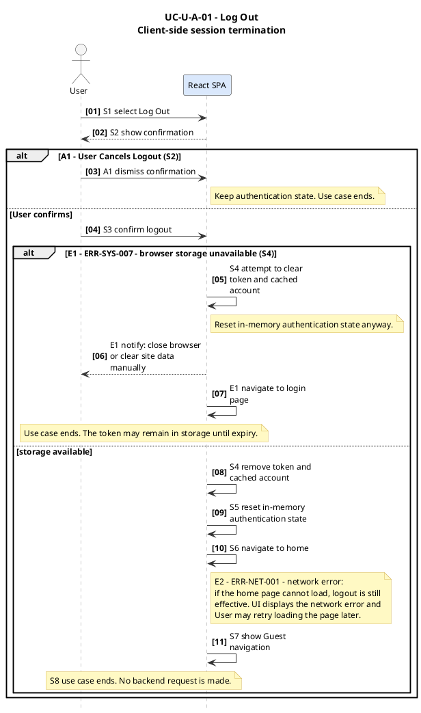

# Sequence Diagram - UC-U-A-01 - Log Out

| Field | Value |
|-------|-------|
| Sequence Diagram ID | SD-UC-U-A-01 |
| Use Case | UC-U-A-01 - Log Out |
| Use Case Specification | [UC-U-A-01-LogOut.md](../../../../RequirementAnalysis/UCSpec/User/AccountAuthentication/UC-U-A-01-LogOut.md) |
| Primary Actor(s) | User, Administrator (through inheritance) |
| Related Requirements | FR-AUTH-03, NFR-SEC-02, NFR-SEC-10 |
| Scope | Main flow, A1-A3, E1-E2 |
| Version | 1.0 |
| Status | Draft |
| Last updated | 2026-11-14 |

## 1. Scope

This diagram covers client-side logout. Arbiter uses stateless JWTs, so logout performs no backend request and terminates no server-side session.

A2 (token already expired) and A3 (multiple browsers) reuse the same client-side clearing path and are dispositioned below. E2 (network error while loading the home page) is client-only and is shown as a note. The discarded token remains technically valid until expiry.

## 2. Scenario Coverage

| Flow | Coverage | Diagram element / disposition |
|------|----------|-------------------------------|
| Main | S1-S8 | Entire diagram; S8 end state is stated in the final note |
| A1 | A1 | `alt A1` at S2 |
| A2 | - | Token already expired; same client-side clearing path; no new interaction |
| A3 | - | Multiple browsers; only the current browser's token is removed; no new interaction |
| E1 | E1 | Nested `alt E1` at S4 |
| E2 | - | Client-only note at UI; logout remains effective |

## 3. Diagram

## 4. Notes

- Logout is idempotent and does not contact the backend.
- The UI clears both the access token and cached account information.
- The discarded token remains technically valid until expiry; password change and account disabling are the revocation mechanisms.
- No password, token, or account data appears in the diagram.

## 5. Change History

| Version | Date | Change |
|---------|------|--------|
| 1.0 | 2026-11-14 | Initial diagram. |
