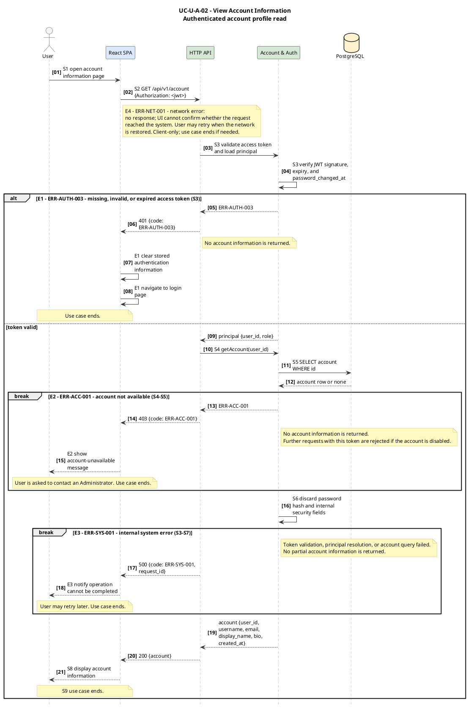

# Sequence Diagram - UC-U-A-02 - View Account Information

| Field | Value |
|-------|-------|
| Sequence Diagram ID | SD-UC-U-A-02 |
| Use Case | UC-U-A-02 - View Account Information |
| Use Case Specification | [UC-U-A-02-ViewAccountInformation.md](../../../../RequirementAnalysis/UCSpec/User/AccountAuthentication/UC-U-A-02-ViewAccountInformation.md) |
| Primary Actor(s) | User, Administrator (through inheritance) |
| Related Requirements | FR-AUTH-04, FR-AUTH-05, NFR-SEC-03, NFR-SEC-10 |
| Scope | Main flow, A1, E1-E4 |
| Version | 1.0 |
| Status | Draft |
| Last updated | 2026-11-14 |

## 1. Scope

This diagram covers viewing the authenticated user's own account information: token validation, principal resolution, the account query, removal of sensitive internal fields, and the response.

The operation is read-only and scoped to the authenticated account. A1 (reload) reuses the same request path. Passwords, password hashes, tokens, and internal security fields never appear in the response.

## 2. Scenario Coverage

| Flow | Coverage | Diagram element / disposition |
|------|----------|-------------------------------|
| Main | S1-S9 | Entire diagram; S9 end state is stated in the final note |
| A1 | - | Reuses S2-S8 with the same request; no new interaction |
| E1 | E1 | `alt E1` at S3 |
| E2 | E2 | `break E2` at S4-S5 |
| E3 | E3 | `break E3` at S3-S7 |
| E4 | - | Client-only note at UI during the request/response |

## 3. Diagram

## 4. Notes

- The response contains only the account owner's profile fields; it never includes the password hash, access token, or internal security fields.
- The backend determines the account from the token; the client does not supply an account identifier.
- The operation is read-only.
- A1 reloads the same data through the same path.

## 5. Change History

| Version | Date | Change |
|---------|------|--------|
| 1.0 | 2026-11-14 | Initial diagram. |
