# Sequence Diagram - UC-U-A-03 - Update Account Information

| Field | Value |
|-------|-------|
| Sequence Diagram ID | SD-UC-U-A-03 |
| Use Case | UC-U-A-03 - Update Account Information |
| Use Case Specification | [UC-U-A-03-UpdateAccountInformation.md](../../../../RequirementAnalysis/UCSpec/User/AccountAuthentication/UC-U-A-03-UpdateAccountInformation.md) |
| Primary Actor(s) | User, Administrator (through inheritance) |
| Related Requirements | FR-AUTH-04, FR-AUTH-06, NFR-SEC-03, NFR-SEC-10 |
| Scope | Main flow, A1-A2, E1-E6 |
| Version | 1.0 |
| Status | Draft |
| Last updated | 2026-11-14 |

## 1. Scope

This diagram covers updating the authenticated user's editable profile fields: display name, bio, and email. Username is immutable and is displayed read-only.

A1 (cancel) is UI-only. A2 (partial update) uses the same request path with only the submitted fields. The update is atomic and scoped to the authenticated account. No password field is part of this flow.

## 2. Scenario Coverage

| Flow | Coverage | Diagram element / disposition |
|------|----------|-------------------------------|
| Main | S1-S13 | Entire diagram; S13 end state is stated in the final note |
| A1 | - | UI-only cancel at S4-S5; unsaved changes are discarded |
| A2 | - | Same request path; the payload contains only the submitted fields |
| E1 | E1 | `alt E1` at S6 |
| E2 | E2 | `alt E2` at S7 |
| E3 | E3 | `alt E3` at S8 |
| E4 | E4 | `break E4` at S6-S8 |
| E5 | E5 | `break E5` at S8-S10 |
| E6 | - | Client-only note at UI during the request/response |

## 3. Diagram

```plantuml
@startuml SD-UC-U-A-03
title UC-U-A-03 - Update Account Information\nAtomic update of display name, bio, and email
hide footbox
autonumber "<b>[00]"
skinparam shadowing false
skinparam responseMessageBelowArrow true
skinparam maxMessageSize 140
skinparam defaultFontName "Helvetica"
skinparam defaultFontSize 12
skinparam ParticipantPadding 12
skinparam BoxPadding 8
skinparam NoteBackgroundColor #FFF9C4
skinparam NoteBorderColor #D6B656
skinparam sequence {
  ArrowColor #333333
  ActorBorderColor #333333
  LifeLineBorderColor #999999
  LifeLineBackgroundColor #FFFFFF
}

actor "User" as User #F5F5F5
participant "React SPA" as UI #DAE8FC
participant "HTTP API" as API #D5E8D4
participant "Account & Auth" as AUTH #D5E8D4
database "PostgreSQL" as DB #FFF2CC

UI -> UI : S1 display current account information
User -> UI : S2 select update information
UI --> User : S3 display update form, username read-only
User -> UI : S4 update one or more editable fields
User -> UI : S5 submit update form
UI -> API : S5 PATCH /api/v1/account {display_name?, bio?, email?}
note right of UI
  E6 - ERR-NET-001 - network error:
  no response; UI cannot confirm whether the update
  succeeded. User may reload the account information
  to check the current state. Client-only.
end note
API -> AUTH : S6 validate access token and determine account
AUTH -> AUTH : S6 verify JWT signature, expiry, and password_changed_at
alt E1 - ERR-AUTH-003 - missing, invalid, or expired access token (S6)
  AUTH --> API : ERR-AUTH-003
  API --> UI : 401 {code: ERR-AUTH-003}
  note right of AUTH : No account data is changed.
  UI -> UI : E1 preserve unsaved form data in browser session
  UI -> UI : E1 clear authentication information and navigate to login
  note over User, UI : After re-login, UI restores the form; continues at S6 if resubmitted, otherwise ends.
end
AUTH --> API : principal {user_id, role}
break E4 - ERR-ACC-001 - account not available (S6-S8)
  AUTH --> API : ERR-ACC-001
  API --> UI : 403 {code: ERR-ACC-001}
  note right of AUTH : No account data is changed.
  UI --> User : E4 notify account information cannot be updated
  note over User, UI : User is asked to contact an Administrator. Use case ends.
end
API -> AUTH : S7-S8 updateAccount(user_id, submitted_fields)
AUTH -> AUTH : S7 validate format, length, and required fields
alt E2 - ERR-VAL-012 - invalid account information (S7)
  AUTH --> API : ERR-VAL-012 {invalid_fields}
  API --> UI : 400 {code: ERR-VAL-012, details: invalid_fields}
  note right of AUTH : No account data is changed.
  UI --> User : E2 show field-level errors
  User -> UI : E2 edit data and resubmit
  note over User, UI : Continues at S6.
else format valid
  AUTH -> DB : S8 SELECT account WHERE email AND id <> user_id
  DB --> AUTH : matching account or none
  alt E3 - ERR-ACC-002 - account identifier already exists (S8)
    AUTH --> API : ERR-ACC-002 {conflicting_field}
    API --> UI : 409 {code: ERR-ACC-002, details: conflicting_field}
    note right of AUTH : No account data is changed.
    UI --> User : E3 ask User to choose a different email
    User -> UI : E3 edit data and resubmit
    note over User, UI : Continues at S6.
  else data valid
    AUTH -> DB : S9 UPDATE account SET submitted fields (tx)
    break E5 - ERR-SYS-001 - internal system error (S8-S10)
      AUTH -> AUTH : E5 roll back transaction
      note right of AUTH : No partial update is persisted.
      AUTH --> API : ERR-SYS-001 {request_id}
      API --> UI : 500 {code: ERR-SYS-001, request_id}
      UI --> User : E5 notify operation cannot be completed
      note over User, UI : User may retry later. Use case ends.
    end
    DB --> AUTH : updated account
    AUTH --> API : 200 {account}
    API --> UI : 200 {account}
    UI -> UI : S11 update displayed information
    UI --> User : S12 notify update succeeded
    note over User, UI : S13 use case ends.
  end
end
@enduml
```

## 4. Notes

- Username is immutable in v1 and is not part of the update payload.
- Email uniqueness is checked with the account itself excluded, then enforced again by the database.
- The whole update is applied in one transaction; a failure leaves the previous values unchanged.
- A1 and A2 are UI input variations; neither changes the server interaction pattern.
- The access token is shown as `<jwt>`; no token value appears.

## 5. Change History

| Version | Date | Change |
|---------|------|--------|
| 1.0 | 2026-11-14 | Initial diagram. |
