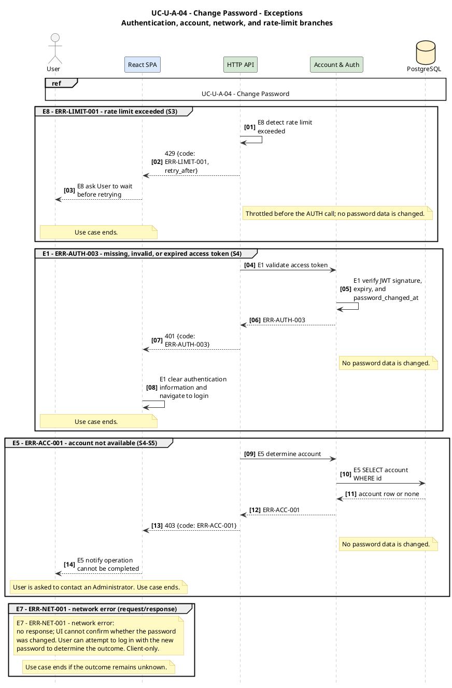

# Sequence Diagram - UC-U-A-04 - Change Password - Exceptions

| Field | Value |
|-------|-------|
| Sequence Diagram ID | SD-UC-U-A-04-X |
| Use Case | UC-U-A-04 - Change Password |
| Use Case Specification | [UC-U-A-04-ChangePassword.md](../../../../RequirementAnalysis/UCSpec/User/AccountAuthentication/UC-U-A-04-ChangePassword.md) |
| Primary Actor(s) | User |
| Related Requirements | FR-AUTH-04, FR-AUTH-08, FR-AUTH-09, FR-AUTH-12, NFR-SEC-01, NFR-SEC-02, NFR-SEC-10, NFR-SEC-11 |
| Scope | E1, E5, E7, E8 |
| Version | 1.0 |
| Status | Draft |
| Last updated | 2026-11-14 |

## 1. Scope

This supplement covers the authentication, account-availability, network, and rate-limit exceptions that are dispositioned out of the [primary diagram](SD-UC-U-A-04-ChangePassword.md). The primary diagram retains the main flow, A1, E2-E4, and E6.

The supplement starts its own numbering at 1 and begins with a `ref` to the use case it continues.

## 2. Scenario Coverage

| Flow | Coverage | Diagram element / disposition |
|------|----------|-------------------------------|
| E1 | E1 | `group E1` |
| E5 | E5 | `group E5` |
| E7 | E7 | `group E7`; client-only note at UI |
| E8 | E8 | `group E8` |

## 3. Diagram

## 4. Notes

- This supplement exists because the primary diagram would otherwise carry more than six exception flows.
- E2 (incorrect current password), E3 (invalid new password), E4 (new password equals current password), and E6 (internal error) remain in the primary diagram.
- The supplement contains no password value, password hash, or token value.

## 5. Change History

| Version | Date | Change |
|---------|------|--------|
| 1.0 | 2026-11-14 | Initial exception supplement. |
