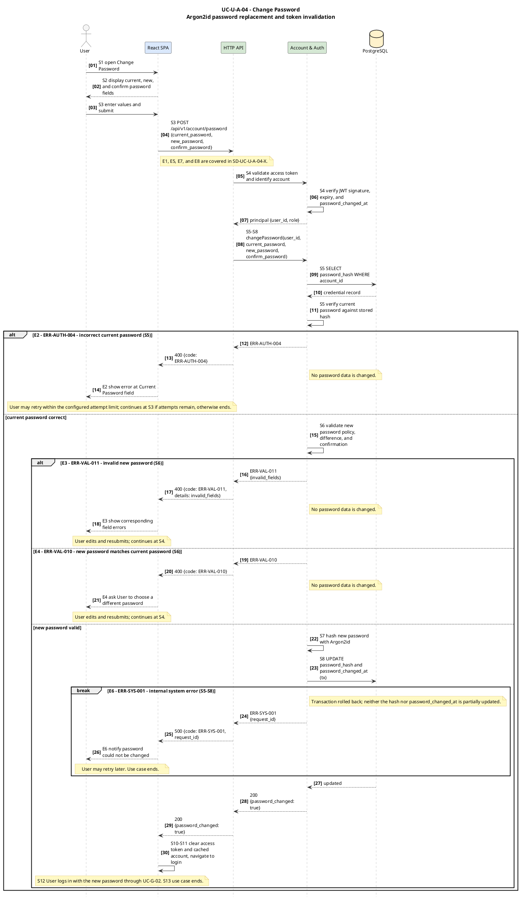

# Sequence Diagram - UC-U-A-04 - Change Password

| Field | Value |
|-------|-------|
| Sequence Diagram ID | SD-UC-U-A-04 |
| Use Case | UC-U-A-04 - Change Password |
| Use Case Specification | [UC-U-A-04-ChangePassword.md](../../../../RequirementAnalysis/UCSpec/User/AccountAuthentication/UC-U-A-04-ChangePassword.md) |
| Primary Actor(s) | User |
| Related Requirements | FR-AUTH-04, FR-AUTH-08, FR-AUTH-09, FR-AUTH-12, NFR-SEC-01, NFR-SEC-02, NFR-SEC-10, NFR-SEC-11 |
| Scope | Main flow, A1, E2-E4, E6; E1, E5, E7, E8 in `SD-UC-U-A-04-X` |
| Version | 1.0 |
| Status | Draft |
| Last updated | 2026-11-14 |

## 1. Scope

This diagram covers changing the authenticated user's password: current-password verification, new-password policy checks, Argon2id hashing, the atomic hash and `password_changed_at` update, and client-side token clearing.

A1 (cancel) is UI-only. The password hash and password-change timestamp are updated in one transaction, and every previously issued token becomes invalid on its next use.

E1 (invalid token), E5 (account not available), E7 (network error), and E8 (rate limit) are covered in the [exception supplement](SD-UC-U-A-04-ChangePassword-Exceptions.md) so that this primary diagram stays within the exception-flow threshold.

## 2. Scenario Coverage

| Flow | Coverage | Diagram element / disposition |
|------|----------|-------------------------------|
| Main | S1-S13 | Entire diagram; S13 end state is stated in the final note |
| A1 | - | UI-only cancel at S3; entered values are discarded |
| E1 | E1 | Covered in [SD-UC-U-A-04-X](SD-UC-U-A-04-ChangePassword-Exceptions.md) |
| E2 | E2 | `alt E2` at S5 |
| E3 | E3 | `alt E3` at S6 |
| E4 | E4 | `alt E4` at S6 |
| E5 | E5 | Covered in [SD-UC-U-A-04-X](SD-UC-U-A-04-ChangePassword-Exceptions.md) |
| E6 | E6 | `break E6` at S5-S8 |
| E7 | - | Covered in [SD-UC-U-A-04-X](SD-UC-U-A-04-ChangePassword-Exceptions.md) as a client-only note |
| E8 | E8 | Covered in [SD-UC-U-A-04-X](SD-UC-U-A-04-ChangePassword-Exceptions.md) |

## 3. Diagram

## 4. Notes

- The current password is verified against the stored Argon2id hash; no password value or hash appears in the diagram.
- The new hash and `password_changed_at` update in one transaction; a failure leaves both unchanged.
- A successful change invalidates every previously issued token on its next use.
- The UI clears the stored token and cached account information after success.
- E1, E5, E7, and E8 are covered in `SD-UC-U-A-04-X`; rate limiting is enforced at `API` with no separate limiter lifeline.

## 5. Change History

| Version | Date | Change |
|---------|------|--------|
| 1.0 | 2026-11-14 | Initial diagram. E1, E5, E7, and E8 are covered by `SD-UC-U-A-04-X`. |
