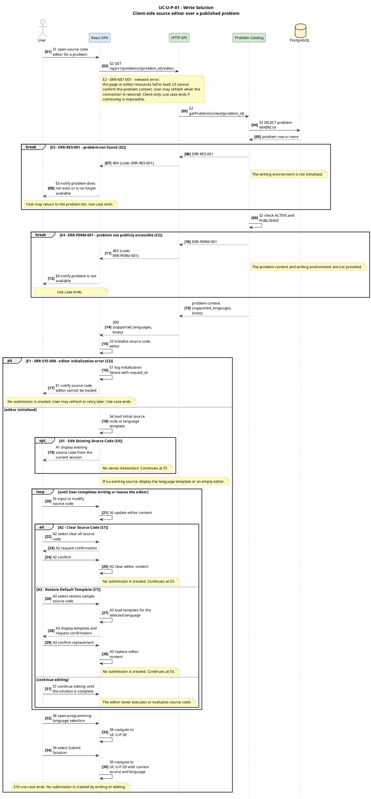

# Sequence Diagram - UC-U-P-01 - Write Solution

| Field | Value |
|-------|-------|
| Sequence Diagram ID | SD-UC-U-P-01 |
| Use Case | UC-U-P-01 - Write Solution |
| Use Case Specification | [UC-U-P-01-WriteSolution.md](../../../../RequirementAnalysis/UCSpec/User/ProblemPractice/UC-U-P-01-WriteSolution.md) |
| Primary Actor(s) | User, Administrator (through inheritance) |
| Related Requirements | FR-SUB-01, NFR-SEC-06, NFR-SEC-10 |
| Scope | Main flow, A1-A3, E1-E4 |
| Version | 1.0 |
| Status | Draft |
| Last updated | 2026-11-14 |

## 1. Scope

This diagram covers opening the source-code editor for a published problem, loading the public problem context, initializing the editor, editing, clearing, and restoring a template. It ends with the UI-only handoffs to UC-U-P-02 - Select Programming Language and UC-U-P-03 - Submit Solution.

The editor and all editing actions are client-side. The only server interaction is the read that confirms the problem exists and is publicly accessible. No submission, outbox event, or queue message is created. The editor context is a public problem read; authentication is enforced when the source is submitted in UC-U-P-03, so no `AUTH` guard appears here.

A1-A3 are client-side variants and are drawn where they change the editing sequence. E1 (editor initialization) and E2 (network) are client-only and are shown at `UI`. E3 and E4 are terminal early exits at the problem lookup.

## 2. Scenario Coverage

| Flow | Coverage | Diagram element / disposition |
|------|----------|-------------------------------|
| Main | S1-S10 | Entire diagram; S10 end state is stated in the final note |
| A1 | A1 | `opt A1` at S4 |
| A2 | A2 | `alt A2` at S7 |
| A3 | A3 | `else A3` at S7 |
| E1 | E1 | `alt E1` at S3 |
| E2 | - | Client-only note at UI during page and editor-resource loading |
| E3 | E3 | `break E3` at S2 |
| E4 | E4 | `break E4` at S2 |

## 3. Diagram

## 4. Notes

- Writing and editing never create a submission; the source remains in the browser session until UC-U-P-03 submits it.
- An Administrator inherits the User behavior; only `User` is drawn.
- The editor is a client-side component and never executes or evaluates the source. Source code is never written to logs.
- The problem context is a public read. Only `ACTIVE` and `PUBLISHED` problems are opened, and hidden test data is not returned.
- The `/editor` endpoint is an architectural placeholder until the REST API specification is approved.
- A1-A3 are session-local actions. The server interaction is limited to the initial problem lookup.

## 5. Change History

| Version | Date | Change |
|---------|------|--------|
| 1.0 | 2026-11-14 | Initial diagram. |
