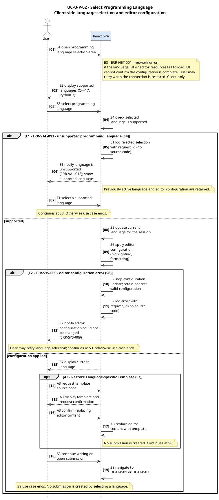

# Sequence Diagram - UC-U-P-02 - Select Programming Language

| Field | Value |
|-------|-------|
| Sequence Diagram ID | SD-UC-U-P-02 |
| Use Case | UC-U-P-02 - Select Programming Language |
| Use Case Specification | [UC-U-P-02-SelectProgrammingLanguage.md](../../../../RequirementAnalysis/UCSpec/User/ProblemPractice/UC-U-P-02-SelectProgrammingLanguage.md) |
| Primary Actor(s) | User, Administrator (through inheritance) |
| Related Requirements | FR-SUB-02, FR-SUB-03 |
| Scope | Main flow, A1-A3, E1-E3 |
| Version | 1.0 |
| Status | Draft |
| Last updated | 2026-11-14 |

## 1. Scope

This diagram covers client-side selection of a supported programming language (C++17 or Python 3), validation against the supported list, session state update, editor reconfiguration, and the template restore action.

No backend request is made. The language list and editor resources are client-side assets, so the diagram declares only `User` and `UI`. Selecting a language never creates a submission and never modifies problem or account data.

A1 (change language) reuses the same S3-S7 path. A2 (re-select the active language) ends without a state change and is dispositioned below. E1 and E2 are client-side validation and configuration failures; E3 is a client-only network note.

## 2. Scenario Coverage

| Flow | Coverage | Diagram element / disposition |
|------|----------|-------------------------------|
| Main | S1-S9 | Entire diagram; S9 end state is stated in the final note |
| A1 | - | Same path as S3-S7; only the selected value changes; no new interaction |
| A2 | - | UI-only; the active language is unchanged and the use case ends without change |
| A3 | A3 | `opt A3` at S7 |
| E1 | E1 | `alt E1` at S4 |
| E2 | E2 | `alt E2` at S6 |
| E3 | - | Client-only note at UI during language-list and editor-resource loading |

## 3. Diagram

## 4. Notes

- The supported list is fixed for the session: C++17 and Python 3 only.
- An Administrator inherits the User behavior; only `User` is drawn.
- The language is session state; it is not persisted until UC-U-P-03 submits a solution.
- A1 and A2 are client-side state variations. A2 in particular ends with the previous language and editor configuration unchanged.
- The editor never executes or evaluates the selected language's source, and no source code is written to logs.
- No backend request is made in this use case.

## 5. Change History

| Version | Date | Change |
|---------|------|--------|
| 1.0 | 2026-11-14 | Initial diagram. |
