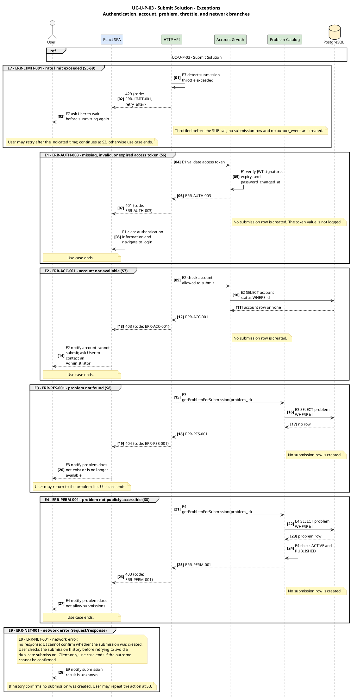

# Sequence Diagram - UC-U-P-03 - Submit Solution - Exceptions

| Field | Value |
|-------|-------|
| Sequence Diagram ID | SD-UC-U-P-03-X |
| Use Case | UC-U-P-03 - Submit Solution |
| Use Case Specification | [UC-U-P-03-SubmitSolution.md](../../../../RequirementAnalysis/UCSpec/User/ProblemPractice/UC-U-P-03-SubmitSolution.md) |
| Primary Actor(s) | User, Administrator (through inheritance) |
| Related Requirements | FR-SUB-04, FR-SUB-05, FR-JUDGE-01, FR-JUDGE-15, NFR-REL-02, NFR-SEC-03, NFR-SEC-10 |
| Scope | E1-E4, E7, E9 |
| Version | 1.0 |
| Status | Draft |
| Last updated | 2026-11-14 |

## 1. Scope

This supplement covers the submission exceptions that are dispositioned out of the [primary diagram](SD-UC-U-P-03-SubmitSolution.md): authentication, account availability, problem lookup and visibility, throttling, and the client-only network branch.

The primary diagram retains the main flow, A1-A2, E5, E6, and E8.

Each group below is an independent terminal branch. `group` is used instead of nested `break` fragments so the supplement reads as an exception catalogue; every branch states its data outcome and end state.

## 2. Scenario Coverage

Flows not listed in this table are covered by the primary diagram.

| Flow | Coverage | Diagram element / disposition |
|------|----------|-------------------------------|
| E1 | E1 | `group E1` at S6 |
| E2 | E2 | `group E2` at S7 |
| E3 | E3 | `group E3` at S8 |
| E4 | E4 | `group E4` at S8 |
| E7 | E7 | `group E7` at S5-S9 |
| E9 | E9 | `group E9`; client-only note at UI |

## 3. Diagram

## 4. Notes

- E7 is enforced at `API` before the `SUB` call. The throttle is one submission per User per five seconds; the response includes `retry_after`.
- An Administrator inherits the User behavior; only `User` is drawn.
- E1, E2, E3, and E4 all leave no submission row and no outbox event. `AUTH` owns the token and account checks; `PROB` owns problem existence and visibility.
- E9 is client-side. The UI cannot determine whether the request reached the server, so the User checks submission history before retrying to avoid a duplicate.
- Hidden test data, source content, token values, and queue internals do not appear in this supplement.
- E5, E6, and E8 remain in the primary diagram.

## 5. Change History

| Version | Date | Change |
|---------|------|--------|
| 1.0 | 2026-11-14 | Initial exception supplement. |
