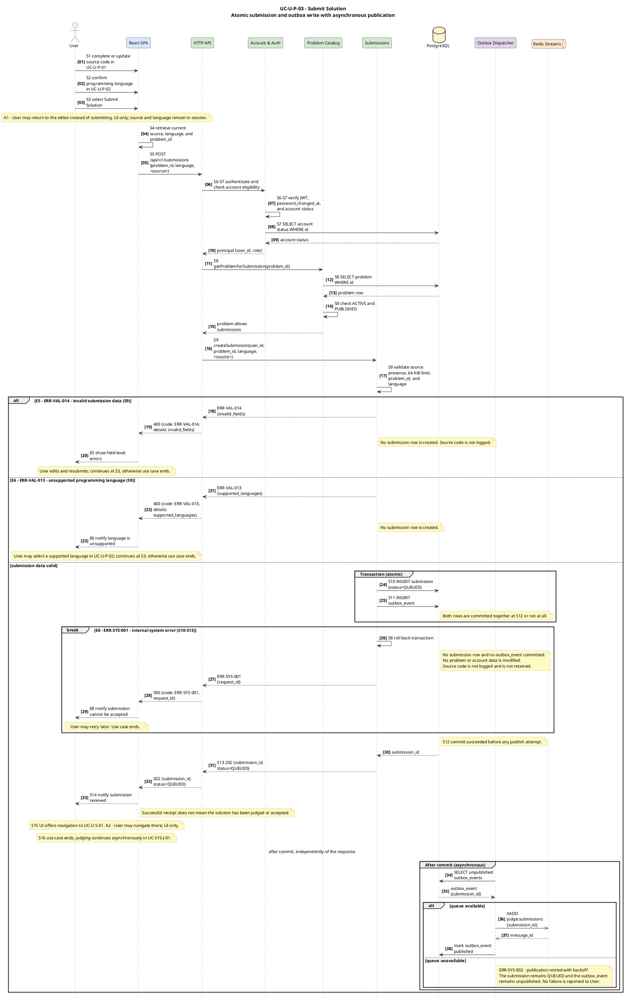

# Sequence Diagram - UC-U-P-03 - Submit Solution

| Field | Value |
|-------|-------|
| Sequence Diagram ID | SD-UC-U-P-03 |
| Use Case | UC-U-P-03 - Submit Solution |
| Use Case Specification | [UC-U-P-03-SubmitSolution.md](../../../../RequirementAnalysis/UCSpec/User/ProblemPractice/UC-U-P-03-SubmitSolution.md) |
| Primary Actor(s) | User, Administrator (through inheritance) |
| Related Requirements | FR-SUB-04, FR-SUB-05, FR-SUB-06, FR-SUB-07, FR-JUDGE-01, FR-JUDGE-02, FR-JUDGE-15, NFR-PERF-02, NFR-REL-02, NFR-SEC-03, NFR-SEC-10 |
| Scope | Main flow, A1-A2, E5-E6, E8; E1-E4, E7, E9 in SD-UC-U-P-03-X |
| Version | 1.0 |
| Status | Draft |
| Last updated | 2026-11-14 |

## 1. Scope

This diagram covers the synchronous acceptance of a submission: authentication and account eligibility, problem eligibility, submission validation, the atomic submission plus outbox-event transaction, the `202 QUEUED` response, and the asynchronous publication phase.

The outbox event is inserted in the same transaction as the submission. Publication happens only after the commit and never rolls back a committed submission. The worker handoff is delegated to UC-SYS-J-01 - Process Submission; no compile or execution step is drawn here.

E5, E6, and E8 are retained in the primary diagram. The authentication, account, problem, throttle, and network branches are in [SD-UC-U-P-03-X](SD-UC-U-P-03-SubmitSolution-Exceptions.md).

## 2. Scenario Coverage

| Flow | Coverage | Diagram element / disposition |
|------|----------|-------------------------------|
| Main | S1-S16 | Entire diagram; S16 end state is stated in the final note |
| A1 | - | UI-only at S3; the session keeps the current source and language |
| A2 | - | UI-only at S15; navigate to UC-U-S-01 |
| E1 | - | `SD-UC-U-P-03-X` `group E1` at S6 |
| E2 | - | `SD-UC-U-P-03-X` `group E2` at S7 |
| E3 | - | `SD-UC-U-P-03-X` `group E3` at S8 |
| E4 | - | `SD-UC-U-P-03-X` `group E4` at S8 |
| E5 | E5 | `alt E5` at S9 |
| E6 | E6 | `else E6` at S9 |
| E7 | - | `SD-UC-U-P-03-X` `group E7` at S5-S9 |
| E8 | E8 | `break E8` at S10-S13 |
| E9 | - | `SD-UC-U-P-03-X` `group E9`; client-only note at UI |

## 3. Diagram

## 4. Notes

- The submission row and its outbox event are one atomic unit. A commit failure leaves neither row persisted; a queue failure leaves both rows durable and only delays publication.
- An Administrator inherits the User behavior; only `User` is drawn.
- The `202` response is returned from the committed submission and does not wait for the queue. A successful response means `QUEUED`, not judged or accepted.
- `OUTBOX` reads the committed event from `DB` and publishes to the `judge:submissions` stream. The dispatcher runs inside the API process but is drawn separately because publication is a distinct asynchronous phase.
- If `QUEUE` is unavailable, the dispatcher retries with backoff, the submission stays `QUEUED`, and no failure is shown to the User. `ERR-SYS-002` is internal and does not roll back the submission.
- The `SUB -> DB` transaction is the only write in the synchronous path. Worker compilation, execution, and test-case evaluation belong to UC-SYS-J-01.
- The `After commit (asynchronous)` group is shown after the S16 end state for completeness. It is not a user interaction step and does not delay the response.
- The access token is shown only as a guard call; no token value, password, source content, hidden test data, or queue internals appear.
- Authentication and account failures (E1, E2), problem failures (E3, E4), throttling (E7), and the client-side network branch (E9) are in `SD-UC-U-P-03-X`.

## 5. Change History

| Version | Date | Change |
|---------|------|--------|
| 1.0 | 2026-11-14 | Initial diagram. |
