# Sequence Diagram - UC-U-ST-01 - View Own Statistics

| Field | Value |
|-------|-------|
| Sequence Diagram ID | SD-UC-U-ST-01 |
| Use Case | UC-U-ST-01 - View Own Statistics |
| Use Case Specification | [UC-U-ST-01-ViewOwnStatistics.md](../../../../RequirementAnalysis/UCSpec/User/Progress/UC-U-ST-01-ViewOwnStatistics.md) |
| Primary Actor(s) | User, Administrator (through inheritance) |
| Related Requirements | FR-AUTH-04, FR-AUTH-09, FR-PROG-01, NFR-SEC-04 |
| Scope | Main flow S1-S10, A1-A3, E1-E5 |
| Version | 1.0 |
| Status | Draft |
| Last updated | 2026-11-14 |

## 1. Scope

This diagram covers the authenticated read of the current User's overall progress, difficulty and tag breakdowns, and ten most recent submissions. Progress & Leaderboard runs a read-only aggregate query; no submission, problem, or account data changes.

## 2. Scenario Coverage

| Flow | Coverage | Diagram element / disposition |
|------|----------|-------------------------------|
| Main | S1-S10 | Entire diagram |
| A1 | A1 | `alt A1` when there are no submissions |
| A2 | A2 | `opt A2` on a subsequent request; recalculates through S2-S9 |
| A3 | A3 | `opt A3` delegates selected submission to its result or details use case |
| E1 | E1 | `alt E1` at S3 |
| E2 | E2 | `break E2` at S3 |
| E3 | E3 | `break E3` at S4-S7 |
| E4 | E4 | Client-only network note |
| E5 | E5 | `break E5` before calculation |

## 3. Diagram

```plantuml
@startuml SD-UC-U-ST-01
title UC-U-ST-01 - View Own Statistics\nAuthenticated read-only progress calculation
hide footbox
autonumber "<b>[00]"
skinparam shadowing false
skinparam responseMessageBelowArrow true
skinparam maxMessageSize 140
skinparam defaultFontName "Helvetica"
skinparam defaultFontSize 12
skinparam ParticipantPadding 12
skinparam BoxPadding 8
skinparam NoteBackgroundColor #FFF9C4
skinparam NoteBorderColor #D6B656
skinparam sequence {
  ArrowColor #333333
  ActorBorderColor #333333
  LifeLineBorderColor #999999
  LifeLineBackgroundColor #FFFFFF
}

actor "User" as User #F5F5F5
participant "React SPA" as UI #DAE8FC
participant "HTTP API" as API #D5E8D4
participant "Account & Auth" as AUTH #D5E8D4
participant "Progress & Leaderboard" as STATS #D5E8D4
database "PostgreSQL" as DB #FFF2CC

User -> UI : S1 open profile or progress page
UI -> API : S2 GET /api/v1/users/me/statistics
note right of UI
  E4 - ERR-NET-001 - network error:
  no definitive response; UI does not show partial or stale data as complete.
  User may retry when the connection is restored.
end note
break E5 - ERR-LIMIT-001 - rate limit exceeded (S2)
  API --> UI : 429 {code: ERR-LIMIT-001, retry_after}
  UI --> User : E5 ask User to wait before trying again
  note right of API : No statistics are read or returned.
  note over User, UI : Current request ends.
end
API -> AUTH : S3 validate access token and load principal
break E1 - ERR-AUTH-003 - missing, invalid, or expired access token (S3)
  AUTH --> API : ERR-AUTH-003
  API --> UI : 401 {code: ERR-AUTH-003}
  UI -> UI : E1 clear stored authentication information and navigate to login
  note right of AUTH : No statistics are read or returned. Log request_id only; never log the token.
  note over User, UI : Use case ends.
end
AUTH --> API : principal {user_id, role}
API -> AUTH : S3 confirm account is active
AUTH -> DB : S3 SELECT account status WHERE id
DB --> AUTH : account status
break E2 - ERR-ACC-001 - account not available (S3)
  AUTH --> API : ERR-ACC-001
  API --> UI : 403 {code: ERR-ACC-001}
  UI --> User : E2 notify statistics are unavailable
  note right of AUTH : No statistics are read or returned. Log request_id and account identifier.
  note over User, UI : Use case ends.
end
AUTH --> API : account active
API -> STATS : S4 getOwnStatistics(principal.user_id)
STATS -> DB : S4-S7 read submissions and non-archived problem metadata\n(read-only reporting query)
DB --> STATS : aggregate inputs and recent submission rows
break E3 - ERR-SYS-001 - internal system error (S4-S7)
  STATS --> API : ERR-SYS-001 {request_id}
  API --> UI : 500 {code: ERR-SYS-001, request_id}
  UI --> User : E3 notify statistics cannot be loaded
  note right of STATS : Do not return a partial result as complete. Log error and request_id; no data is changed.
  note over User, UI : User may retry later; current request ends.
end
STATS -> STATS : S4-S6 calculate distinct attempted/solved problems,\nacceptance rate, and difficulty/tag breakdowns
STATS -> STATS : S7 assemble recent 10 submissions with safe summary fields
alt A1 - user has no submissions (S4)
  STATS --> API : zero counts, acceptance rate 0, empty breakdowns and recent list
  API --> UI : 200 {zero statistics, empty lists}
  UI --> User : A1 display empty state inviting User to solve a problem
  note over User, UI : Use case ends.
else submissions exist
  STATS --> API : S8 statistics and recent submissions
  API --> UI : S8 200 {counts, breakdowns, acceptance_rate, recent_submissions}
  UI --> User : S9 display progress and recent activity
  opt A3 - User opens a completed recent submission (S9)
    User -> UI : A3 open a completed submission
    ref over User, UI : UC-U-S-02 - View Submission Result
  end
  opt A3 - User opens a non-completed recent submission (S9)
    User -> UI : A3 open a non-completed submission
    ref over User, UI : UC-U-S-04 - View Submission Details
  end
  opt A2 - User reloads or refreshes after viewing statistics (S9)
    User -> UI : A2 reload or refresh the progress page
    UI -> API : A2 GET /api/v1/users/me/statistics
    note right of API : Repeats the S3 access and account checks before recalculation.
    API -> STATS : A2 recalculate current statistics for principal.user_id
    STATS -> DB : A2 read current submission and problem aggregates
    DB --> STATS : refreshed aggregates and recent submissions
    STATS --> API : refreshed statistics
    API --> UI : 200 {counts, breakdowns, acceptance_rate, recent_submissions}
    UI --> User : A2 update displayed statistics
  end
end
note over User, UI : S10 use case ends when the progress page is left.
@enduml
```

## 4. Notes

- Attempted and solved counts are distinct non-archived problems; acceptance rate is accepted submissions divided by all submissions, or zero when there are none.
- Difficulty and tag breakdowns use the same attempted/solved rules. Unpublished but non-archived problems remain included.
- Recent activity is limited to ten submissions and contains only problem title, status or completed verdict, language, and creation time.
- The authenticated principal scopes every query. No other user's private data or hidden test-case data is returned.
- Refresh repeats authentication and calculation against current data.

## 5. Change History

| Version | Date | Change |
|---------|------|--------|
| 1.0 | 2026-11-14 | Initial diagram. |
