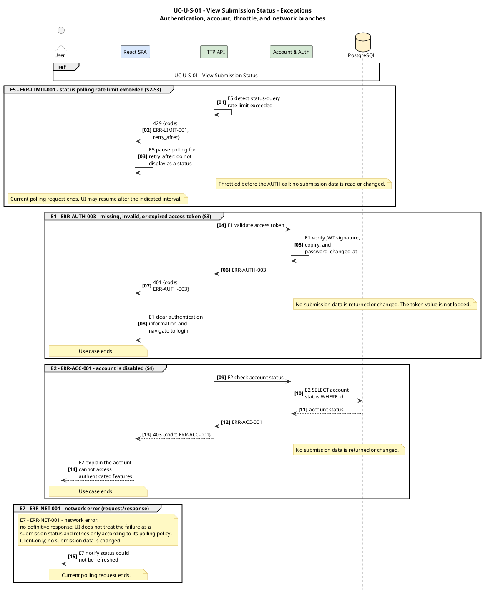

# Sequence Diagram - UC-U-S-01 - View Submission Status - Exceptions

| Field | Value |
|-------|-------|
| Sequence Diagram ID | SD-UC-U-S-01-X |
| Use Case | UC-U-S-01 - View Submission Status |
| Use Case Specification | [UC-U-S-01-ViewSubmissionStatus.md](../../../../RequirementAnalysis/UCSpec/User/SubmissionHistory/UC-U-S-01-ViewSubmissionStatus.md) |
| Primary Actor(s) | User, Administrator (through inheritance) |
| Related Requirements | FR-SUB-08, FR-SUB-11, NFR-PERF-04, NFR-PERF-06, NFR-SEC-04, NFR-USE-03 |
| Scope | E1-E2, E5, E7 |
| Version | 1.0 |
| Status | Draft |
| Last updated | 2026-11-14 |

## 1. Scope

This supplement covers the access-guard, throttle, and network exceptions dispositioned out of the [primary diagram](SD-UC-U-S-01-ViewSubmissionStatus.md). The primary retains the main flow, A1-A3, E3, E4, and E6.

Each group is an independent terminal branch for the current polling request.

## 2. Scenario Coverage

Flows not listed in this table are covered by the primary diagram.

| Flow | Coverage | Diagram element / disposition |
|------|----------|-------------------------------|
| E1 | E1 | `group E1` at S3 |
| E2 | E2 | `group E2` at S4 |
| E5 | E5 | `group E5` at S2-S3 |
| E7 | E7 | `group E7`; client-only note at UI |

## 3. Diagram

## 4. Notes

- E5 pauses polling for the server-provided `retry_after` and never renders the throttle as a submission status.
- E1 and E2 return no submission data and change no submission data.
- E7 is client-only. A failed poll is not a new status and does not change the last confirmed status.
- The supplement contains no token value, source code, hidden test data, or personal data beyond identifiers.
- E3, E4, and E6 remain in the primary diagram.

## 5. Change History

| Version | Date | Change |
|---------|------|--------|
| 1.0 | 2026-11-14 | Initial exception supplement. |
