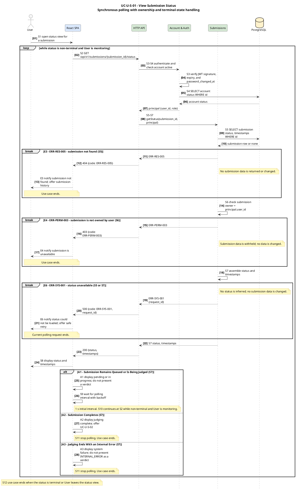

# Sequence Diagram - UC-U-S-01 - View Submission Status

| Field | Value |
|-------|-------|
| Sequence Diagram ID | SD-UC-U-S-01 |
| Use Case | UC-U-S-01 - View Submission Status |
| Use Case Specification | [UC-U-S-01-ViewSubmissionStatus.md](../../../../RequirementAnalysis/UCSpec/User/SubmissionHistory/UC-U-S-01-ViewSubmissionStatus.md) |
| Primary Actor(s) | User, Administrator (through inheritance) |
| Related Requirements | FR-SUB-08, FR-SUB-11, NFR-PERF-04, NFR-PERF-06, NFR-SEC-04, NFR-USE-03 |
| Scope | Main flow, A1-A3, E3-E4, E6; E1-E2, E5, E7 in SD-UC-U-S-01-X |
| Version | 1.0 |
| Status | Draft |
| Last updated | 2026-11-14 |

## 1. Scope

This diagram covers synchronous HTTP polling of one of the authenticated User's submissions: token and account validation, ownership check, status and timestamp retrieval, and the non-terminal, completed, and internal-error outcomes.

Polling starts with a one-second interval and backoff. It stops at `COMPLETED` or `INTERNAL_ERROR`. `INTERNAL_ERROR` is a terminal processing status and is never displayed as a verdict.

E3 (not found), E4 (not owned), and E6 (status unavailable) are retained in the primary diagram. The authentication, account, throttle, and network branches are in [SD-UC-U-S-01-X](SD-UC-U-S-01-ViewSubmissionStatus-Exceptions.md).

## 2. Scenario Coverage

| Flow | Coverage | Diagram element / disposition |
|------|----------|-------------------------------|
| Main | S1-S12 | Entire diagram; the loop and terminal states realize S9-S12 |
| A1 | A1 | `alt A1` at S7 |
| A2 | A2 | `alt A2` at S7 |
| A3 | A3 | `alt A3` at S7 |
| E1 | - | `SD-UC-U-S-01-X` `group E1` at S3 |
| E2 | - | `SD-UC-U-S-01-X` `group E2` at S4 |
| E3 | E3 | `break E3` at S5 |
| E4 | E4 | `break E4` at S6 |
| E5 | - | `SD-UC-U-S-01-X` `group E5` at S2-S3 |
| E6 | E6 | `break E6` at S5-S7 |
| E7 | - | `SD-UC-U-S-01-X` `group E7`; client-only note at UI |

## 3. Diagram

## 4. Notes

- The loop is client-initiated synchronous HTTP polling. No WebSocket, SSE, or server push is used.
- Every poll revalidates the token and account and rechecks ownership; a cached status is not treated as authoritative.
- `INTERNAL_ERROR` is a terminal status, not a verdict. It is displayed as a system failure.
- The response contains only the status and available timestamps. Hidden test data and source code are not part of this use case.
- An Administrator inherits the User behavior for their own submissions; inspecting another user's submission uses UC-AD-S-01.
- E1, E2, E5, and E7 are in `SD-UC-U-S-01-X`.

## 5. Change History

| Version | Date | Change |
|---------|------|--------|
| 1.0 | 2026-11-14 | Initial diagram. |
