# Sequence Diagram - UC-U-S-02 - View Submission Result

| Field | Value |
|-------|-------|
| Sequence Diagram ID | SD-UC-U-S-02 |
| Use Case | UC-U-S-02 - View Submission Result |
| Use Case Specification | [UC-U-S-02-ViewSubmissionResult.md](../../../../RequirementAnalysis/UCSpec/User/SubmissionHistory/UC-U-S-02-ViewSubmissionResult.md) |
| Primary Actor(s) | User, Administrator (through inheritance) |
| Related Requirements | FR-AUTH-04, FR-AUTH-09, FR-SUB-10, FR-SUB-11, FR-JUDGE-11, FR-JUDGE-12, NFR-SEC-04 |
| Scope | Main flow S1-S12, A1-A4, E1-E4, E6; E5 and E7 in SD-UC-U-S-02-X |
| Version | 1.0 |
| Status | Draft |
| Last updated | 2026-11-14 |

## 1. Scope

This diagram covers an authenticated request for one of the User's stored submission results. It shows account and ownership checks, completed-state handling, and retrieval of the stored result without hidden test inputs or expected outputs.

The queued, judging, and internal-error states return status only. E5 (rate limit) and E7 (network error) are in [SD-UC-U-S-02-X](SD-UC-U-S-02-ViewSubmissionResult-Exceptions.md).

## 2. Scenario Coverage

| Flow | Coverage | Diagram element / disposition |
|------|----------|-------------------------------|
| Main | S1-S12 | Entire diagram; S12 end state is stated in the final note |
| A1 | A1 | `alt A1` at S7 |
| A2 | A2 | `alt A2` at S7 |
| A3 | A3 | `alt A3` at S11 |
| A4 | A4 | `alt A4` at S11 |
| E1 | E1 | `alt E1` at S3 |
| E2 | E2 | `break E2` at S4 |
| E3 | E3 | `break E3` at S5 |
| E4 | E4 | `break E4` at S6 |
| E5 | - | `SD-UC-U-S-02-X`, `group E5` before authentication |
| E6 | E6 | `break E6` at S7-S9 |
| E7 | - | `SD-UC-U-S-02-X`, client-only network note |

## 3. Diagram

```plantuml
@startuml SD-UC-U-S-02
title UC-U-S-02 - View Submission Result\nStored result with completion and ownership checks
hide footbox
autonumber "<b>[00]"
skinparam shadowing false
skinparam responseMessageBelowArrow true
skinparam maxMessageSize 140
skinparam defaultFontName "Helvetica"
skinparam defaultFontSize 12
skinparam ParticipantPadding 12
skinparam BoxPadding 8
skinparam NoteBackgroundColor #FFF9C4
skinparam NoteBorderColor #D6B656
skinparam sequence {
  ArrowColor #333333
  ActorBorderColor #333333
  LifeLineBorderColor #999999
  LifeLineBackgroundColor #FFFFFF
}

actor "User" as User #F5F5F5
participant "React SPA" as UI #DAE8FC
participant "HTTP API" as API #D5E8D4
participant "Account & Auth" as AUTH #D5E8D4
participant "Submissions" as SUB #D5E8D4
database "PostgreSQL" as DB #FFF2CC

User -> UI : S1 request a submission result
UI -> API : S2 GET /api/v1/submissions/{submission_id}/result
API -> AUTH : S3 validate access token and load principal
alt E1 - ERR-AUTH-003 - missing, invalid, or expired access token (S3)
  AUTH --> API : ERR-AUTH-003
  API --> UI : 401 {code: ERR-AUTH-003}
  UI -> UI : E1 clear stored authentication information and navigate to login
  note right of AUTH : No result data is returned. Log request_id only; never log the token.
  note over User, UI : S12 use case ends.
else token valid
  AUTH --> API : principal {user_id, role}
  API -> AUTH : S4 confirm account is active
  AUTH -> DB : S4 SELECT account status WHERE id
  DB --> AUTH : account status
  break E2 - ERR-ACC-001 - account is disabled (S4)
    AUTH --> API : ERR-ACC-001
    API --> UI : 403 {code: ERR-ACC-001}
    note right of UI : E2 explain authenticated features are unavailable.
    note right of AUTH : No result data is returned. Log request_id and account identifier.
    note over User, UI : S12 use case ends.
  end
  AUTH --> API : account active
  API -> SUB : S5 getSubmission(submission_id, principal)
  SUB -> DB : S5 SELECT submission owner and status WHERE id
  DB --> SUB : submission row or none
  break E3 - ERR-RES-005 - submission not found (S5)
    SUB --> API : ERR-RES-005
    API --> UI : 404 {code: ERR-RES-005}
    note right of UI : E3 notify submission was not found and offer history.
    note right of SUB : No submission or result data is changed. Log request_id and submission_id.
    note over User, UI : S12 use case ends.
  end
  SUB -> SUB : S6 check owner = principal.user_id
  break E4 - ERR-PERM-003 - submission is not owned by user (S6)
    SUB --> API : ERR-PERM-003
    API --> UI : 403 {code: ERR-PERM-003}
    note right of UI : E4 notify submission is unavailable.
    note right of SUB : Result data is withheld. Log request_id, actor_id, and submission_id.
    note over User, UI : S12 use case ends.
  end
  SUB -> SUB : S7 inspect submission status
  alt A1 - submission is queued or being judged (S7)
    SUB --> API : current status {QUEUED, COMPILING, or RUNNING}
    API --> UI : 200 {status}
    UI --> User : A1 explain result is not ready; offer UC-U-S-01
    note over User, UI : No verdict is returned. Use case ends.
  else A2 - judging ends with an internal error (S7)
    SUB --> API : terminal status {INTERNAL_ERROR}
    API --> UI : 200 {status: INTERNAL_ERROR}
    UI --> User : A2 explain judging could not produce a trustworthy result
    note right of SUB : INTERNAL_ERROR is a status, never a verdict.
    note over User, UI : S12 use case ends.
  else completed
    SUB -> DB : S8 SELECT stored verdict, metrics, and executed-case summary WHERE submission_id
    DB --> SUB : stored result fields
    SUB -> SUB : S9 exclude hidden test inputs and expected outputs
    break E6 - ERR-SYS-001 - result data unavailable (S7-S9)
      SUB --> API : ERR-SYS-001 {request_id}
      API --> UI : 500 {code: ERR-SYS-001, request_id}
      note right of UI : E6 state result could not be loaded; offer safe retry.
      note right of SUB : Do not infer a verdict or return a partial result. Log request_id and submission_id.
      note over User, UI : Use case ends.
    end
    SUB --> API : S10 stored verdict and available result information
    API --> UI : 200 {verdict, metrics, executed_case_summary}
    UI --> User : S11 display verdict and available result information
    alt A3 - submission has a compilation error (S11)
      UI -> UI : A3 display bounded, user-safe compilation information when available
      UI --> User : A3 offer return to editor and UC-U-P-03
    else A4 - submission has a non-accepted verdict (S11)
      UI -> UI : A4 display verdict and available metrics without hidden test data
    else accepted result
      UI -> UI : display accepted verdict and available result information
    end
    note over User, UI : Use case ends.
  end
end
@enduml
```

## 4. Notes

- The result is read only after the submission is confirmed to belong to the authenticated User.
- `INTERNAL_ERROR` and non-terminal states are never returned or displayed as verdicts.
- Result summaries may describe executed cases but never include hidden test inputs or expected outputs.
- Administrator inherits the User behavior for their own submissions; another User's submission is handled by UC-AD-S-01.

## 5. Change History

| Version | Date | Change |
|---------|------|--------|
| 1.0 | 2026-11-14 | Initial diagram. |
