# Sequence Diagram - UC-U-S-03 - View Submission History

| Field | Value |
|-------|-------|
| Sequence Diagram ID | SD-UC-U-S-03 |
| Use Case | UC-U-S-03 - View Submission History |
| Use Case Specification | [UC-U-S-03-ViewSubmissionHistory.md](../../../../RequirementAnalysis/UCSpec/User/SubmissionHistory/UC-U-S-03-ViewSubmissionHistory.md) |
| Primary Actor(s) | User, Administrator (through inheritance) |
| Related Requirements | FR-AUTH-04, FR-AUTH-09, FR-SUB-09, FR-SUB-11, NFR-SEC-04 |
| Scope | Main flow S1-S11, A1-A4, E1-E6 |
| Version | 1.0 |
| Status | Draft |
| Last updated | 2026-11-14 |

## 1. Scope

This diagram covers authenticated, paginated retrieval of the current User's submission summaries, newest first. The server derives the account ID from the authenticated principal, validates pagination, and omits verdicts for non-completed submissions.

## 2. Scenario Coverage

| Flow | Coverage | Diagram element / disposition |
|------|----------|-------------------------------|
| Main | S1-S11 | Entire diagram |
| A1 | A1 | `alt A1` for an empty page |
| A2 | A2 | `opt A2` for another page; same authenticated request path |
| A3 | A3 | `opt A3` on a non-terminal row |
| A4 | A4 | `opt A4` on an internal-error row |
| E1 | E1 | `alt E1` at S3 |
| E2 | E2 | `break E2` at S4 |
| E3 | E3 | `alt E3` at S5; corrected parameters continue at S2 |
| E4 | E4 | `break E4` before authentication/history retrieval |
| E5 | E5 | `break E5` at S7-S8 |
| E6 | E6 | Client-only network note |

## 3. Diagram

```plantuml
@startuml SD-UC-U-S-03
title UC-U-S-03 - View Submission History\nAuthenticated paginated history
hide footbox
autonumber "<b>[00]"
skinparam shadowing false
skinparam responseMessageBelowArrow true
skinparam maxMessageSize 140
skinparam defaultFontName "Helvetica"
skinparam defaultFontSize 12
skinparam ParticipantPadding 12
skinparam BoxPadding 8
skinparam NoteBackgroundColor #FFF9C4
skinparam NoteBorderColor #D6B656
skinparam sequence {
  ArrowColor #333333
  ActorBorderColor #333333
  LifeLineBorderColor #999999
  LifeLineBackgroundColor #FFFFFF
}

actor "User" as User #F5F5F5
participant "React SPA" as UI #DAE8FC
participant "HTTP API" as API #D5E8D4
participant "Account & Auth" as AUTH #D5E8D4
participant "Submissions" as SUB #D5E8D4
database "PostgreSQL" as DB #FFF2CC

User -> UI : S1 open submission history
UI -> API : S2 GET /api/v1/submissions/history {page, page_size}
note right of UI
  E6 - ERR-NET-001 - network error:
  no definitive response; UI does not show an error as an empty page.
  User may safely retry when the connection is restored.
end note
API -> API : E4 detect history-query rate limit exceeded
break E4 - ERR-LIMIT-001 - history request rate limit exceeded (S2 or S3)
  API --> UI : 429 {code: ERR-LIMIT-001, retry_after}
  UI -> UI : E4 wait for retry_after before another request
  note right of UI : E4 explain when another request can be made.
  note right of API : No history data is read or changed.
  note over User, UI : Current request ends.
end
API -> AUTH : S3 validate access token and load principal
break E1 - ERR-AUTH-003 - missing, invalid, or expired access token (S3)
  AUTH --> API : ERR-AUTH-003
  API --> UI : 401 {code: ERR-AUTH-003}
  UI -> UI : E1 clear stored authentication information and navigate to login
  note right of AUTH : No history data is returned. Log request_id only; never log the token.
  note over User, UI : Use case ends.
end
AUTH --> API : principal {user_id, role}
AUTH -> DB : S4 SELECT account status WHERE id
DB --> AUTH : account status
break E2 - ERR-ACC-001 - account is disabled (S4)
  AUTH --> API : ERR-ACC-001
  API --> UI : 403 {code: ERR-ACC-001}
  note right of UI : E2 explain authenticated features are unavailable.
  note right of AUTH : No history data is returned. Log request_id and account identifier.
  note over User, UI : Use case ends.
end
AUTH --> API : account active
alt E3 - ERR-VAL-005 - invalid pagination parameters (S5)
  API --> UI : 400 {code: ERR-VAL-005, invalid_parameters}
  note right of UI : E3 display pagination error and request corrected parameters.
  User -> UI : E3 correct parameters and resubmit
  note right of API : Log request_id and invalid parameter names. Continues at S2; no history is returned.
else valid pagination
  API -> SUB : S6 getHistory(principal.user_id, page, page_size)
  SUB -> DB : S7 SELECT own submissions newest first with page information
  DB --> SUB : summary rows and page information
  break E5 - ERR-SYS-001 - history unavailable (S7-S8)
    SUB --> API : ERR-SYS-001 {request_id}
    API --> UI : 500 {code: ERR-SYS-001, request_id}
    note right of UI : E5 state history could not be loaded; offer safe retry.
    note right of SUB : Do not return an error response as an empty page. Log request_id and account_id.
    note over User, UI : Current request ends.
  end
  SUB -> SUB : S8 ensure each row is scoped to user_id and has verdict only if COMPLETED
  SUB --> API : S8 summary rows and page information
  API --> UI : 200 {items, pagination}
  alt A1 - user has no submission history (S7)
    note right of UI : A1 display no-submissions empty state; total_count=0.
    note right of UI : The empty page has total_count=0.
    note over User, UI : Use case ends.
  else history returned
    UI --> User : S9 display newest-first submission summaries
    opt A3 - a submission is queued or being judged (S9)
      note right of UI : A3 show status without a verdict.
      UI --> User : A3 offer UC-U-S-04 - View Submission Details
    end
    opt A4 - a submission has an internal error (S9)
      note right of UI : A4 show system-error status, not a verdict.
    end
    opt A2 - User navigates to another page or changes page size (S9)
      User -> UI : A2 select another page or page size
      UI -> API : A2 GET /api/v1/submissions/history {page, page_size}
      API -> AUTH : A2 revalidate token and active account
      AUTH -> DB : A2 SELECT account status WHERE id
      DB --> AUTH : account status
      AUTH --> API : A2 authenticated principal
      API -> API : A2 validate pagination parameters
      API -> SUB : A2 getHistory(principal.user_id, page, page_size)
      SUB -> DB : A2 SELECT own submissions newest first with page information
      DB --> SUB : A2 summary rows and page information
      SUB --> API : A2 summary rows and page information
      API --> UI : A2 200 {items, pagination}
      note right of UI : A2 display the selected page.
      note right of API : Applies E1-E5 again for this request; no data is changed.
    end
    opt select a submission (S10)
      User -> UI : S10 select a history row
      ref over User, UI : UC-U-S-04 - View Submission Details
    end
  end
end
note over User, UI : S11 use case ends when User leaves history.
@enduml
```

## 4. Notes

- The server derives `user_id` from the validated principal; no client-supplied account ID scopes the query.
- History rows contain summaries only. Source code and hidden test-case data are not returned.
- `INTERNAL_ERROR` is shown as a status and never as a verdict. A verdict appears only for `COMPLETED`.
- A2 retries the same authenticated and validated request path for the selected page.

## 5. Change History

| Version | Date | Change |
|---------|------|--------|
| 1.0 | 2026-11-14 | Initial diagram. |
