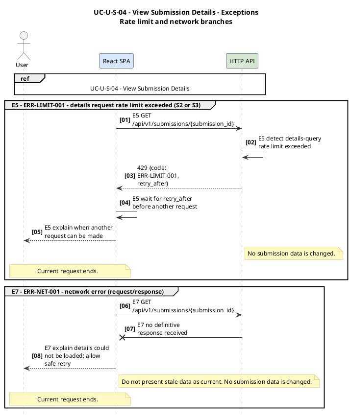

# Sequence Diagram - UC-U-S-04 - View Submission Details - Exceptions

| Field | Value |
|-------|-------|
| Sequence Diagram ID | SD-UC-U-S-04-X |
| Use Case | UC-U-S-04 - View Submission Details |
| Use Case Specification | [UC-U-S-04-ViewSubmissionDetails.md](../../../../RequirementAnalysis/UCSpec/User/SubmissionHistory/UC-U-S-04-ViewSubmissionDetails.md) |
| Primary Actor(s) | User, Administrator (through inheritance) |
| Related Requirements | FR-AUTH-04, FR-AUTH-09, FR-SUB-07, FR-SUB-10, FR-SUB-11, NFR-SEC-04 |
| Scope | E5, E7 |
| Version | 1.0 |
| Status | Draft |
| Last updated | 2026-11-14 |

## 1. Scope

This supplement covers the details-request throttle and client-side network failure; all other flows remain in the [primary diagram](SD-UC-U-S-04-ViewSubmissionDetails.md).

## 2. Scenario Coverage

Flows not listed here are covered by the primary diagram.

| Flow | Coverage | Diagram element / disposition |
|------|----------|-------------------------------|
| E5 | E5 | `group E5` before authentication |
| E7 | E7 | Client-only network note |

## 3. Diagram

## 4. Notes

- E5 is rejected before submission data is read, and the UI honors `retry_after`.
- E7 is client-side; a retry does not imply the original request succeeded.

## 5. Change History

| Version | Date | Change |
|---------|------|--------|
| 1.0 | 2026-11-14 | Initial exception supplement. |
