# Sequence Diagram - UC-U-S-04 - View Submission Details

| Field | Value |
|-------|-------|
| Sequence Diagram ID | SD-UC-U-S-04 |
| Use Case | UC-U-S-04 - View Submission Details |
| Use Case Specification | [UC-U-S-04-ViewSubmissionDetails.md](../../../../RequirementAnalysis/UCSpec/User/SubmissionHistory/UC-U-S-04-ViewSubmissionDetails.md) |
| Primary Actor(s) | User, Administrator (through inheritance) |
| Related Requirements | FR-AUTH-04, FR-AUTH-09, FR-SUB-07, FR-SUB-10, FR-SUB-11, NFR-SEC-04 |
| Scope | Main flow S1-S12, A1-A5, E1-E4, E6; E5 and E7 in SD-UC-U-S-04-X |
| Version | 1.0 |
| Status | Draft |
| Last updated | 2026-11-14 |

## 1. Scope

This diagram covers retrieval of the authenticated User's own submission details, including source code for the owner, available status/result information, and retained problem summary. It enforces account status and ownership before returning details.

E5 (rate limit) and E7 (network error) are in [SD-UC-U-S-04-X](SD-UC-U-S-04-ViewSubmissionDetails-Exceptions.md).

## 2. Scenario Coverage

| Flow | Coverage | Diagram element / disposition |
|------|----------|-------------------------------|
| Main | S1-S12 | Entire diagram |
| A1 | A1 | `alt A1` at S7 |
| A2 | A2 | `alt A2` at S7 |
| A3 | A3 | `alt A3` at S7 |
| A4 | A4 | `opt A4` at S7 |
| A5 | A5 | `opt A5` after display |
| E1 | E1 | `alt E1` at S3 |
| E2 | E2 | `break E2` at S4 |
| E3 | E3 | `break E3` at S5 |
| E4 | E4 | `break E4` at S6 |
| E5 | - | `SD-UC-U-S-04-X`, `group E5` before authentication |
| E6 | E6 | `break E6` at S5-S7 |
| E7 | - | `SD-UC-U-S-04-X`, client-only network note |

## 3. Diagram

```plantuml
@startuml SD-UC-U-S-04
title UC-U-S-04 - View Submission Details\nOwner-only read of submission details
hide footbox
autonumber "<b>[00]"
skinparam shadowing false
skinparam responseMessageBelowArrow true
skinparam maxMessageSize 140
skinparam defaultFontName "Helvetica"
skinparam defaultFontSize 12
skinparam ParticipantPadding 12
skinparam BoxPadding 8
skinparam NoteBackgroundColor #FFF9C4
skinparam NoteBorderColor #D6B656
skinparam sequence {
  ArrowColor #333333
  ActorBorderColor #333333
  LifeLineBorderColor #999999
  LifeLineBackgroundColor #FFFFFF
}

actor "User" as User #F5F5F5
participant "React SPA" as UI #DAE8FC
participant "HTTP API" as API #D5E8D4
participant "Account & Auth" as AUTH #D5E8D4
participant "Submissions" as SUB #D5E8D4
database "PostgreSQL" as DB #FFF2CC

User -> UI : S1 open submission details
UI -> API : S2 GET /api/v1/submissions/{submission_id}
API -> AUTH : S3 validate access token and load principal
alt E1 - ERR-AUTH-003 - missing, invalid, or expired access token (S3)
  AUTH --> API : ERR-AUTH-003
  API --> UI : 401 {code: ERR-AUTH-003}
  UI -> UI : E1 clear stored authentication information and navigate to login
  note right of AUTH : No details are returned. Log request_id only; never log the token.
  note over User, UI : Use case ends.
else token valid
  AUTH --> API : principal {user_id, role}
  API -> AUTH : S4 confirm account is active
  AUTH -> DB : S4 SELECT account status WHERE id
  DB --> AUTH : account status
  break E2 - ERR-ACC-001 - account is disabled (S4)
    AUTH --> API : ERR-ACC-001
    API --> UI : 403 {code: ERR-ACC-001}
    note right of UI : E2 explain authenticated features are unavailable.
    note right of AUTH : No details are returned. Log request_id and account identifier.
    note over User, UI : Use case ends.
  end
  AUTH --> API : account active
  API -> SUB : S5 getDetails(submission_id, principal)
  SUB -> DB : S5 SELECT submission, result summary, and retained problem summary WHERE id
  DB --> SUB : submission row and available details, or none
  break E3 - ERR-RES-005 - submission not found (S5)
    SUB --> API : ERR-RES-005
    API --> UI : 404 {code: ERR-RES-005}
    note right of UI : E3 notify submission was not found and offer history.
    note right of SUB : No submission data is changed. Log request_id and submission_id.
    note over User, UI : Use case ends.
  end
  SUB -> SUB : S6 check owner = principal.user_id
  break E4 - ERR-PERM-003 - submission is not owned by user (S6)
    SUB --> API : ERR-PERM-003
    API --> UI : 403 {code: ERR-PERM-003}
    note right of UI : E4 notify submission is unavailable.
    note right of SUB : Details and source code are withheld. Log request_id, actor_id, and submission_id.
    note over User, UI : Use case ends.
  end
  SUB -> SUB : S7 assemble available details for current status
  SUB -> SUB : S8 exclude hidden test inputs and expected outputs
  opt A4 - problem is no longer public (S7)
    SUB -> SUB : A4 include problem information retained with the submission
  end
  break E6 - ERR-SYS-001 - submission details unavailable (S5 or S7)
    SUB --> API : ERR-SYS-001 {request_id}
    API --> UI : 500 {code: ERR-SYS-001, request_id}
    UI --> User : E6 state details could not be loaded; offer safe retry
    note right of SUB : Do not return incomplete or untrustworthy details. Log request_id and submission_id.
    note over User, UI : Use case ends.
  end
  SUB --> API : S9 submission and available result details
  API --> UI : S9 200 {submission, problem_summary, result_summary}
  UI --> User : S10 display details in read-only mode
  alt A1 - submission is queued or being judged (S7)
    UI -> UI : A1 show source code and current status without verdict or final metrics
    UI --> User : A1 offer UC-U-S-01 - View Submission Status
  else A2 - submission has completed (S7)
    UI -> UI : A2 display stored verdict and available result summary
    UI --> User : A2 offer UC-U-S-02 - View Submission Result
  else A3 - judging ends with an internal error (S7)
    UI -> UI : A3 display terminal status without a verdict
    UI --> User : A3 explain judging could not produce a trustworthy result
  end
  alt A5 - User returns to submission history (S10)
    User -> UI : A5 request return to history
    ref over User, UI : UC-U-S-03 - View Submission History
  else User remains on details
    opt S11 - User opens status for a non-terminal submission
      User -> UI : S11 open submission status
      ref over User, UI : UC-U-S-01 - View Submission Status
    end
    opt S11 - User opens result for a completed submission
      User -> UI : S11 open submission result
      ref over User, UI : UC-U-S-02 - View Submission Result
    end
  end
  note over User, UI : S12 use case ends.
end
@enduml
```

## 4. Notes

- Only the authenticated owner receives source code. Administrator inspection of another User's submission uses UC-AD-S-01.
- Hidden test inputs and expected outputs are never returned.
- A non-terminal submission has no verdict or final metrics; `INTERNAL_ERROR` is a status, not a verdict.
- The problem summary retained with a submission remains available to its owner if the problem is unpublished or inactive.

## 5. Change History

| Version | Date | Change |
|---------|------|--------|
| 1.0 | 2026-11-14 | Initial diagram. |
