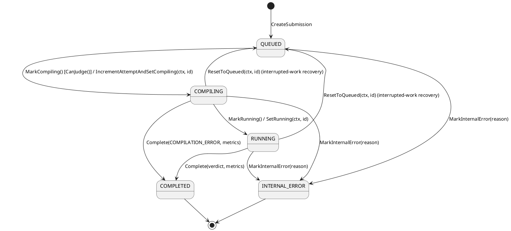

# Submission — Class Specification

| Document control | Value |
|---|---|
| Project | Arbiter — Online Judge Platform |
| Artifact | Class design specification |
| Class | `Submission` |
| Classifier kind | Class |
| Package / subsystem | `Submission Module (Go)` |
| DCD alias | `SUBSubmission` |
| Design class diagram | [DesignClassDiagram.md](../../DesignClassDiagram/DesignClassDiagram.md) |
| Ruleset | [Ruleset.md](../../Ruleset.md) |
| Status | Draft |
| Version | 0.1 |
| Date | 2026-11-16 |

## 1. Class identification

`Submission` is a class in the `Submission Module (Go)` package/subsystem of the design class diagram.

Submission aggregate root holding ownership, source, status, verdict, attempts, timestamps, and metrics.

- Declared incoming design relationships: `SubmissionCommandService`, `SubmissionQueryService`, `JudgeContext`.

## 2. Attribute design

| Name | Data type | Visibility | Scope | Default value | Description |
|------|-----------|------------|-------|---------------|-------------|
| `ID` | `SubmissionID` | Public | Instance | — | Unique identifier for the record. |
| `UserID` | `AccountID` | Public | Instance | — | Identifier of the owning user. |
| `ProblemID` | `ProblemID` | Public | Instance | — | Identifier of the owning problem. |
| `Language` | `Language` | Public | Instance | — | Submission programming language. |
| `Source` | `string` | Public | Instance | — | Submitted source code. |
| `Status` | `SubmissionStatus` | Public | Instance | — | Lifecycle state of the submission (`QUEUED`, `COMPILING`, `RUNNING`, `COMPLETED`, or `INTERNAL_ERROR`). |
| `Verdict` | `*Verdict` | Public | Instance | — | Final verdict; nil until the submission completes. |
| `JudgeAttempts` | `int` | Public | Instance | — | Attempt counter used to bound retries. |
| `CreatedAt` | `time.Time` | Public | Instance | — | Creation timestamp. |
| `StartedAt` | `*time.Time` | Public | Instance | — | Timestamp when judging started. |
| `CompletedAt` | `*time.Time` | Public | Instance | — | Timestamp when judging completed. |
| `UpdatedAt` | `time.Time` | Public | Instance | — | Last-update timestamp. |
| `RuntimeMS` | `int` | Public | Instance | — | Measured aggregate or per-test runtime in milliseconds. |
| `PeakMemoryKB` | `int` | Public | Instance | — | Measured peak memory in kilobytes. |
| `CompilationOutput` | `string` | Public | Instance | — | Compiler output or bounded diagnostic text. |
| `RetainedProblemSummary` | `string` | Public | Instance | — | Problem summary retained so history views survive problem changes. |

## 3. Operation design

| Name (signature without return type) | Return type(s) | Visibility | Scope | Description |
|--------------------------------------|-----------------|------------|-------|-------------|
| `IsTerminal()` | `bool` | Public | Instance | Derives whether `Status` is `COMPLETED` or `INTERNAL_ERROR`. |
| `CanJudge()` | `bool` | Public | Instance | Derives whether the submission may be judged from `Status` and `JudgeAttempts`. |
| `MarkCompiling()` | `error` | Public | Instance | Transitions `Status` to `COMPILING` and records `StartedAt`. |
| `MarkRunning()` | `error` | Public | Instance | Transitions `Status` to `RUNNING` and records `StartedAt` when it is not already set. |
| `Complete(verdict: Verdict, metrics: ResultMetrics)` | `error` | Public | Instance | Sets `Status` to `COMPLETED`, stores `Verdict`, copies the runtime and peak-memory values from `metrics`, and records `CompletedAt`. |
| `MarkInternalError(reason: string)` | `error` | Public | Instance | Sets `Status` to `INTERNAL_ERROR` and records `reason` using the submission's existing diagnostic fields; no dedicated reason attribute is declared. |
| `ValidateSource(maxBytes: int)` | `error` | Public | Instance | Checks that `Source` is present and does not exceed `maxBytes`. |

## 4. Parameter design

### `IsTerminal()`

This operation has no parameters.

### `CanJudge()`

This operation has no parameters.

### `MarkCompiling()`

This operation has no parameters.

### `MarkRunning()`

This operation has no parameters.

### `Complete(verdict: Verdict, metrics: ResultMetrics)`

| Name | Data type | Default value | Direction | Description |
|------|-----------|---------------|-----------|-------------|
| `verdict` | `Verdict` | — | in | Final verdict to record. |
| `metrics` | `ResultMetrics` | — | in | Aggregate runtime and peak-memory values. |

### `MarkInternalError(reason: string)`

| Name | Data type | Default value | Direction | Description |
|------|-----------|---------------|-----------|-------------|
| `reason` | `string` | — | in | Internal failure reason to record. |

### `ValidateSource(maxBytes: int)`

| Name | Data type | Default value | Direction | Description |
|------|-----------|---------------|-----------|-------------|
| `maxBytes` | `int` | — | in | Maximum accepted source size in bytes. |

## 5. Exception

| Error / outcome | Condition | Handling | Evidence |
|---|---|---|---|
| `ERR-VAL-002` | Invalid language or source configuration. | The submission is rejected before judging; no verdict is produced. | [SD-UC-SYS-J-01-ProcessSubmission](../../../../ArchitecturalDesign/SequenceDiagram/System/Judge/SD-UC-SYS-J-01-ProcessSubmission.md) |
| `ERR-VAL-014` | Invalid submission data. | The submission is rejected; no submission or outbox row is created. | [SD-UC-U-P-03-SubmitSolution](../../../../ArchitecturalDesign/SequenceDiagram/User/ProblemPractice/SD-UC-U-P-03-SubmitSolution.md) |
| `ERR-SYS-001` | Internal system, persistence, or assembly error. | The request fails with an internal error; transactions roll back where applicable. | [SD-UC-U-P-03-SubmitSolution](../../../../ArchitecturalDesign/SequenceDiagram/User/ProblemPractice/SD-UC-U-P-03-SubmitSolution.md) |
| `ERR-SYS-004` | Docker Engine or container failure. | Judging fails as an infrastructure error; no user-code verdict is inferred. | [SD-UC-SYS-J-01-ProcessSubmission-Exceptions](../../../../ArchitecturalDesign/SequenceDiagram/System/Judge/SD-UC-SYS-J-01-ProcessSubmission-Exceptions.md) |
| `ERR-CONFLICT-012` | The problem has no executable test cases. | The submission is persisted as `INTERNAL_ERROR`; no verdict is inferred. | [SD-UC-SYS-J-01-ProcessSubmission](../../../../ArchitecturalDesign/SequenceDiagram/System/Judge/SD-UC-SYS-J-01-ProcessSubmission.md) |
| `ERR-RES-002` | Required test-case data is missing or unreadable. | Judging stops and the submission is persisted as `INTERNAL_ERROR`; test-case contents are not exposed. | [SD-UC-SYS-J-01-ProcessSubmission-Exceptions](../../../../ArchitecturalDesign/SequenceDiagram/System/Judge/SD-UC-SYS-J-01-ProcessSubmission-Exceptions.md) |
| `ERR-SYS-005` | Output comparison fails unexpectedly during judging. | The submission is persisted as `INTERNAL_ERROR`; it is never recorded as `ACCEPTED`. | [SD-UC-SYS-J-01-ProcessSubmission](../../../../ArchitecturalDesign/SequenceDiagram/System/Judge/SD-UC-SYS-J-01-ProcessSubmission.md) |

## 6. Method

### `IsTerminal()`

Derives whether `Status` is `COMPLETED` or `INTERNAL_ERROR`. It has no parameters. It reads the declared attribute(s) `Status`. It returns `bool`.

### `CanJudge()`

Derives whether the submission may be judged from `Status` and `JudgeAttempts`. It has no parameters. It reads the declared attribute(s) `Status`, `JudgeAttempts`. It returns `bool`.

### `MarkCompiling()`

Transitions `Status` to `COMPILING` and records `StartedAt`. It has no parameters. It updates the declared attribute(s) `Status`, `StartedAt`. It returns `error`. Failures are returned through the declared error result rather than as a successful value.

### `MarkRunning()`

Transitions `Status` to `RUNNING` and records `StartedAt` when it is not already set. It has no parameters. It updates the declared attribute(s) `Status`, `StartedAt`. It returns `error`. Failures are returned through the declared error result rather than as a successful value.

### `Complete(verdict: Verdict, metrics: ResultMetrics)`

Sets `Status` to `COMPLETED`, stores `Verdict`, copies the runtime and peak-memory values from `metrics`, and records `CompletedAt`. It uses `verdict`, `metrics`. It updates the declared attribute(s) `Status`, `Verdict`, `RuntimeMS`, `PeakMemoryKB`, `CompletedAt`. It returns `error`. Failures are returned through the declared error result rather than as a successful value.

### `MarkInternalError(reason: string)`

Sets `Status` to `INTERNAL_ERROR` and records `reason` using the submission's existing diagnostic fields; no dedicated reason attribute is declared. It uses `reason`. It updates the declared attribute(s) `Status`, `CompilationOutput`. It returns `error`. Failures are returned through the declared error result rather than as a successful value.

### `ValidateSource(maxBytes: int)`

Checks that `Source` is present and does not exceed `maxBytes`. It uses `maxBytes`. It reads the declared attribute(s) `Source`. It returns `error`. Failures are returned through the declared error result rather than as a successful value.

## 7. Other diagrams

A state machine clarifies the submission lifecycle declared by `SubmissionStatus`. It uses the submission operations and the existing store operations that persist status transitions. A compilation failure is terminal but still has the `COMPLETED` status and `COMPILATION_ERROR` verdict.

