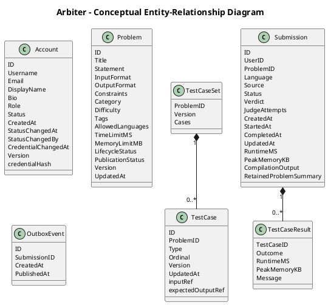

# Entity-Relationship Diagram

**Arbiter — Online Judge Platform**

| Document control | Value |
|---|---|
| Project | Arbiter — Online Judge Platform |
| Artifact | Conceptual entity-relationship diagram |
| Entity inventory | [EntityList.md](EntityList.md) |
| Design class diagram | [DesignClassDiagram.md](../ClassDiagram/DesignClassDiagram/DesignClassDiagram.md) |
| Status | Draft |
| Version | 0.1 |
| Date | 2026-11-17 |

## 1. Purpose and Notation

This conceptual model shows all database-persisted entities identified in the [entity inventory](EntityList.md), their design attributes, and the structural relationships specified in the DCD.

The diagram is implementation-independent: attributes are shown without data types, visibility, or key markings. Attribute names are retained from the DCD. Composition diamonds and multiplicities use the same ownership and cardinality as the DCD. No physical tables or additional relationships are inferred.

## 2. Diagram

## 3. Relationship Traceability

| Whole / owner | Relationship | Part | Multiplicity | DCD basis |
|---|---|---|---|---|
| `TestCaseSet` | Composition | `TestCase` | One set contains zero or more cases; each case belongs to one set. A draft set may be empty. | `TestCaseSet "1" *-- "0..*" TestCase` |
| `Submission` | Composition | `TestCaseResult` | One submission owns zero or more case results; each result belongs to one submission. | `Submission "1" *-- "0..*" TestCaseResult` |

## 4. Modeling Notes

- The composition diamonds remain at the owning ends, as in the DCD.
- `ID`, `ProblemID`, `UserID`, `SubmissionID`, and `TestCaseID` are shown as ordinary attributes. The conceptual diagram does not identify any attribute as a primary or foreign key.
- The DCD does not declare direct structural associations between the other persisted entities. Identifier attributes are retained as attributes and are not converted into additional relationships.
- `TestCaseData` content is held by the protected file store and is not included as database entity data. `inputRef` and `expectedOutputRef` are shown as attributes of `TestCase`, consistent with the DCD.
- `TestCaseSet` and `TestCaseResult` are logical persisted entities/owned records; this diagram does not prescribe whether either has a separate physical table.
