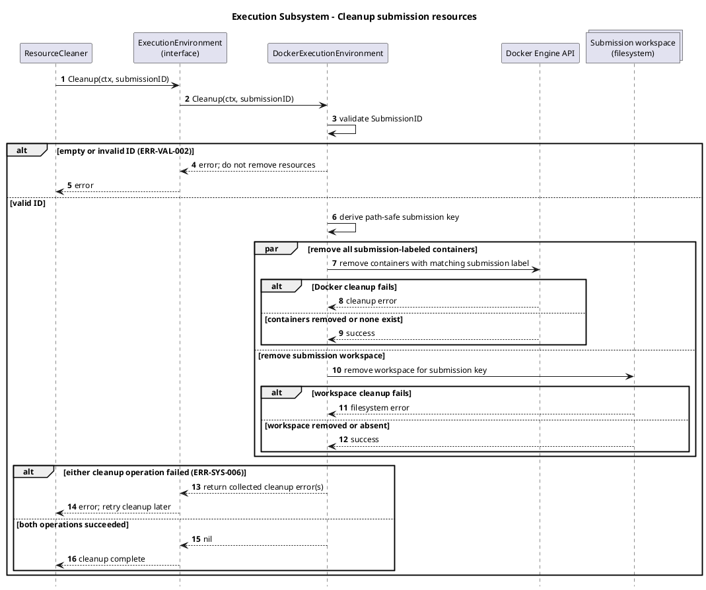

# Sequence Diagram — Execution Subsystem — Cleanup

| Field | Value |
|---|---|
| Sequence Diagram ID | SD-EXE-Cleanup |
| Realized operation | `ExecutionEnvironment.Cleanup` |
| Internal realization | `DockerExecutionEnvironment.Cleanup` |
| Status | Draft |
| Version | 0.1 |
| Date | 2026-11-18 |

## 1. Scope

Shows idempotent, submission-scoped removal of Docker containers and temporary workspace data, including partial cleanup failures.

## 2. Diagram

## 3. Notes

- Both cleanup paths are attempted even if the other fails. The returned error preserves failures from both paths.
- Missing containers and an absent workspace are already-clean states and therefore succeed, making cleanup safe to retry.
- Cleanup does not modify a Submission or its verdict. A committed result remains valid when cleanup must be retried.
