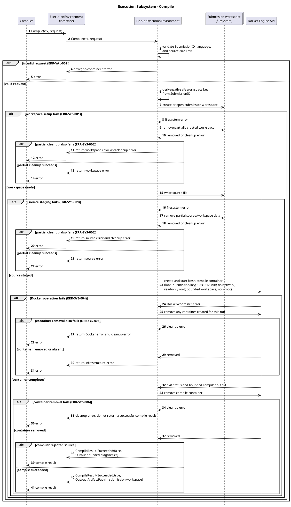

# Sequence Diagram — Execution Subsystem — Compile

| Field | Value |
|---|---|
| Sequence Diagram ID | SD-EXE-Compile |
| Realized operation | `ExecutionEnvironment.Compile` |
| Internal realization | `DockerExecutionEnvironment.Compile` |
| Status | Draft |
| Version | 0.1 |
| Date | 2026-11-18 |

## 1. Scope

Shows request validation, workspace preparation, isolated compilation, result mapping, and documented failure paths. A compiler rejection is a normal `CompileResult`; infrastructure and local workspace failures are returned as errors.

## 2. Diagram

## 3. Notes

- The caller supplies `SubmissionID` from the loaded Submission. The derived workspace key is used for both path containment and the container label; the raw identifier is not concatenated into a path.
- C++17 compilation and Python 3 syntax checking use separate toolchain commands. A compiler's nonzero exit is not an infrastructure error.
- The artifact remains available for `ExecutionEnvironment.Execute` until submission cleanup.
- Source and compiler output beyond the bounded result are not logged.
