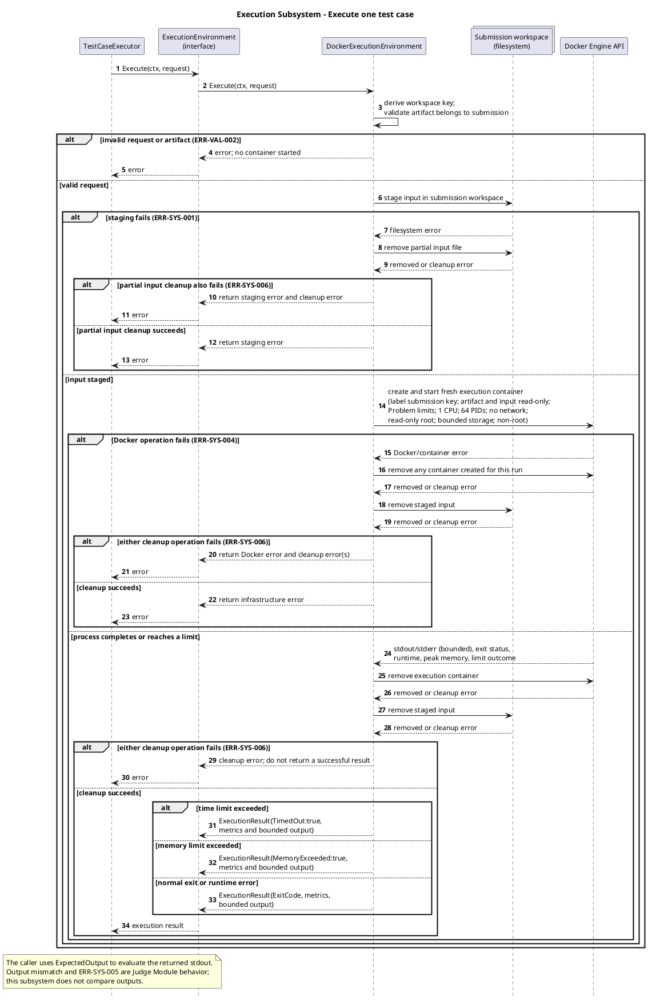

# Sequence Diagram — Execution Subsystem — Execute

| Field | Value |
|---|---|
| Sequence Diagram ID | SD-EXE-Execute |
| Realized operation | `ExecutionEnvironment.Execute` |
| Internal realization | `DockerExecutionEnvironment.Execute` |
| Status | Draft |
| Version | 0.1 |
| Date | 2026-11-18 |

## 1. Scope

Shows one isolated test-case execution and maps normal process termination, timeout, memory-limit termination, and documented infrastructure/local failures into the interface result or error.

## 2. Diagram

## 3. Notes

- Every test case runs in a new container. The execution request's submission ID scopes temporary input, the artifact check, and the container label.
- Captured stdout retains at most one byte beyond the 1 MiB output threshold. This preserves the caller's ability to recognize output-cap overflow without an added result field.
- Time-limit, memory-limit, and program-exit outcomes are execution data, not infrastructure errors.
- Expected-output comparison is intentionally outside this subsystem and remains the responsibility of the Judge Module.
