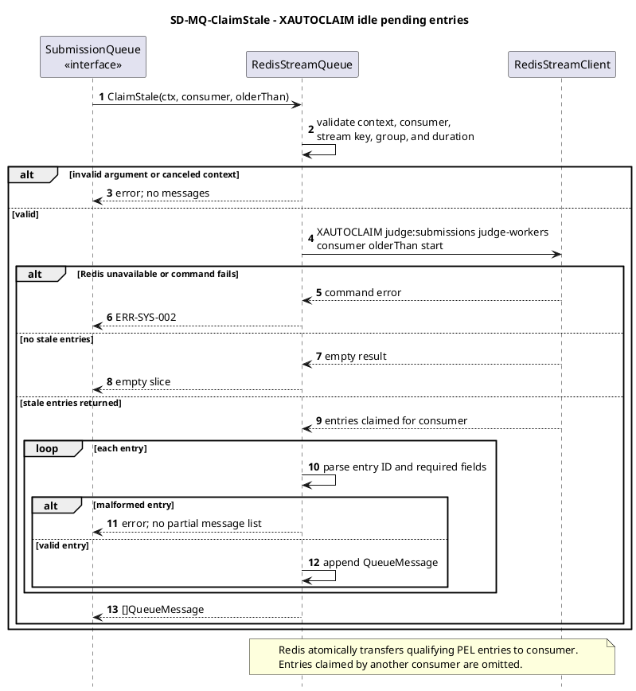

# SD-MQ-ClaimStale — Reclaim Idle Pending Messages

| Field | Value |
|---|---|
| Sequence Diagram ID | `SD-MQ-ClaimStale` |
| Owning subsystem | Message Queue Subsystem |
| Interface operation | `SubmissionQueue.ClaimStale(ctx, consumer, olderThan)` |
| Element specification | [RedisStreamQueue](../Specification/RedisStreamQueue.md) |
| Status | Draft |
| Version | 0.1 |
| Date | 2026-11-19 |

