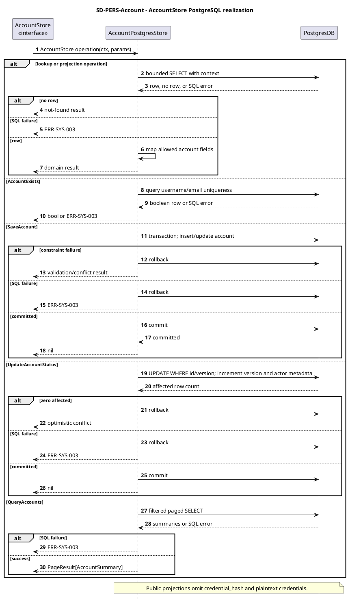

# SD-PERS-Account — Account Persistence Operations

| Field | Value |
|---|---|
| Sequence Diagram ID | `SD-PERS-Account` |
| Owning subsystem | Persistence Subsystem |
| Realized interface | `AccountStore` |
| Element specification | [AccountPostgresStore](../Specification/AccountPostgresStore.md) |
| Status | Draft |
| Version | 0.1 |
| Date | 2026-11-19 |

