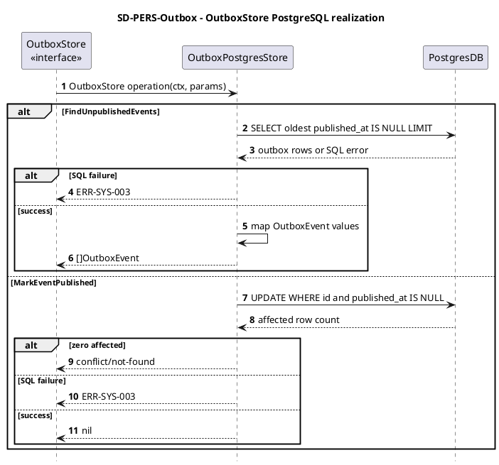

# SD-PERS-Outbox — Outbox Persistence Operations

| Field | Value |
|---|---|
| Sequence Diagram ID | `SD-PERS-Outbox` |
| Owning subsystem | Persistence Subsystem |
| Realized interface | `OutboxStore` |
| Element specification | [OutboxPostgresStore](../Specification/OutboxPostgresStore.md) |
| Status | Draft |
| Version | 0.1 |
| Date | 2026-11-19 |

