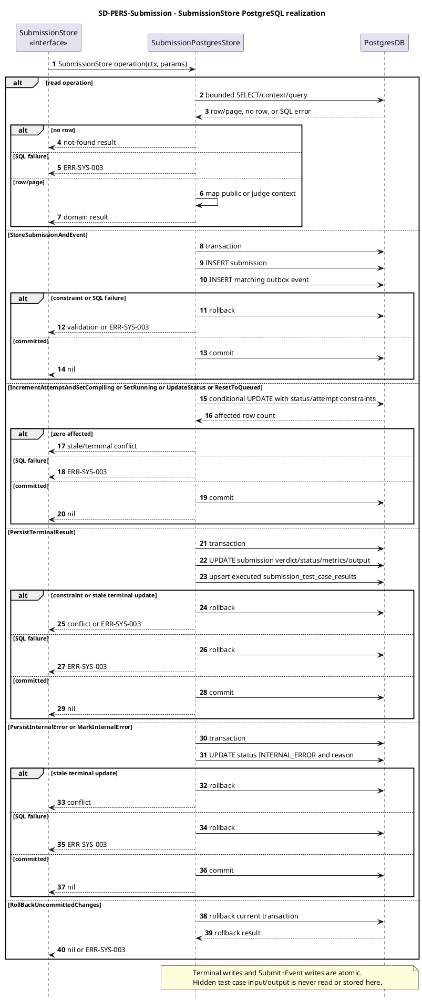

# SD-PERS-Submission — Submission Persistence Operations

| Field | Value |
|---|---|
| Sequence Diagram ID | `SD-PERS-Submission` |
| Owning subsystem | Persistence Subsystem |
| Realized interface | `SubmissionStore` |
| Element specification | [SubmissionPostgresStore](../Specification/SubmissionPostgresStore.md) |
| Status | Draft |
| Version | 0.1 |
| Date | 2026-11-19 |

