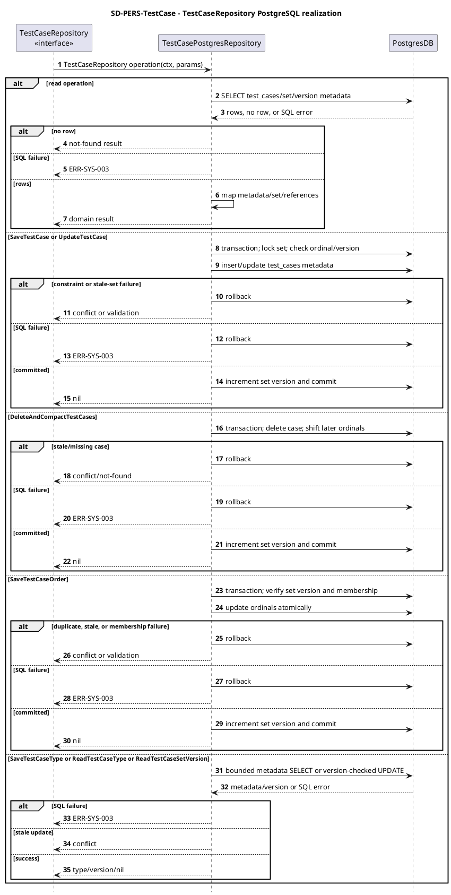

# SD-PERS-TestCase — Test-Case Persistence Operations

| Field | Value |
|---|---|
| Sequence Diagram ID | `SD-PERS-TestCase` |
| Owning subsystem | Persistence Subsystem |
| Realized interface | `TestCaseRepository` |
| Element specification | [TestCasePostgresRepository](../Specification/TestCasePostgresRepository.md) |
| Status | Draft |
| Version | 0.1 |
| Date | 2026-11-19 |

